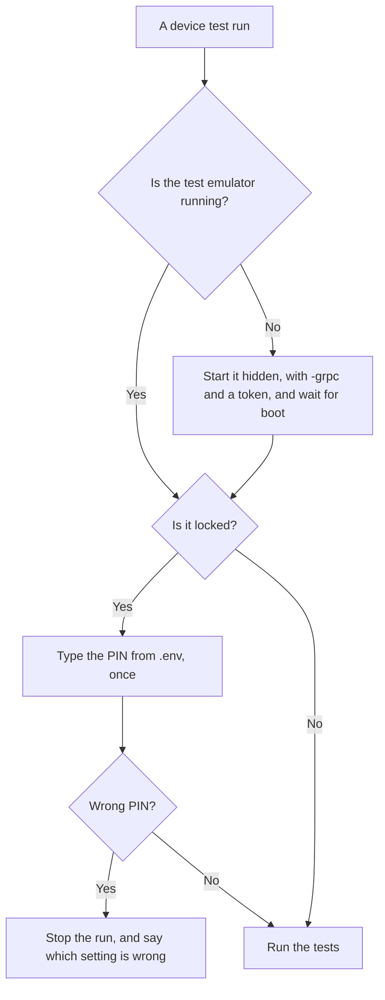

# Android Device Tests

Run end-to-end tests of an Android app on an emulator: the real app and its real screens, driven through adb the way a user would. This skill is general know-how. A project's own facts, such as which AVD and which ports, live in its e2e repository's README, and its secrets, such as the PIN, in its untracked `.env`. Read the README first. A new e2e repository has neither yet: [Start a new e2e repository](#start-a-new-e2e-repository) says what to settle.



## Emulator only

Device tests run on an emulator, never on a person's phone.

**Why:** a phone holds a real account and real data, it's often locked, and its owner may be using it. Each wrong PIN locks it for longer. An emulator can be started, reset and driven by the run alone.

> Example: a phone is connected over Wi-Fi beside the emulator. The run picks the emulator by its serial, such as `emulator-5554`, and leaves the phone alone.

## Start a new e2e repository

Before you set anything up, settle the project's facts with the user, and write each one down:

| Fact | Who decides | Where it goes |
| --- | --- | --- |
| The AVD | The user, or they OK a new one with a Google Play image, such as a Pixel 8 with Android 16 | README |
| The ports | The defaults, console `5554` and gRPC `8554`, unless they're taken | README |
| The test Google account | The user names one, or makes one. Never their own | Untracked `.env` |
| The screen lock PIN | The user, or they OK one you pick | Untracked `.env` |

The account's password stays with the user, who types it in the emulator's window. The README names each `.env` key without its value, so the next setup knows what to ask for.

## Set up the emulator once

Do this with the user, once for each AVD.

1. **Use an AVD with a Google Play system image,** such as a Pixel 8 with Android 16. Google accounts, passkeys and Google sign-in need Google's apps, which a plain image lacks. These steps were tested on a Google Play image.
2. **Let the user sign in to the test Google account,** in the emulator's window. Open the screen for them with `adb shell am start -a android.settings.ADD_ACCOUNT_SETTINGS --esa account_types com.google`. Never type the password yourself, and use the account the e2e repository names, never the user's own.
3. **Set the screen lock, on an AVD that has none yet,** with `adb shell locksettings set-pin <PIN>`, using the PIN in the e2e repository's untracked `.env`. Passkeys need a screen lock.
4. **Wait out Google Play after the first sign-in.** It updates its apps for a few minutes, and an update of Android System WebView stops every app that uses it. Android may also restart once to finish system updates. Play is done when `adb logcat -d` shows no new `installPackageLI` line for 2 to 3 minutes.

> Example: right after the sign-in, Play updated its apps for a few minutes, and the app under test died mid-start ("Killing … due to installPackageLI"). A minute after the next boot, Android restarted itself, and `getprop sys.boot.reason` said `reboot`.

## Start it for a run

```sh
emulator -avd <AVD> -qt-hide-window -no-boot-anim -no-snapshot-save -grpc 8554 -grpc-use-token
```

- **`-qt-hide-window`, not `-no-window`.** `-no-window` runs a separate headless binary without working audio.
- **`-grpc <port> -grpc-use-token`, never `-grpc` alone.** Alone, the control port listens on every network interface with no login. With the token, it listens on `127.0.0.1` only. On macOS, the port and token are in the emulator's discovery file, `~/Library/Caches/TemporaryItems/avd/running/pid_<pid>.ini`, as `grpc.port` and `grpc.token`. An emulator started without the control port still runs the tests, but its pictures stay still.
- **`-no-snapshot-save`** leaves the saved state as it was. The account and the PIN stay on the AVD's disk anyway.
- **Wait for boot:** `adb shell getprop sys.boot_completed` prints `1`. After a first sign-in, also check `sys.boot.reason`, since an early restart can lock the device again.
- **Stop what you started,** with `adb -s <serial> emu kill`. Leave an emulator you didn't start alone.

## The screen lock PIN

- **Type it once.** After a few wrong PINs, Android locks the device, for longer each time, such as 5 minutes, then 15, then 30, and the wait starts again at every boot.
- **On "Wrong PIN", stop the run** with a message that names the `.env` setting. Never type it again, and never try PINs with `adb shell locksettings verify`, because each try counts.
- **The PIN screen is secure,** so a screenshot of it comes out black. Read it with a UI dump instead.

> Example: the `.env` held the phone's PIN, not the emulator's. After five tries, the emulator was locked for 30 minutes, again at every boot.

## Read and drive the screen

- **Run the app with its animations on,** the way people use it.
- **Read the screen with `uiautomator2`** (Python, `dump_hierarchy()`). It returns the same XML as `uiautomator dump`, in about 0.05 seconds, without waiting for a still screen. `uiautomator dump` waits up to 10 seconds for a still screen, and gives up while anything moves. The two can't run together: `uiautomator2`'s on-device server holds the screen reader.
- **A dialog hides the screen beneath it** in a dump. Find a dialog's buttons by their text too: on Google Play images, the permission dialog comes from `com.google.android.permissioncontroller`, not `com.android.permissioncontroller`.
- **`pm clear` also resets runtime permissions,** so a run that starts clean meets the first-run questions, such as the microphone question.
- **Tap through `adb shell input`,** such as `input swipe x y x y 1800` for a long press.

> Example: with the app's animations on, `uiautomator dump` never read the Welcome screen, while `uiautomator2` read it at once, and all four sign-up and email tests passed.

## Pictures of a run

Only when the user or the project wants them. They are test-run artifacts: never committed, and the next run may delete them.

- **A still:** `adb exec-out screencap -p` returns the screen as a PNG.
- **Named steps and a flow sheet:** a test names each step, such as "Paused Home", and gets a numbered screenshot. When the test ends, also when it fails, its steps are joined side by side into one sheet, so the user sees the flow, and where it stopped.
- **Moving pictures:** the emulator's gRPC `streamScreenshot` sends each frame as it's drawn, about 60 a second, each with a timestamp. Record a few seconds after each step, sample the frames evenly, such as 10 a second, and save a looping GIF with Pillow; the last frame repeats while the screen stands still. A moving sheet is the still sheet's layout with every step playing. Each clip adds its length to the run, so keep it short, such as 2 seconds, and give the project a setting that turns clips off.
- **Set both `width` and `height`** in the `ImageFormat` you send. The frame keeps the device's shape and fits inside both, so a tall box such as 360 × 1440 gives frames 360 wide. With either at 0, frames come at full size: 7.8 MB at 1080×2400, above gRPC's 4 MB default, so also raise the client's `grpc.max_receive_message_length`.
- **The gRPC protocol ships with the SDK,** in `$ANDROID_HOME/emulator/lib/emulator_controller.proto`. Compile it with `grpcio-tools` when the tests start, instead of copying generated code.

## Sound

- **The emulator's microphone gives the app silence,** unless the emulator starts with `-allow-host-audio`, which also opens the Mac's microphone. Ask the user before you use it.
- **Don't build a test on `injectAudio`.** It crashed emulator 36.6 every time no app was recording. Even with `-allow-host-audio`, while an app recorded, the sound reached it once in three tries.
- **So an emulator test can't have a speaking user.** An app that waits for speech, such as a voice lesson that asks "Still there?" when the learner stays silent, can't be driven past that unattended. Disable such a test with its reason, instead of letting it fail.

## Reach the Mac from the emulator

- `10.0.2.2` is the Mac's own `localhost`.
- `adb reverse tcp:3000 tcp:3000` maps a port on the emulator's `localhost` to the same port on the Mac.
- The Mac's network address, such as its Tailscale address, works too.

## Apps with a dev server, such as Expo

- **The app loads its code and settings from the dev server** (Metro), once, when it starts. A setting from its config, such as an animation switch, can't change while it runs.
- **A test run can use its own dev server** on another port, with its settings in the shell: a shell value wins over the project's `.env`. A person's own dev server then keeps running.
- **Right after `pm clear`, the dev client can fail with "Unable to load script",** because it looked for the dev server before it knew where it was. Starting the app again works.
- **The dev client can cover the app with its developer menu,** such as its first-run intro, "This is the developer menu…", right after `pm clear`. Close it before reading the app's screen: tap its Continue or Close button, or press Back with `adb shell input keyevent 4`.

## When a run fails in the device

| What you see | Likely cause | What to do |
| --- | --- | --- |
| A UI dump keeps failing while the app animates | `uiautomator dump` waits for a still screen | Read with `uiautomator2` |
| The app vanishes soon after the first sign-in | Play is updating WebView | Wait until Play is quiet, then run again |
| The device is still locked right after boot | Android restarted itself, or is still booting | Check `sys.boot.reason` and the uptime, then run again |
| "Wrong PIN" | The `.env` PIN isn't this emulator's | Stop, and ask the user for the emulator's PIN |
| The emulator quits, and gRPC says "Connection reset by peer" | `injectAudio` while no app records | Don't inject sound |
| gRPC says "Received message larger than max" | A frame asked for without both width and height | Set both |

To dig further, read `adb logcat -d` for the app and `ActivityManager`, `adb logcat -b crash` for crashes on the device, and `~/Library/Logs/DiagnosticReports/` for crashes of the emulator itself.

## Check before you run

- **The device** is an emulator, picked by its serial.
- **Its control port** has `-grpc-use-token`, never `-grpc` alone.
- **The PIN** comes from `.env`, and is typed at most once.
- **The app** runs with its animations on, and the tests read the screen with `uiautomator2`.
- **Nothing you started** is left running.
