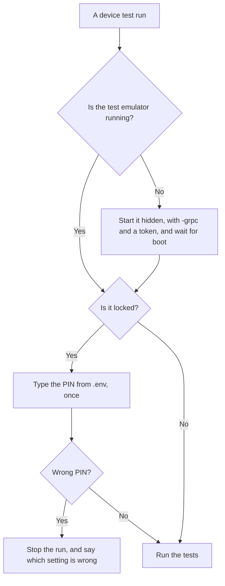
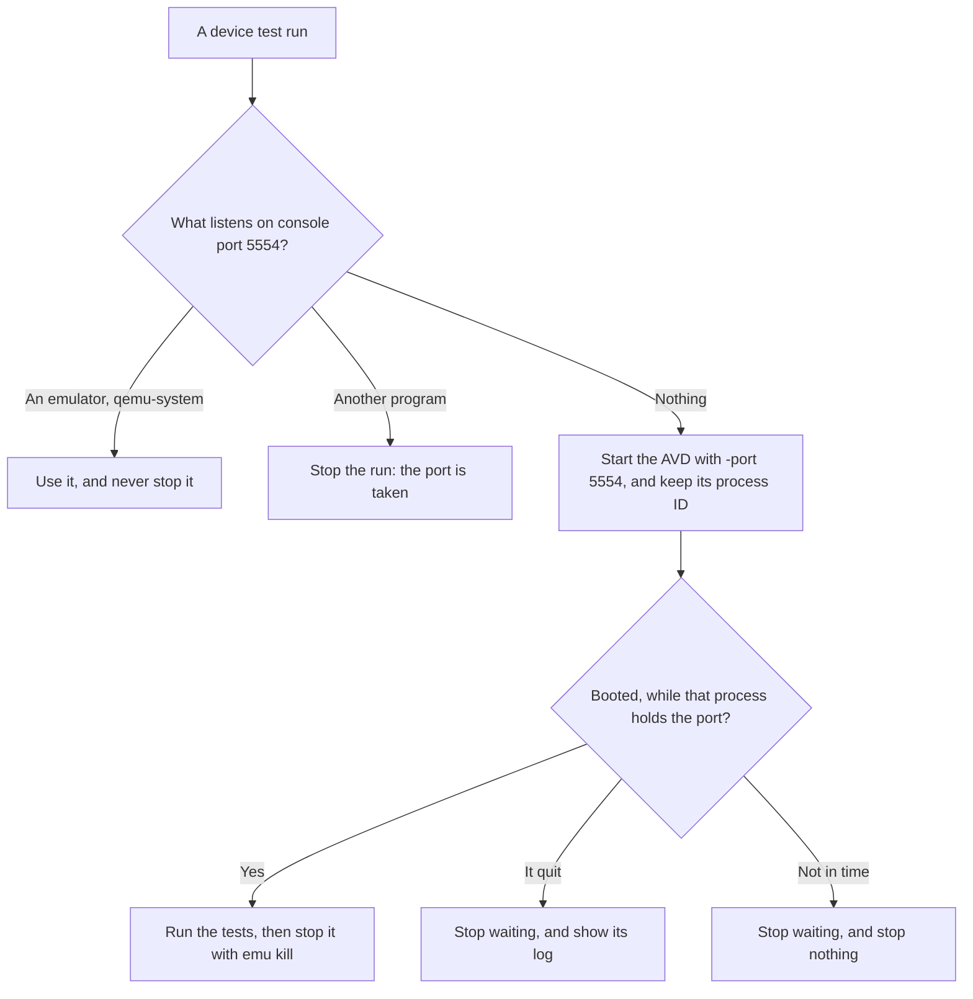

# Android Device Tests

Run end-to-end tests of an Android app on an emulator: the real app and its real screens, driven through adb the way a user would. This skill is general know-how. A project's own facts, such as which AVD and which ports, live in its e2e repository's README, and its secrets, such as the PIN, in its untracked `.env`. Read the README first. A new e2e repository has neither yet: [Start a new e2e repository](#start-a-new-e2e-repository) says what to settle.



## Emulator only

Device tests run on an emulator, never on a person's phone. The runner enforces it: it accepts only serials that start with `emulator-`, and stops with a message when `ANDROID_SERIAL` names a phone.

**Why:** a phone holds a real account and real data, it's often locked, and its owner may be using it. Each wrong PIN locks it for longer. An emulator can be started, reset and driven by the run alone.

> Example: a phone is connected over Wi-Fi beside the emulator. The run picks the emulator by its serial, such as `emulator-5554`, and leaves the phone alone.

## Start a new e2e repository

Before you set anything up, settle the project's facts with the user, and write each one down:

| Fact | Who decides | Where it goes |
| --- | --- | --- |
| The AVD | The user, or they OK a new one with a Google Play image, such as a Pixel 8 with Android 16 | README |
| The ports | The defaults, console `5554` and gRPC `8554`, unless they're taken | README |
| The test Google account | The user names one, or makes one. Never their own | Untracked `.env` |
| The screen lock PIN | The user, or they OK one you pick | Untracked `.env` |

The account's password stays with the user, who types it in the emulator's window. The README names each `.env` key without its value, so the next setup knows what to ask for.

Before its first test, a new repository also needs its runner and helpers: what starts the emulator, reads the screen, and takes the step pictures. The sections below say how each of them works. The runner's own tests replace its emulator start with a stub, so testing the runner never boots a real emulator.

> Example: a few of the runner's own tests called its real start step, and running them booted the Pixel 8 emulator.

## Set up the emulator once

Do this with the user, once for each AVD.

1. **Use an AVD with a Google Play system image,** such as a Pixel 8 with Android 16. Google accounts, passkeys and Google sign-in need Google's apps, which a plain image lacks. These steps were tested on a Google Play image.
2. **Let the user sign in to the test Google account,** in the emulator's window. Open the screen for them with `adb shell am start -a android.settings.ADD_ACCOUNT_SETTINGS --esa account_types com.google`. Never type the password yourself, and use the account the e2e repository names, never the user's own.
3. **Set the screen lock, on an AVD that has none yet,** with `adb shell locksettings set-pin <PIN>`, using the PIN in the e2e repository's untracked `.env`. Passkeys need a screen lock.
4. **Wait out Google Play after the first sign-in.** It updates its apps for a few minutes, and an update of Android System WebView stops every app that uses it. Android may also restart once to finish system updates. Play is done when `adb logcat -d` shows no new `installPackageLI` line for 2 to 3 minutes.

> Example: right after the sign-in, Play updated its apps for a few minutes, and the app under test died mid-start ("Killing … due to installPackageLI"). A minute after the next boot, Android restarted itself, and `getprop sys.boot.reason` said `reboot`.

## Start it for a run

```sh
emulator -avd <AVD> -port 5554 -qt-hide-window -no-boot-anim -no-snapshot-save -grpc 8554 -grpc-use-token
```

- **`-port 5554`** fixes the console port, so the emulator's serial is `emulator-5554`.
- **`-qt-hide-window`, not `-no-window`.** `-no-window` runs a separate headless binary without working audio.
- **`-grpc <port> -grpc-use-token`, never `-grpc` alone.** Alone, the control port listens on every network interface with no login. With the token, it listens on `127.0.0.1` only. On macOS, the port and token are in the emulator's discovery file, `~/Library/Caches/TemporaryItems/avd/running/pid_<pid>.ini`, as `grpc.port` and `grpc.token`. An emulator that crashes can leave its file behind, and its process ID can later belong to another program, so read the file of the `qemu-system` process that holds the console port. An emulator started without the control port still runs the tests, but its pictures stay still.
- **`-no-snapshot-save`** leaves the saved state as it was. The account and the PIN stay on the AVD's disk anyway.
- **Wait for boot:** `adb shell getprop sys.boot_completed` prints `1`. After a first sign-in, also check `sys.boot.reason`, since an early restart can lock the device again.

### Stop only the emulator you started

The serial can't tell you which emulator is yours: any emulator on console port 5554 answers to `emulator-5554`, including one that another session started. The program that holds the port can, and `lsof +c 0 -nP -iTCP:5554 -sTCP:LISTEN` names it.



- **Look at the port before you start one,** not only at `adb devices`. A booting emulator already holds its port while `adb devices` still lists it as `offline`. A stale `offline` line left by a crash holds no port.
- **The emulator you start keeps its process ID,** because the `emulator` program turns itself into `qemu-system-…`. `lsof -nP -a -p <pid> -iTCP:5554 -sTCP:LISTEN` shows whether it holds the port.
- **Count its boot, and stop it, only while it holds the port.** Stop it with `adb -s emulator-5554 emu kill` at the end of the run, also when the run fails, such as from an exit trap. When it doesn't hold the port, stop nothing, and say why.
- **If it quits while you wait,** stop waiting and show its log, which says why, such as a taken port.

> Example: another session's emulator is still booting on port 5554, so `adb devices` lists it as `offline`. A run that looks only at `adb devices` starts its own emulator on the same port, which fails to start, because the port is taken. Then the other emulator finishes booting and looks like the run's own, and stopping it by serial would kill the other session's emulator.

## The screen lock PIN

- **Type it once,** key by key with `adb shell input keyevent`. After a few wrong PINs, Android locks the device, for longer each time, such as 5 minutes, then 15, then 30, and the wait starts again at every boot.
- **On "Wrong PIN", stop the whole run,** not just the test, with a message that names the `.env` setting: in pytest, with `pytest.exit`. After `pytest.fail` in a step that every test runs, such as making a passkey, the next test types the PIN again. Never type it again, and never try PINs with `adb shell locksettings verify`, because each try counts.
- **Stop the same way when you can't tell,** such as when the PIN screen still shows, or can't be read, a few seconds after the PIN.
- **The PIN screen is secure,** so a screenshot of it comes out black. Read it with a UI dump instead.

> Example: the `.env` held the phone's PIN, not the emulator's. After five tries, the emulator was locked for 30 minutes, again at every boot.

> Example: an older helper typed the PIN with `input text`, and when the PIN screen stayed, typed it again key by key: two tries for each unlock.

## Read and drive the screen

- **Run the app with its animations on,** the way people use it.
- **Read the screen with `uiautomator2`** (Python, `dump_hierarchy()`). It returns the same XML as `uiautomator dump`, in about 0.05 seconds, without waiting for a still screen. `uiautomator dump` waits up to 10 seconds for a still screen, and gives up while anything moves. The two can't run together: `uiautomator2`'s on-device server holds the screen reader.
- **A dialog hides the screen beneath it** in a dump. Find a dialog's buttons by their text too: on Google Play images, the permission dialog comes from `com.google.android.permissioncontroller`, not `com.android.permissioncontroller`.
- **`pm clear` also resets runtime permissions,** so a run that starts clean meets the first-run questions, such as the microphone question.
- **Tap through `adb shell input`,** such as `input swipe x y x y 1800` for a long press.

> Example: with the app's animations on, `uiautomator dump` never read the Welcome screen, while `uiautomator2` read it at once, and all four sign-up and email tests passed.

## Pictures of a run

Only when the user or the project wants them. They are test-run artifacts: never committed, and the next run may delete them.

- **A still:** `adb exec-out screencap -p` returns the screen as a PNG.
- **Named steps and a flow sheet:** a test names each step, such as "Paused Home", and gets a numbered screenshot. When the test ends, also when it fails, its steps are joined side by side into one sheet, so the user sees the flow, and where it stopped.
- **Moving pictures:** the emulator's gRPC `streamScreenshot` sends each frame as it's drawn, about 60 a second, each with a timestamp. Record a few seconds after each step, sample the frames evenly, such as 10 a second, and save a looping GIF with Pillow; the last frame repeats while the screen stands still. A moving sheet is the still sheet's layout with every step playing. When Pillow saves a GIF, it merges identical frames in a row into one longer frame: a clip of 10 frames came back as 3, lasting 300, 200 and 500 ms. To read a clip back frame by frame, such as for a moving sheet, repeat each frame for as long as it lasts. Each clip adds its length to the run, so keep it short, such as 2 seconds, and give the project a setting that turns clips off.
- **Set both `width` and `height`** in the `ImageFormat` you send. The frame keeps the device's shape and fits inside both, so a tall box such as 360 × 1440 gives frames 360 wide. With either at 0, frames come at full size: 7.8 MB at 1080×2400, above gRPC's 4 MB default, so also raise the client's `grpc.max_receive_message_length`.
- **The gRPC protocol ships with the SDK,** in `$ANDROID_HOME/emulator/lib/emulator_controller.proto`. Compile it with `grpcio-tools` when the tests start, instead of copying generated code.

### One map of all flows

A sheet shows one flow. The **flow map** shows every flow on one page: flows that start with the same steps share those screens, and an arrow leaves the screen where they part.

> Example: "Sign up" walks Welcome → the email screen → the new passkey sheet. "Sign in" walks Welcome → the email screen → the screen lock. The map shows Welcome and the email screen once, and two arrows leave the email screen.

Draw it as the last step of a run with pictures, after its last test, with this skill's script. A run that only repeats one test to find a failure needs no map.

```sh
python3 <this skill's folder>/scripts/flow_map.py <pictures folder> <map folder> [--title "<Project> Flow Map"] [--all]
```

For example, a run of two flows, into a map that already held a third (made up):

```text
Flow map: 3 flows on 9 screens, in /Users/kev/projects/shop/flow-map/index.html
New: Sign up
Walked again: Sign in
Kept from earlier runs: 1 flow
The page shows 9 pictures, listed in /Users/kev/projects/shop/flow-map/pictures.json
```

- **It only draws.** It reads the run's pictures and writes into the map folder. It changes no test, no sheet, and nothing in a repository.
- **It creates the map, or updates it.** The map folder outlives the runs, so keep it outside the folder that a run cleans, such as `<workspace>/flow-map/`. It keeps every flow the map has seen, each with a copy of its pictures. A flow that ran again gets its new pictures, and a flow that didn't run stays as it was. `--title` names the page the first time.
- **After a run of every flow test, add `--all`.** A flow that the run didn't walk then leaves the map, such as one whose test was renamed or removed.
- **It reads one folder for each flow** in the pictures folder: the step pictures, numbered in order, such as `02-the-email-screen.png`, and for a step with a clip, the clip of the same name that ends in `.gif`. A step is named after its file, so `03-ident-004-home-signed-in.png` becomes "IDENT-004: home signed in".
- **For the exact words, save a `flow.json` in the flow's folder,** from the helper that takes the pictures. With an outcome, the map marks each flow as ✓ or ✗, and the screen where a failed flow stopped:

  ```json
  {"title": "Sign in", "outcome": "passed", "steps": [{"name": "IDENT-004: Home, signed in", "picture": "03-ident-004-home-signed-in.png"}]}
  ```

- **Two flows share a screen while their step names agree from the start.** The same name later, on another path, is drawn again.
- **Show it once it's drawn.** `index.html` in the map folder opens in any browser, so tell the user where it is. It scrolls and zooms, its list picks one flow and fades the others, and a click shows a picture larger.
- **Publish it only with the user's OK.** Where you can publish a page for the user, such as an artifact in Claude, ask once, before the first time: the pictures show whatever the screens showed, such as the test account's address. After a yes, publish `index.html` with the pictures that `pictures.json` lists as files beside it, and save the page's link as `link.txt` in the map folder. From then on, the script's report names that page, and each later run updates it without asking again.

**Why by the start, and not by the name alone:** a step's name says what its picture shows, and two screens can share a name. "The same button opens the sheet again" follows both a sign-up and a sign-in, on two different screens. Flows that have walked the same steps from the same start are on the same screen.

The script needs only Python 3, and its page loads nothing from the network. Its tests run on made-up pictures: `python3 -m unittest discover -s <this skill's folder>/tests`.

## Write a flow test

A flow test walks one flow the way a user does, such as signing up, and checks what the screen shows at each step.

- **One test for one flow.** A flow test starts the real app and drives it step by step, so it's slow: a short one took 39 seconds, sign-up included. Let one test prove several rules on its way, instead of writing one test for each rule.
- **Walk one path of the journey map,** when the project's spec has one, as Spec Workflow's [Writing specs](../spec-workflow/references/writing-specs.md#paths-and-flow-tests) describes. The test's steps follow that path's boxes, in order, and its title says which path it is, such as "Try again after the audio fails to load".
- **Name each step:** what the user just did, or what they now see, such as "Tap Verify Email: email sent". The names are the captions of the [pictures](#pictures-of-a-run), so a name says only what its picture shows: "Home enables a new Class" is wrong for a learner with no credits, whose Home can't. Where two flows walk the same steps from the same start, give those steps the same names, so the [flow map](#one-map-of-all-flows) shows their screens once.
- **Put a rule's ID where it's proven,** when the project's rules have IDs: in the name of the step that proves it, and in the test's title. Where a test's name can't hold the ID, as in Python, the first line of its docstring does.
- **Find things the way a user does:** by the text on them, or by their spoken label. Use a test ID only for a view that has neither, such as an avatar. Adding a test ID to the app is a change of its own.
- **Do only what the user would do.** A restart or a refresh by hand hides what the app should do by itself.
- **Wait for what the rule names,** such as a text, within the time the rule gives, with room for a slow emulator. Say in a comment where the number comes from. Never sleep for a fixed time instead.
- **Check only what the rule says.** When a check for something no rule says fails, nobody can tell whether the app is wrong.
- **Take the step's picture before its checks,** so a failed check still shows its screen.
- **Say what the flow needs,** such as a new user or a seeded credit, and set it up in a fixture, never by hand.
- **When it fails, find out who is wrong** before you change anything: the run, the test, the rule, or the app. [When a run fails in the device](#when-a-run-fails-in-the-device) lists the run's traps. Never change a check just to make the test pass.

For example, in Python with pytest (the helper names are made up):

```python
def test_home_notices_a_verified_email_by_itself(new_learner, flow_pictures):
    """VERIFY-001: after Verify Email, Home says by itself that the email is verified."""
    button = find_by_label("Verify Email")
    flow_pictures.snap("Home: email not verified")

    tap(button)
    wait_for_text("Verification email sent.")
    flow_pictures.snap("Tap Verify Email: email sent")

    # The rule gives Home 5 seconds until its next check. 20 leave room for a slow emulator.
    wait_for_text("Email verified. You can start now.", seconds=20)
    flow_pictures.snap("VERIFY-001: Home says the email is verified")
    assert find_by_label("Verify Email") is None
```

> Example: an older test restarted the app after the email was verified, and then checked Home. It passed, but it never showed that Home notices the verification by itself. The flow test above waits on Home instead, and its third picture shows the result.

## Sound

- **The emulator's microphone gives the app silence,** unless the emulator starts with `-allow-host-audio`, which also opens the Mac's microphone. Ask the user before you use it.
- **Don't build a test on `injectAudio`.** It crashed emulator 36.6 every time no app was recording. Even with `-allow-host-audio`, while an app recorded, the sound reached it once in three tries.
- **So an emulator test can't have a speaking user.** An app that waits for speech, such as a voice lesson that asks "Still there?" when the learner stays silent, can't be driven past that unattended. Disable such a test with its reason, instead of letting it fail.

## Reach the Mac from the emulator

- `10.0.2.2` is the Mac's own `localhost`.
- `adb reverse tcp:3000 tcp:3000` maps a port on the emulator's `localhost` to the same port on the Mac.
- The Mac's network address, such as its Tailscale address, works too.

## Apps with a dev server, such as Expo

- **The app loads its code and settings from the dev server** (Metro), once, when it starts. A setting from its config, such as an animation switch, can't change while it runs.
- **A test run can use its own dev server** on another port, with its settings in the shell: a shell value wins over the project's `.env`. A person's own dev server then keeps running.
- **Right after `pm clear`, the dev client can fail with "Unable to load script",** because it looked for the dev server before it knew where it was. Starting the app again works.
- **The dev client can cover the app with its developer menu,** such as its first-run intro, "This is the developer menu…", right after `pm clear`. Close it before reading the app's screen: tap its Continue or Close button, or press Back with `adb shell input keyevent 4`.

## When a run fails in the device

| What you see | Likely cause | What to do |
| --- | --- | --- |
| A UI dump keeps failing while the app animates | `uiautomator dump` waits for a still screen | Read with `uiautomator2` |
| The app vanishes soon after the first sign-in | Play is updating WebView | Wait until Play is quiet, then run again |
| In the middle of a test, the app restarts or is back at its first screen | Another run is using the same emulator. Its install and `pm clear` reset the app | Wait until the other run ends, then run again |
| The device is still locked right after boot | Android restarted itself, or is still booting | Check `sys.boot.reason` and the uptime, then run again |
| "Wrong PIN" | The `.env` PIN isn't this emulator's | Stop, and ask the user for the emulator's PIN |
| The emulator quits, and gRPC says "Connection reset by peer" | `injectAudio` while no app records | Don't inject sound |
| gRPC says "Received message larger than max" | A frame asked for without both width and height | Set both |

To dig further, read `adb logcat -d` for the app and `ActivityManager`, `adb logcat -b crash` for crashes on the device, and `~/Library/Logs/DiagnosticReports/` for crashes of the emulator itself.

## Check before you run

- **The device** is an emulator, picked by its serial.
- **Its control port** has `-grpc-use-token`, never `-grpc` alone.
- **The PIN** comes from `.env`, and is typed at most once.
- **The app** runs with its animations on, and the tests read the screen with `uiautomator2`.
- **Nothing you started** is left running, and nothing you didn't start is stopped.
