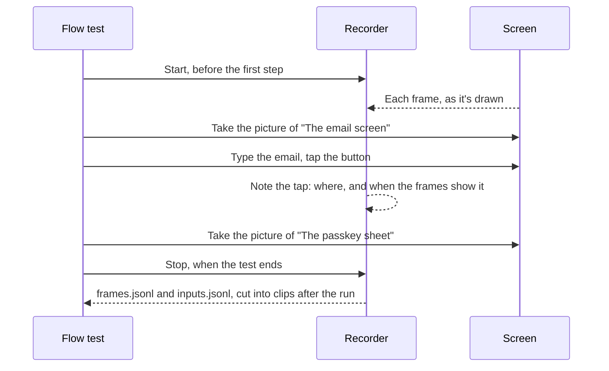

# Flow Tests

A flow test walks one flow the way a user does, such as signing up, on the real product, and leaves a picture of each step. This skill holds what every platform shares. A platform skill says how to drive the product, and where its frames and inputs come from:

| Platform | Skill | What drives it | Where the frames come from |
| --- | --- | --- | --- |
| Android | [android-device-tests](../android-device-tests/SKILL.md) | an emulator, through adb | the emulator's gRPC screen stream |
| Web | [web-browser-tests](../web-browser-tests/SKILL.md) | a test browser, through Playwright | Chromium's screencast |

A run with pictures goes like this:

1. **The tests run.** Each one takes its step pictures and, with clips on, records frames and inputs beside it, in [the format below](#the-pictures-of-a-run).
2. **This skill's script draws them:** [a clip of each step, and the flow sheets](#draw-the-clips-and-sheets).
3. **Its map script joins all flows** on [one page](#one-map-of-all-flows).

The platform only collects. This skill draws. So a web run and an Android run look the same on a sheet and on the map.

## Start a new e2e repository

Before you set anything up, settle the project's facts with the user, and write each one down. The platform skill lists its own facts, such as the AVD or the base URL. Every platform has these:

| Fact | Who decides | Where it goes |
| --- | --- | --- |
| What drives the product | The platform skill, with the user's OK | README |
| The test accounts and test data | The user names them, or how the project makes them, such as through its own API or seed script. Never their own account | README, with the secrets in the untracked `.env` |
| The secrets, such as a password or a PIN | The user | Untracked `.env` |

The README names each `.env` key without its value, so the next setup knows what to ask for.

- **Check the machine's tools, and install none of them.** When a tool is missing, such as Node, uv, or the Android SDK, stop and name it, with the command that would install it. Each person installs those their own way.
- **Install the e2e repository's own packages,** from its lockfile, such as with `npm ci`. That's part of running the project.
- **Before its first test, the repository needs its runner and helpers:** what starts the product, reads the screen, and takes the pictures. The runner's own tests replace that start with a stub, so testing the runner never starts the real thing.

> Example: a few of an Android runner's own tests called its real start step, and running them booted the Pixel 8 emulator.

## Write a flow test

- **One test for one flow.** A flow test starts the real product and drives it step by step, so it's slow: a short Android one took 39 seconds, sign-up included. Let one test prove several rules on its way, instead of writing one test for each rule.
- **Walk one path of the journey map,** when the project's spec has one, as Spec Workflow's [Writing specs](../spec-workflow/references/writing-specs.md#paths-and-flow-tests) describes. The test's steps follow that path's boxes, in order, and its title says which path it is, such as "Try again after the audio fails to load".
- **Name each step:** what the user just did, or what they now see, such as "Tap Verify Email: email sent". The names are the captions of the [pictures](#the-pictures-of-a-run), so a name says only what its picture shows: "Home enables a new Class" is wrong for a learner with no credits, whose Home can't. Where two flows walk the same steps from the same start, give those steps the same names, so the [flow map](#one-map-of-all-flows) shows their screens once.
- **Put a rule's ID where it's proven,** when the project's rules have IDs: in the name of the step that proves it, and in the test's title. Where a test's name can't hold the ID, as in Python, the first line of its docstring does.
- **Find things the way a user does:** by the text on them, or by their spoken label. Use a test ID only for a view that has neither, such as an avatar. Adding a test ID to the product is a change of its own.
- **Do only what the user would do.** A restart or a refresh by hand hides what the product should do by itself.
- **Wait for what the rule names,** such as a text, within the time the rule gives, with room for a slow machine. Say in a comment where the number comes from. Never sleep for a fixed time instead.
- **Check only what the rule says.** When a check for something no rule says fails, nobody can tell whether the product is wrong.
- **Take the step's picture before its checks,** so a failed check still shows its screen.
- **Say what the flow needs,** such as a new user or a seeded credit, and set it up in a fixture, never by hand.
- **Never put a secret in a step's name or a test's title.** The names end up in pictures, reports and logs.
- **When it fails, find out who is wrong** before you change anything: the run, the test, the rule, or the product. The platform skill lists the run's traps. Never change a check just to make the test pass.

For example, in Python with pytest (the helper names are made up):

```python
def test_home_notices_a_verified_email_by_itself(new_learner, flow_pictures):
    """VERIFY-001: after Verify Email, Home says by itself that the email is verified."""
    button = find_by_label("Verify Email")
    flow_pictures.snap("Home: email not verified")

    tap(button)
    wait_for_text("Verification email sent.")
    flow_pictures.snap("Tap Verify Email: email sent")

    # The rule gives Home 5 seconds until its next check. 20 leave room for a slow emulator.
    wait_for_text("Email verified. You can start now.", seconds=20)
    flow_pictures.snap("VERIFY-001: Home says the email is verified")
    assert find_by_label("Verify Email") is None
```

> Example: an older test restarted the app after the email was verified, and then checked Home. It passed, but it never showed that Home notices the verification by itself. The flow test above waits on Home instead, and its third picture shows the result.

## The pictures of a run

Only when the user or the project wants them. They are test-run artifacts: never committed, and the next run may delete them. Each flow gets one folder in the run's pictures folder:

```text
<pictures folder>/               such as test-results/pictures
  sign-up/                       one folder for each flow, named after its test
    flow.json                    written after each step, and once more when the test ends
    01-welcome.png               a picture of each step, numbered in order
    02-the-email-screen.png
    recording/                   only with clips on
      frames.jsonl
      inputs.jsonl
      00001.jpg, 00002.jpg ...   the frames, as PNG or JPEG
```

`flow.json` names the flow and its steps:

```json
{
  "title": "IDENT-004: Sign in with a passkey",
  "outcome": "passed",
  "screen": [1280, 720],
  "steps": [
    {"name": "Welcome", "picture": "01-welcome.png", "at": 1795658401.12},
    {"name": "IDENT-004: Home, signed in", "picture": "02-ident-004-home-signed-in.png", "at": 1795658404.87}
  ]
}
```

- **`outcome`** is `passed` or `failed`, and `null` while the test runs.
- **`screen`** is the size that the inputs' places are in, such as a browser's viewport in CSS pixels, or a phone's own pixels. Frames may be smaller.
- **`at`** is when the step's picture was taken, in seconds since the epoch. Steps, frames and inputs all use this one clock.

`recording/frames.jsonl` has a line for each frame kept, and a line for each break:

```text
{"at": 1795658401.10, "frame": "00001.jpg"}           a frame, and when the screen drew it
{"at": 1795658403.55, "pause": "a secret was typed"}  frames left out on purpose from here, until the next frame
{"at": 1795658409.00, "lost": "the page crashed"}     the stream broke here: nothing is known after it
{"at": 1795658410.12, "end": true}                    the recording ended with the test
```

`recording/inputs.jsonl` has a line for each input, placed in `screen` units, and timed when the frames show it:

```text
{"at": 1795658402.31, "kind": "tap", "place": [640, 412]}
{"at": 1795658405.02, "kind": "swipe", "place": [640, 600], "to": [640, 200], "ms": 300}
{"at": 1795658406.40, "kind": "key"}
```

A key says only when the test typed, never what.

### Record beside the test

A step's clip runs from its picture to the next step's picture. It shows the step's screen, what the test does on it, and the next screen as it arrives.

> Example: the clip of "The email screen" opens on the empty field. The email goes in, a dot lands on **Continue with Passkey**, the button says "Creating passkey...", and the passkey sheet slides up. The next step's clip opens on that sheet.



These are the rules for a platform's recorder:

- **Read the frames in the background,** from the first step until the test ends. A recording that stops the test after each step ends before the test acts, so it shows only a screen that stands still, and it adds its length to the run.
- **Keep the newest frame of each tenth of a second.** A screen stream sends a frame each time the screen changes, up to 60 a second, and none while it stands still.
- **Note every input where every input passes,** such as the one helper that runs `adb shell input`, or the page's own events. Time it when the frames show it, and measure that, without guessing.
- **Note no input that may not have happened on the recorded screen,** such as a command that failed. A missing dot is seen and fixed. A wrong dot misleads.
- **Never record a secret.** From the first key of a secret until its screen is gone, and for half a second more, while it fades, write no frame to disk, and write a `pause` line instead. When typing the secret fails, stay paused for the rest of the test: its screen may still be up.
- **Take a step's picture once the screen stands still:** when it hasn't moved for 0.3 seconds, or after 2 seconds at most. The recorder knows when the screen last moved, so no step waits a fixed time. Count the test's last input as a move, from when the frames show it: a picture taken right after a tap would otherwise come before the tap shows. Before the stream's first frame, nothing is known about the screen: wait for that frame, but only for the recording's first half second.
- **Never show a frozen frame as a still screen.** When the stream fails, or ends by itself, write a `lost` line. The clips lose everything after it, with a note that names the step and the reason.
- **Stop the recording first when the test ends,** also when the test failed or took no step. Write the `end` line, then the `outcome` in `flow.json`.
- **Give the project a setting that turns clips off.** The step pictures and the still sheet stay.

> Example: the Android Sign up flow has 5 steps. With a 2-second clip after each step, it took 28 seconds from its first picture to its sheet. Recorded beside the test, it takes about 15.

## Draw the clips and sheets

After a run with pictures, draw them with this skill's script, before the map:

```sh
uv run --no-project --with pillow python -I <this skill's folder>/scripts/flow_sheets.py <pictures folder>
```

It needs uv. If uv is missing, stop and say so. The script takes a run's pictures folder, or one flow's folder. For example, after a web run of three made-up flows (paths shortened):

```text
SHOP-001: A new shopper signs up, and Home notices the verified email by itself: 6 steps, 4 with a clip. flow.png, flow.gif (93 KB). Clips 1.5-2.6 s
SHOP-002: A shopper signs in with their password: 4 steps, 2 with a clip. flow.png, flow.gif (57 KB). Clips 1.5-2.7 s
SHOP-003: Help names the shop phone number: 3 steps, 1 with a clip. flow.png, flow.gif (31 KB). Clips 1.5-1.5 s
```

Beside each flow's step pictures, it writes:

- **A clip of each step where something happens,** with the step picture's name and `.gif`, such as `02-the-email-screen.gif`. A step has a clip when the test acts in it, or when its screen ends more than 0.5% different from how it began, such as a banner that turns green.
- **The still sheet, `flow.png`:** the steps side by side, each under its number and name. The title says whether the flow passed or failed, and a failed flow's last step has a red frame, so the user sees where it stopped.
- **The moving sheet, `flow.gif`,** when a step has a clip: the still sheet's layout, with the steps playing their clips one after another, from left to right. While a step plays, it has a blue frame, and each other step shows the first frame of its own clip. With every step playing at once, nobody can follow clips that each show what happens.

What a clip shows:

- **One finger, in the step where it lands.** A dot shows from 0.3 seconds before a touch lands until 0.2 seconds after, and moves along a swipe. It has a dark edge and a light halo, so it shows on light and dark screens. The next step's first tap lands right after a step ends, so it shows only in the next step. Of two touches close together, such as a tap and then a swipe, only the nearer one shows.
- **The waits are cut.** The clip keeps the seconds around what happens: the step's own picture, each input, each time much of the screen changes, and the next step's picture. It cuts everything between, such as a wait for the server.
- **A move is told by how much changes, not by whether anything does.** A waiting screen never stands still: a text cursor blinks, and a spinner turns. The script compares small copies of the frames, a tenth as wide, colour by colour, since a banner that turns from orange to green keeps its brightness. A sheet, a keyboard or a new screen changes far more than 8% of such a copy, and a spinner far less.
- **It opens and closes calmly.** It holds its first frame for 0.4 seconds before anything happens, and its last frame for 0.6 seconds before it starts again.
- **It's 6 seconds at most,** by keeping its start and its end.
- **After a `pause`, it goes on with the next frame,** or with the next step's picture, since the script counts each step's picture as a frame at its time. A frame from before a secret says nothing about the screen after it, and a screen that stands still after it sends no new frame.

> Example: the web shop's "The email screen" clip opens on the empty field for 0.4 seconds. A dot lands on **Continue**, the email goes in, and the spinner turns for one second of its 2.5-second wait. The clip then ends on "Choose a password", 2.6 seconds in all, and 30 KB.

**Why one palette for each GIF:** the script gives all frames of a GIF one palette, picked by fast octree, without dithering. Then two frames differ only where the screen changed, and the GIF stores only that part. With a palette for each frame, Pillow stored the whole sheet again for every frame: 9.7 MB for a sheet of 5 steps, where one palette gave 0.8 MB. The palette comes from the sheet together with a small copy of every frame, so a screen that shows only inside a clip keeps its colours. Median cut, Pillow's default, gives most of its 256 colours to the large areas of white and grey, so a small bright area, such as a blue button, turns grey-blue.

**To read a clip back frame by frame,** repeat each frame for as long as it lasts. When Pillow saves a GIF, it merges identical frames in a row into one longer frame: a clip of 10 frames came back as 3, lasting 300, 200 and 500 ms.

The tests run on made-up frames: `uv run --no-project --with pillow python -m unittest discover -s <this skill's folder>/tests`. Without Pillow, the tests of the drawing are skipped, and the rest still run.

## One map of all flows

A sheet shows one flow. The **flow map** shows every flow on one page: flows that start with the same steps share those screens, and an arrow leaves the screen where they part.

> Example: "Sign up" walks Welcome → the email screen → the new passkey sheet. "Sign in" walks Welcome → the email screen → the screen lock. The map shows Welcome and the email screen once, and two arrows leave the email screen.

Draw it as the last step of a run with pictures, after the sheets, with this skill's script. A run that only repeats one test to find a failure needs no map.

```sh
python3 -I <this skill's folder>/scripts/flow_map.py <pictures folder> <map folder> [--title "<Project> Flow Map"] [--all]
```

For example, a run of two flows, into a map that already held a third (made up):

```text
Flow map: 3 flows on 9 screens, in /Users/kev/projects/shop/flow-map/index.html
New: Sign up
Walked again: Sign in
Kept from earlier runs: 1 flow
The page uses 11 pictures, listed in /Users/kev/projects/shop/flow-map/pictures.json
```

- **It only draws.** It reads the run's pictures and writes into the map folder. It changes no test, no sheet, and nothing in a repository.
- **It creates the map, or updates it.** The map folder outlives the runs, so keep it outside the folder that a run cleans, such as `<workspace>/flow-map/`. It keeps every flow the map has seen, each with a copy of its pictures. A flow that ran again gets its new pictures, and a flow that didn't run stays as it was. `--title` names the page the first time.
- **Keep one map for each platform,** when the workspace has more than one, such as `<workspace>/flow-map/android/` and `<workspace>/flow-map/web/`. A map draws every picture in the shape of its first one, and flows share a screen while their step names agree from the start, so an Android "Welcome" and a web "Welcome" would be drawn as one screen.
- **After a run of every flow test, add `--all`.** A flow that the run didn't walk then leaves the map, such as one whose test was renamed or removed.
- **It reads one folder for each flow** in the pictures folder: the step pictures, numbered in order, such as `02-the-email-screen.png`, and for a step with a clip, the clip of the same name that ends in `.gif`. Without a `flow.json`, a step is named after its file, so `03-ident-004-home-signed-in.png` becomes "IDENT-004: home signed in". With one, the map takes the exact names, and marks each flow as ✓ or ✗ by its outcome, and the screen where a failed flow stopped.
- **It draws each picture in the shape of the run's pictures:** 170 × 378 for a phone screen, 320 × 180 for a browser window.
- **Two flows share a screen while their step names agree from the start.** The same name later, on another path, is drawn again.
- **Show it once it's drawn.** `index.html` in the map folder opens in any browser, so tell the user where it is. It scrolls and zooms, its list picks one flow and fades the others, and a click shows a picture larger.
- **A shared screen plays one flow's clip:** the clip of the flow that was walked last. A clip shows what its flow did on the screen, and two flows can do different things there. So once a flow is picked in the list, each of its screens plays that flow's own clip, and on a shared screen, the large view names that flow when it plays that flow's clip. Keep a reload from bringing the list back picked, with `autocomplete="off"`: the page applies a pick only when it changes. Before a flow is picked, say on the page that a shared screen plays the walked-last flow's clip: where flows part, it runs on to that flow's next screen.
- **Publish it only with the user's OK.** Where you can publish a page for the user, such as an artifact in Claude, ask once, before the first time: the pictures show whatever the screens showed, such as the test account's address. After a yes, publish `index.html` with the pictures that `pictures.json` lists as files beside it, and save the page's link as `link.txt` in the map folder. From then on, the script's report names that page, and each later run updates it without asking again.

**Why by the start, and not by the name alone:** a step's name says what its picture shows, and two screens can share a name. "The same button opens the sheet again" follows both a sign-up and a sign-in, on two different screens. Flows that have walked the same steps from the same start are on the same screen.

The map script needs only Python 3, and its page loads nothing from the network.

## Check before you finish

- **Each step's name** says what its picture shows, carries the rule's ID where it proves one, and holds no secret.
- **No frame and no picture** shows a secret, and the recording has a `pause` line where one was typed.
- **The sheets are drawn,** then the map, and the user knows where `index.html` is.
- **Nothing was installed** on the machine, and each missing tool was named.
