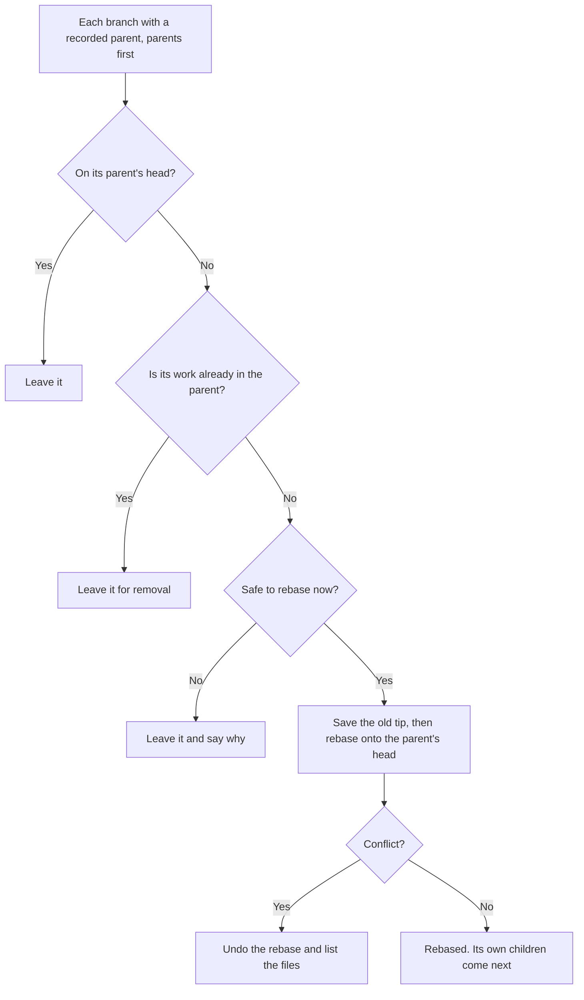
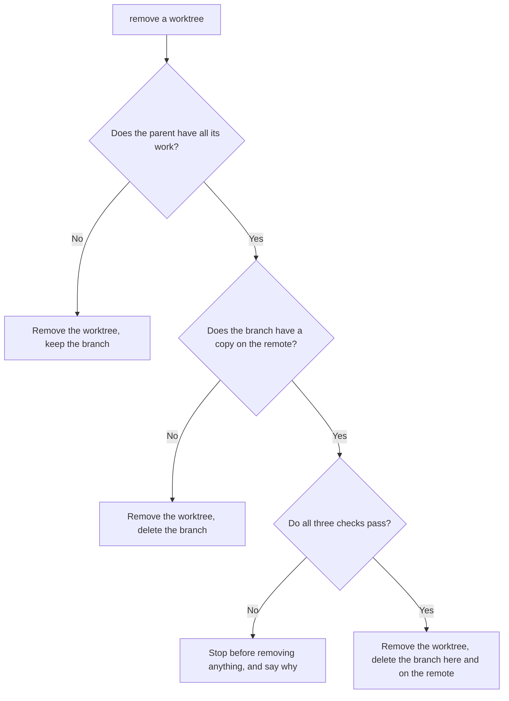

# Git Worktrees

Create, sync and remove git worktrees with this skill's script. Each worktree goes beside the repository's main checkout, never inside a repository. Each branch follows its parent, the branch it was created from: when the parent gets new commits, the branch is rebased onto them, and its copy on the remote follows. Once its work is merged, removing its worktree deletes the branch here and on the remote, after checking that this loses no work and closes no open pull request.

**Why:** the folder name shows the repository and branch at a glance, paths stay short, and no checkout sits inside another one. Claude Code's automatic cleanup never removes these folders. The copied `.env` lets the worktree run, the copied IntelliJ files give it the main checkout's modules and build settings, and the workspace files show every worktree in one VS Code or IntelliJ window. A branch that follows its parent always builds on what's really there, so conflicts show up early, while they're small.

## Create a worktree

```bash
python3 <this skill's folder>/scripts/worktree.py add <repo> <branch> [--from <parent>] [--env-from <folder>]
```

- `<repo>`: any checkout of the repository, usually its main checkout.
- `<branch>`: an existing branch is checked out as it is. A branch that exists only on the remote gets a local branch that tracks it. Any other name is a new branch, and needs `--from`.
- `--from`: the branch the new branch builds on. The new branch starts at its head, and the script records it as the parent, so `sync` keeps the new branch on that head. A commit or a tag works too, but then no parent is recorded.
- `--env-from`: the checkout to copy the `.env` and IntelliJ files from. By default, it's the checkout where `--from` is checked out, or else `<repo>`.

For example, run from the ichbinkalt workspace (made up):

```bash
python3 <this skill's folder>/scripts/worktree.py add ichbinkalt-backend 001-initial-pause-limit --from 001-initial
```

```text
Created /Users/kev/projects/ichbinkalt/ichbinkalt-backend-001-initial-pause-limit on new branch 001-initial-pause-limit from 001-initial at 6c671b9
Parent: 001-initial, so sync keeps 001-initial-pause-limit on its head
.env: copied from /Users/kev/projects/ichbinkalt/ichbinkalt-backend-001-initial
.idea: copied 4 files from /Users/kev/projects/ichbinkalt/ichbinkalt-backend-001-initial
ichbinkalt.code-workspace: added
ichbinkalt IntelliJ workspace: added. To load it now, right-click it in IntelliJ's Project view and choose Load Project. Otherwise IntelliJ loads it at its next start.
```

If the parent is behind its own copy on the remote, as of the last fetch, the script adds a line such as `Note: 001-initial is 2 commits behind origin/001-initial, as of the last fetch. Pull it, then run sync.` It never fetches by itself.

The script does six more things:

1. **Names the folder** `<repo folder>-<branch>`, beside the main checkout, with any `/` in the branch name as `-`. For example, branch `fix/login` of `~/code/app` goes in `~/code/app-fix-login`.
2. **Copies the `.env`** when the source has one and the worktree doesn't, with the same permissions. It never prints the file. If Git doesn't ignore `.env`, it adds a local exclusion, so the file can't be committed.
3. **Copies IntelliJ's untracked files.** Each file in the source's `.idea` folder that Git doesn't track, such as `misc.xml`, `modules.xml` or a module's `.iml`, goes to the worktree unless the worktree already has it. It leaves out `workspace.xml`, the checkout's own window and run state, `.name`, because the worktree goes by its folder name, and `shelf/`. If Git doesn't ignore a copied file, it adds a local exclusion, as for `.env`.
4. **Updates the VS Code workspace file.** Each `.code-workspace` file beside the main checkout that lists the main checkout gets the new folder, with a relative path, in sorted place. When the folder has no `.code-workspace` file at all, it creates `<folder>.code-workspace`, with the folder itself as a root named `<folder> (root)`, so step 5 sets it up. It never does this in the home folder, a temporary folder, or a folder inside a Git checkout, and it leaves an existing workspace file without such a root as it is:

   ```text
   ichbinkalt.code-workspace: created, with ichbinkalt as its root
   ```
5. **Shows each checkout once.** A workspace can list its own folder as a root, with `"path": "."`, to show the files beside the checkouts. In such a workspace, every Git checkout in that folder is listed as its own folder, and none shows inside the root. So the script lists each checkout there that the workspace doesn't list yet, then hides the listed folders in the root's `.vscode/settings.json`, in `files.exclude` and `files.watcherExclude`. The root then shows only the loose files and other folders. It hides a new worktree before creating it, so the folder never shows in the root, even for a moment. It does this on every `add`, `remove` and `sync`, so it also catches checkouts made elsewhere, such as a clone or a worktree from another tool, and creates the settings file when needed:

   ```text
   ichbinkalt.code-workspace: lists ichbinkalt-docs
   ichbinkalt/.vscode/settings.json: hides ichbinkalt-backend-001-initial-pause-limit, ichbinkalt-docs
   ```

   A checkout taken out of the workspace in VS Code comes back at the next run while it's still in the folder. To drop one for good, move it out of the folder or delete it.

   It looks after only entries that name a checkout, or a folder that no longer exists. Patterns with glob characters, such as `**/node_modules`, and other folders, such as `.idea`, stay as they are. It never changes the settings of a root that's itself a Git checkout.
6. **Updates the IntelliJ workspace.** When `.idea/jb-workspace.xml` beside the main checkout is a multi-project workspace, every Git checkout in that folder is listed in it as a subproject, as in VS Code. So it lists the new folder, with the main checkout's Git remote, and any checkout there it doesn't list yet, with that checkout's `origin` remote, each under its folder name. When the folder has no `.idea` at all, it creates the workspace first, with the same exceptions as step 4: never in the home folder, a temporary folder, or a folder inside a Git checkout. A folder whose `.idea` belongs to an ordinary IntelliJ project stays as it is. It does this on every `add`, `remove` and `sync`:

   ```text
   ichbinkalt IntelliJ workspace: lists ichbinkalt-docs. IntelliJ loads them at its next start, or right away with Load Project on each in its Project view.
   ```

   IntelliJ watches that file, so new entries show up in its Project view at once. It loads their modules and builds at its next start, which for many new entries can take a while, or right away with **Load Project**.

To work in the new worktree in Claude Code, call `EnterWorktree` with its `path`. Claude Code asks the user first, because the folder is outside `.claude/worktrees/`.

## Keep children on their parent's head

When a branch gets new commits, every branch created from it moves onto its new head, parents first, at every depth. It doesn't matter how the commits got there: a merge, a commit made directly on the parent, a pull of someone else's work, or a rebase of the parent itself.

Git doesn't do this by itself, and nothing runs it automatically. Run `sync` in each repository where a parent moved:

- right after a merge, commit or pull on a branch that has children
- when you start work in a repository, because the user may have committed or pulled since
- before you review or merge a branch

```bash
python3 <this skill's folder>/scripts/worktree.py sync <repo>
```

Sync also lists and hides checkouts made elsewhere in a workspace with an outer root, as step 5 of [Create a worktree](#create-a-worktree) describes.

For example, after three new commits on `master`, one of them pushed straight to it:

```text
/Users/kev/.ksp
master 2b27083
  personal-finance-review: rebased onto master 2b27083: 1 commit of its own, unchanged
Old tips and bases: refs/recovery/sync/2026-11-08-155619/
```

**Why at those points:** a parent can move while nobody watches, such as when the user pulls a teammate's work. Checking whenever work starts, and before anything builds on a branch, catches every move before it matters.

Each branch goes through these checks, parents first:



A branch is safe to rebase when all of these hold:

- **It has its own worktree.** Sync rebases a branch only inside its own worktree, so no other checkout changes.
- **Its worktree is clean:** no uncommitted or untracked files, and no rebase or merge in progress. Someone may be halfway through an edit there.
- **Its copy on the remote has nothing new.** Sync fetches first, so it sees the latest pushes. If someone else pushed commits to the branch, a rebase followed by a force-push would erase them. Older versions of the branch's own commits, left by earlier rebases, don't count: they have the same author, date and subject as the local ones.

When a rebase conflicts, sync undoes it, so the branch is exactly as it was, and prints the files and the command to rebase by hand. The other branches still move. For example, if `001-initial-review-memory` conflicts with `001-initial`, sync reports its files, leaves it alone, and still rebases its siblings.

**Copies on the remote.** After rebasing, sync pushes each rebased branch over its copy on the remote, so the remote stays current. Every push uses `--force-with-lease`, pinned to the commit sync checked, so it can't overwrite a commit nobody here has seen. A branch rebased earlier, whose copy still holds only older versions of its commits, is pushed the same way.

```text
Copies on the remote:
  origin/001-initial-review-memory: pushed 72894cf → 0b0df1b
```

Sync never publishes a branch that has no copy on the remote yet. It also never pushes a copy that's only behind: those new local commits weren't rewritten, so you push them when you choose. A failed push leaves the local rebase in place and says why.

**Recovery.** Sync saves each rebased branch's old tip and base as `refs/recovery/sync/<time>/tip/<branch>` and `refs/recovery/sync/<time>/base/<branch>`. To undo a rebase, run `git reset --keep <old tip>` in the branch's worktree, then `git config branch.<branch>.worktreeBase <old base>`. Delete the refs once you no longer need them, with `git update-ref -d <ref>`.

### Record a parent for an existing branch

Branches created before this command, or by other tools, have no recorded parent, so sync leaves them alone. Record one with:

```bash
python3 <this skill's folder>/scripts/worktree.py parent <worktree> <parent>
```

```text
Parent of 001-initial-review-memory: 001-initial. Its own commits start after 6ace5c4.
```

Use the same command when a branch moves to a different parent. The next sync replays only its own commits onto the new parent.

## Remove a worktree

```bash
python3 <this skill's folder>/scripts/worktree.py remove <worktree> [--close-prs]
```

It first removes the folder's entries from the same VS Code and IntelliJ workspace files and waits 3 seconds, so both editors drop the folder while its files still exist. Then it runs `git worktree remove`, which refuses a worktree with uncommitted changes, untracked files, or a lock. If git refuses, the script puts the entries back.

**Why this order:** an editor or language server, such as the IntelliJ one, that sees a listed folder's files vanish can keep that folder's modules in its cache. On its next start it fails on them, with errors such as `can't parse url with authority: file://$WORKSPACE_54$/src/test`.

**When IntelliJ has loaded the folder,** it stops before removing anything. IntelliJ then links the folder's Gradle build in `gradle.xml`, its Maven build in `misc.xml`, or its modules in `modules.xml`, and only IntelliJ can unlink those safely:

```text
Stopped before removing anything: IntelliJ still has ichbinkalt-backend-001-initial-pause-limit loaded in the ichbinkalt IntelliJ workspace, in gradle.xml. Right-click it in IntelliJ's Project view, choose Remove 'ichbinkalt-backend-001-initial-pause-limit' from Workspace, then run remove again.
```

A folder that IntelliJ lists but never loaded needs nothing from the user: the script takes its entry out itself.

**Why stop instead of unlinking it:** IntelliJ keeps those files in memory and rewrites them on its own schedule, so a change made beside it can clash with what it holds. Left in place, the links point at a folder that's gone, and a leftover entry offers to check the repository out again in its place.

An outer root, such as `"path": "."`, keeps hiding the folder until `git worktree remove` has deleted it. Only then does the script drop the folder's entries from that root's `.vscode/settings.json`, so the folder never shows up there while its files still exist.

Then it deals with the branch. When its parent already has all its work, the script deletes the branch here and its copy on the remote, after saving its tip as `refs/recovery/removed/<time>/<branch>`. It fetches first, so a branch merged on the remote, such as through a pull request, counts even before you pull its parent.

```text
ichbinkalt.code-workspace: removed
ichbinkalt IntelliJ workspace: removed
Removed /Users/kev/projects/ichbinkalt/ichbinkalt-backend-001-initial-pause-limit.
ichbinkalt/.vscode/settings.json: no longer hides ichbinkalt-backend-001-initial-pause-limit
Deleted branch 001-initial-pause-limit: 001-initial has all its work. Its tip is saved as refs/recovery/removed/2026-11-08-171500/001-initial-pause-limit.
origin/001-initial-pause-limit: deleted from origin
```

It keeps the branch when it has no recorded parent, when other branches build on it, or when it has work that neither the parent nor the parent's copy on the remote has. It says so when the remote already deleted the branch's copy.

### Before it deletes a copy on the remote

Deleting a branch on the remote can lose work or close pull requests, so the script checks the copy first. If a check fails, it stops before removing anything and says why. Run `remove` again once that's fixed.



1. **The copy holds nothing new.** If someone else pushed commits to it, deleting it would lose them.
2. **The parent's copy on the remote has the work too.** Otherwise the work would be left only on this machine. For example, after a squash into `001-initial` that isn't pushed yet, it says `Push 001-initial, then run remove again.`
3. **No open pull request uses it.** Deleting a branch on GitHub closes the pull requests from it, as "Closed" rather than "Merged", and closes or retargets the ones into it. The script asks the `gh` CLI. For a fork, it also looks in the parent's repository, where the fork's pull requests live.

```text
Stopped before removing anything: deleting origin/001-initial-pause-limit would close the pull requests from it, and close or retarget those into it:
  #12 Add the Pause limit (from it): https://github.com/example/ichbinkalt-backend/pull/12
Merge or close them first, or run remove again with --close-prs.
```

If `gh` can't tell, because it isn't installed or logged in, or the remote isn't on GitHub, the script stops too. `--close-prs` skips the pull request check, for when the user has decided those pull requests can close. The other two checks still apply.

**Why stop instead of keeping the branch:** a kept branch has no worktree left to run `remove` from, so its copy on the remote would stay behind with nothing to clean it up. Stopping leaves everything in place for the next try.

## Don't use Claude Code's own worktree features

`EnterWorktree` with a `name`, a subagent's `isolation: worktree`, `use_worktree` for a new session, and `claude --worktree` all put the worktree in `.claude/worktrees/`, inside the repository. Create it with this script instead, then enter it with `EnterWorktree` and its `path`.

## If it fails

| The script says | What to do |
| --- | --- |
| `... already exists.` | Use that worktree if it's on the branch you want. Otherwise, ask the user. |
| `New branch ... needs --from <parent>` | Pass the branch the new one builds on, such as `--from 001-initial`. |
| `git:` and the branch is already used by another worktree | Work in that worktree instead. |
| `git:` and the worktree contains modified or untracked files | Commit or save the work first. Never force the removal. |
| `... so update it by hand` | The worktree step worked. Edit that workspace file yourself. In a `.code-workspace` file, add or remove the folder's entry, keep the entries sorted, and keep its comments. In `.idea/jb-workspace.xml`, add or remove the folder's `<project>` entry, or ask the user to do it in IntelliJ. For a `.vscode/settings.json`, add or remove the folder in `files.exclude` (as `<folder>`) and `files.watcherExclude` (as `<folder>/**`). |
| `... does not exist.` | The worktree was removed by hand. Run `git worktree prune` in the main checkout, and remove its `.code-workspace` entry yourself. If IntelliJ still shows the folder, ask the user to remove it there with **Remove '...' from Workspace**. |
| Remove: `Stopped ...: IntelliJ still has ... loaded` | Ask the user to right-click the folder in IntelliJ's Project view and choose **Remove '...' from Workspace**, then run `remove` again. IntelliJ saves that change within a few seconds. If it still stops, wait a moment, or ask the user to choose File → Save All. |
| Sync: `... uncommitted or untracked files` | Run `sync` again once that work is committed. Never commit or stash someone else's edits to make sync run. |
| Sync: `its rebase conflicts in ...` | Run the printed command in that worktree, resolve the conflicts, and check the result. If a conflict needs a decision, ask the user. |
| Sync: `... has 1 commit it lacks; pull them in first` | Someone else pushed to this branch. Ask the user before pulling their commits in, then run `sync` again. |
| Sync: `already in <parent>, so it only waits for removal` | Remove its worktree with `remove`, which deletes the branch too. |
| Sync: `its parent ... no longer exists` | Record the new parent with `parent`. |
| Sync: `not checked out in any worktree` | Create a worktree for it with `add`, then run `sync` again. |
| Sync: `... not pushed, because it has ... commits that ... doesn't` | Someone else pushed to this branch. Ask the user before pulling their commits in, then run `sync` again. |
| Sync: `... not updated, because the push failed` | The local rebase stays. If the reason says `stale info`, someone pushed in between: run `sync` again, which fetches and checks again. Otherwise fix the cause, such as the network, and run `sync` again. |
| `Couldn't fetch ...` | The checks used the last fetch, and pushes may fail. Run the command again once the remote is reachable. |
| Remove: `Kept branch ...: it has work that isn't in ...` | Nothing is lost. If you know it was merged some other way, delete it yourself with `git branch -D <branch>`. |
| Remove: `Stopped ...: ... has 1 commit that ... doesn't` | Someone else pushed to the branch after its work was merged. Ask the user whether to pull those commits in or drop them. |
| Remove: `Stopped ...: ... doesn't have its work yet` | Push the parent, then run `remove` again. |
| Remove: `Stopped ...: deleting ... would close the pull requests ...` | Show the user the listed pull requests. Merge or close them, or, with the user's OK, run `remove` again with `--close-prs`. |
| Remove: `Stopped ...: couldn't check the pull requests ...` | If `gh` isn't logged in, ask the user to run `gh auth login`. If a sandbox blocked the network, run the command again with network access. With the user's OK, `--close-prs` deletes the copy without checking. |
| Remove: `... not deleted, because the push failed` | Run the printed command once the remote is reachable. |

## How it works

- `scripts/worktree.py` runs the commands. `checkouts.py` wraps git, `env_copy.py` copies the `.env`, `idea_copy.py` copies IntelliJ's untracked files, `editors.py` lists and unlists the folder in both editors' workspaces, `workspace.py` edits the VS Code workspace files, `root_excludes.py` lists the checkouts in an outer root and hides them there, `intellij_workspace.py` edits IntelliJ's `jb-workspace.xml` and finds what IntelliJ has loaded, `intellij_sync.py` lists every checkout in it and creates it when missing, `lineage.py` keeps each branch's parent and base, `sync.py` rebases the children, `cleanup.py` decides what happens to a removed worktree's branch, `remote_copy.py` fetches, checks, pushes and deletes each branch's copy on the remote, and `pull_requests.py` asks `gh` which open pull requests use a copy.
- **Leases:** every push names the commit it expects on the remote, as in `--force-with-lease=<branch>:<commit>`. If the remote has anything else by then, the push fails instead of overwriting it.
- Each branch's parent and base live in git config, as `branch.<name>.worktreeParent` and `branch.<name>.worktreeBase`. They follow a renamed branch and go away with a deleted one.
- **Why the base matters:** the base is the parent commit where a branch's own commits start. A rebase gives commits new IDs, so after a parent is rebased, its old commits still sit under its children, and a plain `git rebase` would try to replay them a second time. Sync replays only the branch's own commits, with `git rebase --onto <parent's head> <base>`. If a branch was rebased by hand, its fork point is newer than the recorded base, and sync uses the fork point instead.
- `GIT_WORKTREES_UNLIST_PAUSE` sets the wait after the workspace files change, in seconds. The default is 3, and the tests use 0.
- It needs Python 3 and git. Deleting a branch's copy on GitHub also needs the `gh` CLI, logged in. It reads workspace files with Python's built-in `json`, which can't keep comments, so it leaves a file that has comments for a manual edit instead of rewriting it without them. It reads IntelliJ's workspace with Python's built-in `xml.etree`, and changes it only when writing the file back unchanged would give exactly the same text, so nothing but the folder's entry ever changes. It replaces the file in one step, because IntelliJ reloads it the moment it changes.
- Tests: `python3 -m unittest discover -s <this skill's folder>/tests`. They run on throwaway repositories.
