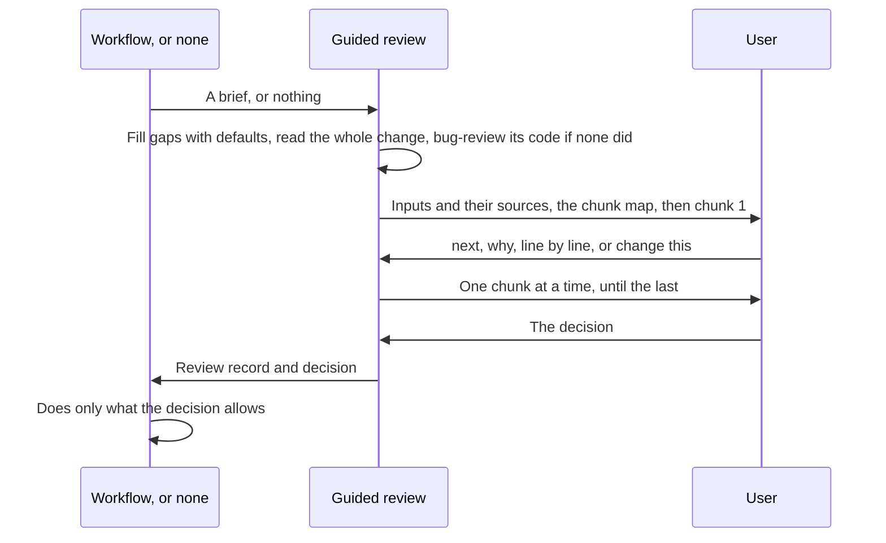
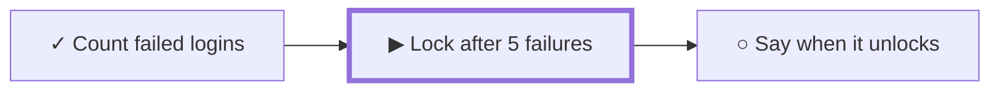
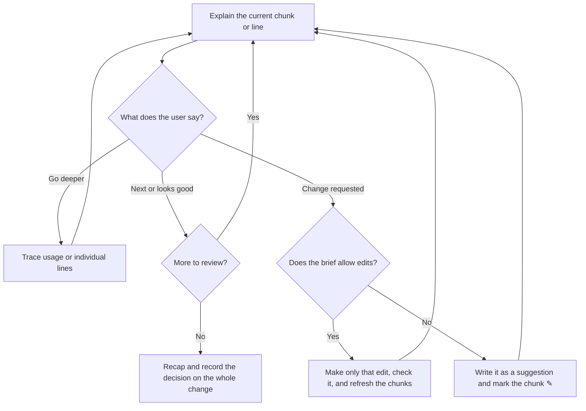

# Guided Review

Walk the user through a change, one chunk at a time, so they can question it and decide. Stay in the current conversation.

A workflow can hand the review a **brief**: what to compare, why the change exists, a starting plan, the checks already run, extra rules, whether edits are allowed, what the decision means, and where to keep the record. Every field has a default, so the review also runs with no workflow at all, such as for a colleague's pull request. [The brief](references/brief.md) lists the fields, their defaults, how to find the comparison, and sample briefs.



## Establish the comparison

Take the base and head from the brief, or find them as [Find the comparison](references/brief.md#find-the-comparison) describes, and verify them in Git. Read the whole change before explaining any of it, including callers, contracts, tests, new and deleted files, and file permission changes. Separate inherited parent work, earlier approved changes, and new or changed work.

**Why:** the user should judge only what this change adds, and nothing in the diff should surprise you halfway through.

Name the change, its repositories and where you read each one, and what the decision is for. Reviewing a plan or spec before the code exists doesn't approve the code built from it.

Take every code snippet and line number from the reviewed commits, such as `git diff <base>..<head> -- <file>`, not from the current files. If the checkout has moved on, explain the reviewed commits rather than the current lines. Read a branch that isn't checked out straight from Git, such as with `git show <head>:<file>`, instead of checking it out.

## Check what already ran

Every check in the brief must cover the exact commits under review. If a check is missing or stale, say so before the first chunk. Fixes that earlier checks made are part of the reviewed diff. The review doesn't run a workflow's own checks, such as its cleanup pass or its tests.

**When no bug review covers the comparison and the change has code, run one before the first chunk,** unless the user says not to:

- Use `/code-review` in Claude Code, or the host's own code review command elsewhere, on exactly the comparison under review. Give it the comparison as its target, or name both commits in the request if it can't take one.
- Always pass the level: `medium`, unless the user asks for another one. Without a level, `/code-review` reuses the last level the user typed, which may be `max`.
- Never pass `--fix` or `--comment`. The review edits nothing, and posts nothing.
- Check that each finding falls inside the diff. Fix nothing: each finding goes into its chunk with a suggested change, for the user to decide. Mention findings outside the change in the recap.

**Why:** whoever explains a change tends to accept its choices. A bug review reads the code fresh, and in a review without a workflow, it's the only bug hunt the change gets.

## Open the review

Start with the purpose, the comparison, the checks, and a short chunk map, then explain the first chunk right away. Say where each input came from, and flag any that came from a default or is missing. For example, for a Jira ticket (made up):

```text
Reviewing   AUTH-88-login-limit against main, from merge base 3f2a9c1 to 8d41e07   (from the ticket)
Why         AUTH-88's 3 acceptance criteria                                         (from the ticket)
Plan        3 chunks, one per criterion                                             (from the ticket)
Checks      CI passed at 8d41e07                                                    (from the PR)
            Bug review: none yet, so running one at medium first                     (default)
Edits       none: it's Priya's branch                                               (default)
Decision    your verdict, posted only if you ask                                    (default)
```

**Why:** when a workflow forgets a field, the user sees it in the first message, instead of getting a quietly weaker review.

If the brief has a starting plan, such as a chunk map planned before building or a ticket's acceptance criteria, start from it, and say where the final chunks differ from it, and why. Without one, cut the chunks from the diff. A chunk is one meaningful decision or behavior. It may connect a spec rule, a contract, a backend caller, a frontend use, and tests. Follow the behavior or data path rather than file order, and cover the complete diff and every repository.

**Why one chunk at a time:** a whole diff at once is too much to question. One chunk lets the user push back before the next one builds on it.

## Start every chunk with a map and a location line

**Start every new or resumed chunk with a progress map, then the location line, then the chunk's title.** Don't use a bare counter such as "2/5": it shows the position, but not what's done or what comes next.

- Send the map as an image made with the [mermaid-image](../mermaid-image/SKILL.md) skill: left to right for 4 chunks or fewer, top-down for more. Give the current chunk a thicker border. Where images can't be sent, or mermaid-image isn't installed, use a text map, one chunk per line with its repositories.
- Mark each chunk: ✓ accepted, ▶ now, ○ not yet, ↷ skipped, ✎ needs a change.
- The location line names the worktree folder and the branch. Repeat it even when unchanged, and link the folder name to its absolute path. If a chunk spans repositories, name each worktree and its repository. Take the locations from the brief and Git, not from the chat's working directory.
- For a pull request that isn't checked out, the location line names the repository and the branch or commit, and says that no local worktree is in use.
- In line-by-line steps, repeat the location line and name the lines being explained, such as `limiter.py`, lines 18–25. The map comes back with the next chunk.

**Why:** the map shows the whole review at a glance, by name: what's covered, where you are, and what's left. With many worktrees open, the location line means the user never has to guess which copy of the code they're reading.

## Explain the chunk

For the current chunk, explain each of these in detail, in easy words, with as many concrete examples as it takes, such as before and after values, a sample request, or a user scenario:

- **What changed:** before and after in words, then the code itself, as described below.
- **Why:** the requirement, defect, or tradeoff, from the brief's why. Separate evidence from guesses about past intent.
- **How it's used:** real callers, data movement, side effects, and failure paths.
- **How to judge it:** simpler alternatives, the checks that actually ran, each check's findings for this chunk, and open questions. Say what a check confirmed and how it was fixed. Give each plausible issue with a suggested change, for the user to accept or reject.

**Show the code itself, not only a link.** Under What changed, show the lines that carry the chunk's decision as a `diff` block, plus the test lines that check it. That's usually 5 to 20 lines.

- Above the block, name the file, its lines, and the commit. A link to the file can follow as an extra.
- Number the lines from the reviewed head, not by counting. A hunk header such as `@@ -38,3 +40,3 @@` says the hunk starts at line 40 of the head file, and `git show <head>:<file> | cat -n | sed -n '40,42p'` prints those lines with their numbers, in the diff's order without the removed lines.
- Under the block, explain the important lines in short notes, each pointing at its line by number, such as "Line 22 starts the count again".
- Cut unrelated lines, and mark the cut with `…`. For an edit repeated in many places, such as a rename, show one example and list the other files.
- Name the chunk's other changed lines in a sentence. Their diffs come in line by line, if the user asks for it.
- For a spec or other prose, quote the new wording, and the old wording when it matters, instead of a diff. Code blocks don't wrap, so a diff of long lines scrolls sideways, worst on a phone.

**Why:** a link opens the whole file as it is today, not the change, and its line numbers drift after edits and rebases. It often can't open at all: the desktop app opens only files inside the session's folders, and a phone may not open it. The user approves the code, so they need to see the code, not only a description of it. Line numbers let a note or a question point at a line, such as "line 22", and let the user find it in the IDE.

A chunk might start with this map, sent as an image (made up):



Where images can't be sent, the same map as text:

```text
✓ Count failed logins      auth-service
▶ Lock after 5 failures    auth-service
○ Say when it unlocks      auth-service, web
```

> **Worktree:** auth-service-AUTH-88-login-limit, linked to its folder · **Branch:** AUTH-88-login-limit
>
> **Lock after 5 failures**
>
> **What changed:** after 5 failed logins in a row, the account locks for 15 minutes. Before, there was no limit, so a script could guess passwords forever.
>
> `auth/limiter.py`, lines 18–23, at `8d41e07`:
>
> ```diff
>   18  def record_failure(account):
>   19      account.failures += 1
> + 20      if account.failures >= MAX_FAILURES:
> + 21          account.locked_until = now() + LOCK_TIME
> + 22          account.failures = 0
>   23      save(account)
> ```
>
> - `MAX_FAILURES` is 5 and `LOCK_TIME` is 15 minutes, both set at the top of the file.
> - Line 22 starts the count again, so the first wrong password after the lock doesn't lock the account at once.
>
> `tests/test_limiter.py`, line 31, the test that checks the limit:
>
> ```diff
> + 31      assert locked_after(failures=5) and not locked_after(failures=4)
> ```
>
> **Why:** AUTH-88's second criterion: 5 failed logins in a row lock the account for 15 minutes.
>
> **How it's used:** `login()` calls `record_failure()` after a wrong password, and checks `locked_until` before it checks the password. A locked account gets "Try again at 14:35", not "Wrong password".
>
> **How to judge it:** a simpler option is a delay after each failure, but that ties up a worker for every attempt. CI ran with 42 passing tests. The bug review found one plausible issue: two logins at the same moment can both read 4 failures, so a sixth try gets through. Suggested change: increase the count in the database, in one step. Accept it, or keep the current behavior?
>
> Reply `next` or `line by line`, or ask anything.

When the brief names extra rules, such as a domain glossary or team conventions, check each chunk they apply to against them. Show how the chunk meets them, with a small table or diagram when it helps, and flag what breaks them.

Use a small Mermaid diagram when it helps, sent as an image like the map, or as ASCII where images can't be sent: a call hierarchy for usage, a sequence diagram for ordering, a data-flow diagram for transformations, or a state diagram or flowchart for lifecycle choices. Label real calls, payloads, and failure paths, and mark anything unverified. Don't invent a call graph, defend unnecessary complexity, or force a diagram onto a trivial rename. Check diagrams the change adds or edits in files with the mermaid-image script, and don't claim a diagram renders if you haven't checked. Without mermaid-image, say that it wasn't checked.

> For the chunk above, a sequence diagram would show `login()`, `record_failure()`, and the account store, with a locked account's "Try again at 14:35" drawn as its own arrow back to the user.

**Show other code the same way.** When you show code to explain it, not as a diff, such as a caller under How it's used or an answer to "show callers", use a block for its language, numbered from the reviewed head, with the file, its lines, and the commit above it.

> For the chunk above, the user asks where `record_failure()` is called:
>
> `auth/login.py`, lines 31–36, at `8d41e07`:
>
> ```python
> 31  def login(account, password):
> 32      if account.locked_until and account.locked_until > now():
> 33          return locked_message(account)
> 34      if not check_password(account, password):
> 35          record_failure(account)
> 36          return WRONG_PASSWORD
> ```
>
> - Line 32 checks the lock before the password, so a locked account gets "Try again at 14:35", even with the right password.
> - Line 35 is the only call to `record_failure()`.

## Pause after each chunk

**After one chunk, end the response and wait.** Close with one line of choices, such as "Reply `next` or `line by line`, or ask anything", because the user can't ask for a mode they don't know about. Don't explain the whole diff at once, and don't treat silence as agreement. Adapt the detail to the user, and keep your place through their questions.



| What the user says | What happens |
| --- | --- |
| Next / continue | Move on by one group in line mode, or one chunk in chunk mode. This never approves the whole change |
| Why / show callers / what if it fails | Stay on this chunk and explain the requested path |
| Line by line | Go through the chunk's other changed lines in small groups of about 10 lines or one function. Show each group as a diff with notes, and wait between steps |
| Looks good / approve this chunk | Record this chunk as accepted and present the next one. It covers only this chunk, not the whole change |
| Change this, or accept a suggested change | Pause the review. If the brief allows edits, make only the requested edit where it says, check it the way it says, and refresh the affected chunks. If not, write the change as a suggestion the user can pass on, such as a draft review comment, record it, and mark the chunk ✎ |
| Skip / pause | Record the skipped part, or save the position. Neither is approval |
| The final decision, such as "approve" or "approve for `<destination>`" | Record that exact decision, in the words the brief defines. Recognize an explicit waiver if the user deliberately skips the rest |

A question about an alternative isn't an edit request. When the change does something its why doesn't cover, such as new behavior or a new shared term, raise it as an open question for the decision: the code doesn't become the decision just by being there. Don't silently fix code while explaining it, or rewrite the spec or ticket to justify it.

**Without an edit policy in the brief, the review is read-only:** no edits, commits, branch switches, or pushes, until the user asks for a specific edit on a branch they own.

**Post nothing on your own.** Don't post PR comments, Jira comments, or approvals, or create other external artifacts, just because this looks like a PR review. When the user asks you to post, show the exact text and where it goes, and wait for their OK.

## Keep the review record

Keep the record where the brief says. Without a brief, keep it in the conversation.

| Record | Content |
| --- | --- |
| Identity and scope | The change's name; its repositories, and evidence for unaffected ones; worktree folders, branches, and paths; purpose; what the decision is for |
| Commits | Per repository: base and head; the version of the why, such as a spec commit or a ticket; each check, and whether it's still current |
| Progress | Stable chunk IDs, paths and hunks, each chunk's status (discussed, accepted, skipped, or needs a change), the current chunk or line, questions, edits and suggestions, and the user's decision on each finding |
| Decision | Approved, changes requested, paused, rejected, or walkthrough complete, plus any explicit waiver. A brief can add its own |

After edits, rebases, new pushes to the branch, or unexpected changes in other repositories or in the spec or ticket, regenerate the affected chunks and mark the earlier decision stale. Keep useful discussion of unchanged code, but get a decision that covers the current commits.

**Why:** an approval belongs to the exact code the user saw.

When coverage is complete or explicitly waived, recap the scope, open issues, checks, and limits. **Finishing the walkthrough isn't the decision.** Recognize clear approval of the concrete whole-change proposal without asking twice. Then hand the record and decision back to the workflow that asked for the review, which does only the authorized action. With no workflow, stop there: nothing is posted, merged, or changed unless the user asks. Approving one part, such as one repository or one pull request, doesn't approve the others. Keep the user's review position until they move on, for example with "next" or "looks good".

## Check before you send

- **The first reply** names the comparison, from the merge base to a pinned head, and where each input came from. It flags each gap. If the change has code and no bug review covered it, one ran first.
- **Each chunk** starts with the progress map, then the location line, then the title. It covers what changed, why, how it's used, and how to judge it, with the key lines as a `diff` and the file, lines, and commit above them. Each line-by-line step shows its lines the same way, after the location line.
- **Each reply** explains one chunk at most, and ends with one line of choices. Each line of code it shows has its number from Git, except a removed line.
- **Never** take "next" or "looks good" as approval of the whole change, or show the base branch's newer commits as part of the change. Never edit, switch branches, commit, push, or post unless the brief or the user allows it.

More examples, such as which code goes in the chat: [Examples](references/examples.md).
