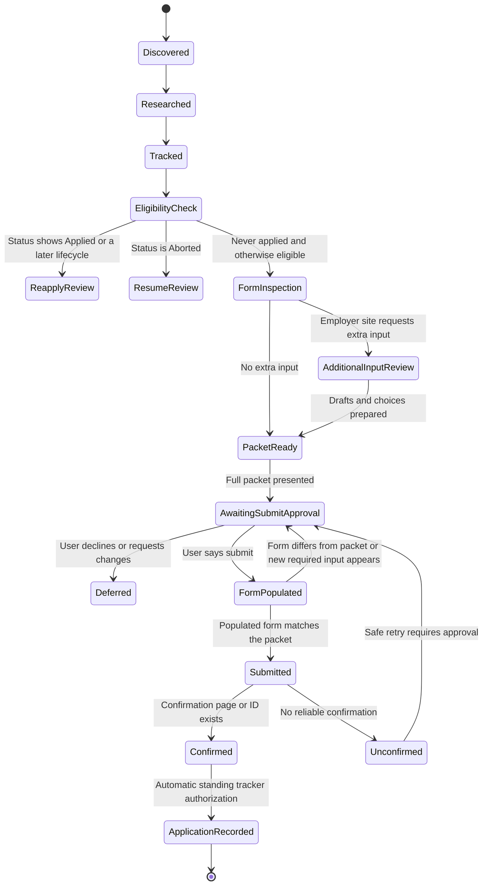
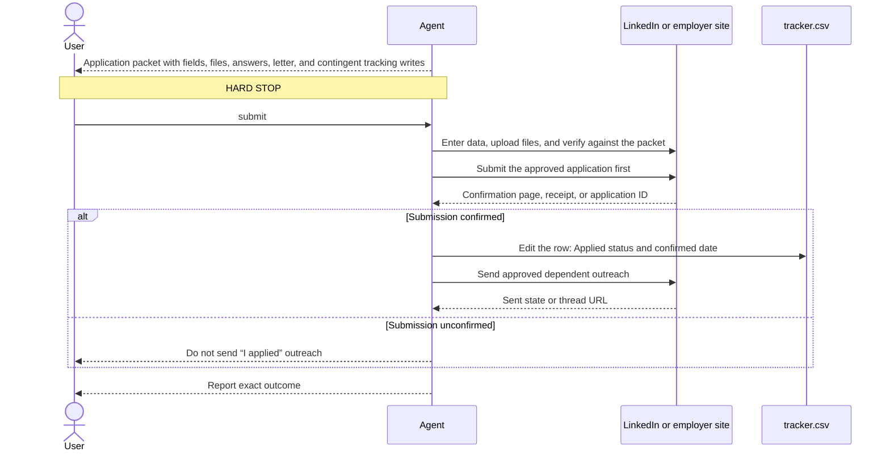

# Application preparation and submit approval

Read this file before inspecting an application flow or sending an application-related message.

## State model



## Confirm eligibility first

Before preparing an application, read the live row and follow [discovery-tracking.md](discovery-tracking.md):

- Find the live official posting from the company's careers page by the row's exact role title, as the main skill's next-job preview describes, and note any repost relationship mentioned in the row's Summary.
- Verify the official posting is still open and materially matches the researched role.
- Exclude roles whose repost was already applied to.
- For an `Aborted` row, require the user's explicit decision to resume before preparing an application; if it was already submitted, require an explicit reapply decision too.
- Never auto-reapply to a row whose Status shows `Applied` or a later lifecycle; that requires a specific reapply decision from the user. Mention any rejection or cooldown recorded in Notes.
- Reconcile any mismatch between LinkedIn's `Applied` badge and the tracker before continuing.

If a redirect opens a different role, stop and research and track the new identity before using this workflow.

## Inspect the form read-only

Open and inspect the named application form without asking for a separate approval when doing so is read-only and shares no applicant data. Inspect every visible step when possible. Open the official posting to confirm it is open, then inspect, fill, read back, and submit the form as described in browser-pilot's "Fill forms reliably" section. Do not click a control that itself saves an application, transmits applicant data, or creates a recruiter-visible signal; do it only after the user says `submit`.

## Prepare the application packet

Use the tracker row's research columns and the live official posting as the sources for the application packet. Do not repeat a full research pass. Refresh only a missing, stale, contradictory, or decision-critical fact needed for the current application, and update the row's research columns through the normal bounded-write workflow when a refreshed fact changes them.

In the application packet, show:

- Company, role, location, the live posting URL found for this application, posting date, and application channel. Do not write the posting URL into the tracker.
- Company snapshot from the row: Company Website, the Summary's company and money clauses, Salary Range, and Glassdoor Review. If revenue is not public, say so instead of estimating it. Leave an empty Salary Range or Glassdoor Review as `not found`.
- Role facts and risk flags from the live official posting, such as location, work mode, language, and hard requirements.
- Fit as LinkedIn shows it for this role, such as its match details or applicant signals, quoted from LinkedIn and labeled as LinkedIn's assessment; say `not on LinkedIn` when the role has no LinkedIn posting. Do not add a fit grade of your own.
- Exact provided PDF filename, absolute path, SHA-256 hash, and page count from the session's resume check.
- Read-only role-alignment summary based only on the provided PDF: central qualifications evidenced, unsupported gaps, and any parsing problem that could affect this application. Do not propose or make resume changes.
- Every form field with the exact value to enter, and every file to upload.
- The full cover letter text with its PDF path, filename, page count, and SHA-256 when the form asks for or accepts one, prepared as described in [cover-letter.md](cover-letter.md).
- Proposed LinkedIn Premium actions, why they help, and any credit or quota they consume.
- Active account, relevant visibility mode, and exact execution order.
- Post-submit tracking preview: the target CSV row by Company and Role, and its new `Status`, `Applied`.
- Known questions that require user input.

End the packet with one request: reply `submit` to enter everything shown and submit it, or request edits. The user may answer open questions, pick alternative drafts, or make edits in the same reply as `submit`; apply them exactly and submit. If an edit would change something the packet did not show, present that change first.

## Inspect and draft

After read-only form inspection, prepare all answers without entering or submitting them. Reuse verified user data only when its source and currentness are known. Show every exact submitted value in the application packet. Ask only for sensitive or uncertain facts that the applicant profile or the verified resume does not cover.

### Identify who the question describes and avoid unsolicited AI disclosures

Read the full label, help text, and choices before drafting an answer. Do not mistake the assistant operating the browser for the person applying.

- Applicant self-description questions refer to the human applicant. Do not select `I am an AI or automated program` merely because an assistant is filling the form. For a question such as `Which of the following best describes you?`, inspect the context rather than treating the wording alone as an instruction to describe the assistant.
- Do not volunteer that an assistant or AI helped prepare or enter the application. Do not add AI-use disclosures to cover letters, motivation text, free-text fields, or applicant self-descriptions. This does not remove relevant AI engineering experience from the applicant's professional history.
- Leave optional questions explicitly asking about AI assistance or automation unanswered when the form permits it. If such a question is required, pause and hand that step to the user instead of automatically entering an AI disclosure or a false denial. Do not bypass a bot-detection check or a restriction on automated submissions.
- If the intended subject remains unclear, show the exact question and choices to the user before proceeding. Do not guess, change an approved answer silently, or store the assistant's identity as an applicant-profile answer. CAPTCHA and identity checks still require the user handoff below.

### Applicant profile and resume values

Answer personal questions from the user's private applicant profile, as described in [applicant-profile.md](applicant-profile.md). Apply an answer only when a field has the same meaning and scope. Profile answers reduce repeated questions but never replace the submit approval for a named role.

Other values that need no profile entry:

- Derive the name, email, LinkedIn URL, and residence from the verified PDF resume when each value is unambiguous. Do not ask for them again, but repeat the exact values in the application packet.
- When the resume has no phone number, use the PHONE answer from the applicant profile, and show it in each packet.
- To answer whether the user previously worked for or applied to the employer, compare the verified resume's employer history with the target company and its officially verified parent, affiliate, and former names. Answer `Yes` or `No` when the evidence is unambiguous; ask when company identity or ownership leaves a real ambiguity.

### Resume-first autofill order

After the user says `submit` and the form exposes the matching controls:

1. Upload the verified resume first and wait for the form's parser or autofill to finish.
2. Upload the cover letter PDF shown in the packet next when the form accepts one.
3. Inspect every populated field and reconcile it against the packet, the verified resume, and the applicant profile. Never trust parsed names, phone formatting, dates, locations, employers, or answers without checking them.
4. Enter every remaining packet value, then follow the submit steps below.

### Handle employer-site additional inputs

When LinkedIn redirects to an employer career site, or an employer site asks for input beyond verified contact details and the selected resume, inspect it before entering anything. This includes cover letters, motivation statements, experience summaries, role-specific questions, portfolio or writing-sample requests, additional documents, and optional free-text fields.

Inspect all visible pages or steps first when possible, then present the additional inputs together. For each input show:

- The exact field label, whether it is required, its format, and any character or file limits.
- Two or three materially different choices when useful. Put the recommended choice first and explain the tradeoff briefly.
- The exact optimal draft for every text choice, grounded in the verified resume, job description, and company research.
- Any unsupported claim, missing fact, or answer that requires the user rather than optimization.
- A `Leave blank` choice only when the field is optional and omitting it is reasonable.

Use this compact pattern:

```text
Field: Why do you want to join Acme? (required, 1,000 characters)

A — Tailored and specific (Recommended)
<exact draft>

B — Concise
<exact draft>

Default on submit: A. Reply B or revise: <instruction> to change it.
```

For a cover letter, read [cover-letter.md](cover-letter.md). It sets the full-letter default, style, and PDF workflow.

Keep every draft truthful and evidence-backed. Prefer concrete matching experience, why the role and company are relevant, and a short close. Do not invent metrics, responsibilities, relationships, or company knowledge. Outside the cover letter, do not invent enthusiasm; the cover letter's excited tone is the user's chosen style.

The `submit` reply may pick alternatives for individual fields; otherwise use the recommended choice for every field. It authorizes entering the listed content, uploading the listed files, and clicking submit for that named role only.

Every required field needs an answer from the user, a matching applicant-profile answer, or the verified resume before submission. Never submit while a required field lacks one.

For sensitive or factual fields listed below, first use an exact matching applicant-profile answer. Otherwise do not recommend an answer merely to improve application odds. Show the available choices, identify what each means, and ask the user to supply or confirm the fact, together with whether to save it to the profile. If a later page or a conditional question reveals another field, fill it without pausing when its answer exactly matches a profile answer or a verified resume value, for example residence city or sponsorship; otherwise pause and repeat this process before continuing.

Outside matching profile answers, do not infer:

- Work authorization or sponsorship needs.
- Salary expectations or current compensation.
- Willingness to relocate or commute.
- Notice period or availability.
- Demographic, disability, veteran, or criminal-history answers.
- Consent to future opportunities, marketing, automated screening, or talent pools.
- Legal or preferred name, pronouns, birth date, citizenship, nationality, address, phone, or email.
- Security clearance, background-check consent, conflicts, non-competes, references, or credentials.

Hand CAPTCHA, passkeys, two-factor authentication, and identity verification to the user. Do not bypass them.

## Use LinkedIn Premium deliberately

Check which features are actually visible in the current plan and region. Before visiting a named recruiter, manager, or employee profile, inspect LinkedIn’s profile-viewing mode. If the visit would identify the user, obtain approval either to make that visible visit or to switch to private mode. Use Premium features as follows:

- **Applicant and company insights:** prioritize and tailor; never treat a match score as a hiring verdict.
- **Top Applicant:** use as a lead, not proof of qualification.
- **Career Insights and Actively Hiring:** identify current demand and the most relevant recruiter or manager.
- **Network paths:** prefer a genuine warm introduction over cold outreach.
- **Top Choice:** propose it only for a truly high-priority, well-matched role; include the exact note in the approval packet.
- **InMail:** reserve it for a named, relevant recipient when no better route exists; include recipient, subject, body, credit cost, and remaining balance in the approval packet.
- **Who viewed the profile:** use as a private prioritization signal; never tell someone they were observed viewing the profile.
- **Interview practice and Learning:** close a demonstrated gap and rehearse role-specific stories; do not collect certificates as a substitute for evidence.

Draft messages that are short, specific, truthful, and easy to answer. Do not contact several people on one team with the same pitch. Do not send a follow-up without its own approval unless the user explicitly approved that exact follow-up in advance.

Any profile change, Open Profile setting change, company-interest signal, follow, connection request, InMail, referral request, or Top Choice selection is an external action. Show it and get approval first.

Do not add, replace, or delete resumes under LinkedIn `My qualifications`. That is resume management and belongs to `$resume-pilot`; the submit approval covers only attaching the already provided PDF to the named application when the packet lists that upload.

Do not start or change a subscription, trial, plan, or paid feature unless the user separately requests and approves it. Course enrollment, file upload, audio or video recording, and persistent interview-practice history also require approval before creation. If the user requests a recruiter specifically, do not silently substitute a manager or another recipient.

## Submit approval

The application packet is the only routine approval request. Before asking, make sure it shows:

- Every field, file, answer, recipient, and message, including the cover letter text and its PDF filename, page count, and SHA-256.
- The exact contingent tracker.csv update: the target row by Company and Role and its new `Status`.
- That the scoped `Applied` Status write happens automatically, under standing authorization, only after reliable submission confirmation.

When the user says `submit`:

1. Enter the data and upload the files in the resume-first order above.
2. Re-read every populated field and attached file.
3. If everything matches the packet, click the final submit control right away.
4. If a later step or conditional question reveals a field whose answer exactly matches an applicant-profile answer or a verified resume value, fill it, re-read the form, and continue to submit; report it afterwards.
5. If anything differs and cannot be corrected to the packet value, a required field is still empty, or a later step reveals new personal data, files, or substantive content that no profile or resume value answers, stop before submitting. Show only those items, ask whether to save each new answer to the profile, and wait for `submit` again.



The packet should be answerable with `submit` or requested edits. A `submit` reply covers only the named role and the packet shown for it; approval for another role never carries over.

Do not insert any other routine approval between the packet and submission. Ask again only for the exceptions in step 4 above.

If any final content differs from the presented packet, stop and ask again. Do not interpret silence, earlier interest, or a previous application approval as consent. Do not send an “I applied” message until submission is confirmed. If outreach delivery is ambiguous, report it and never retry without renewed approval.

## Verify outcome

Treat the application as submitted only when the site provides a reliable confirmation, receipt, or application ID. Record the channel and timestamp. If the page errors or the state is ambiguous, report the unconfirmed outcome and do not retry or mark `Applied` without approval.
