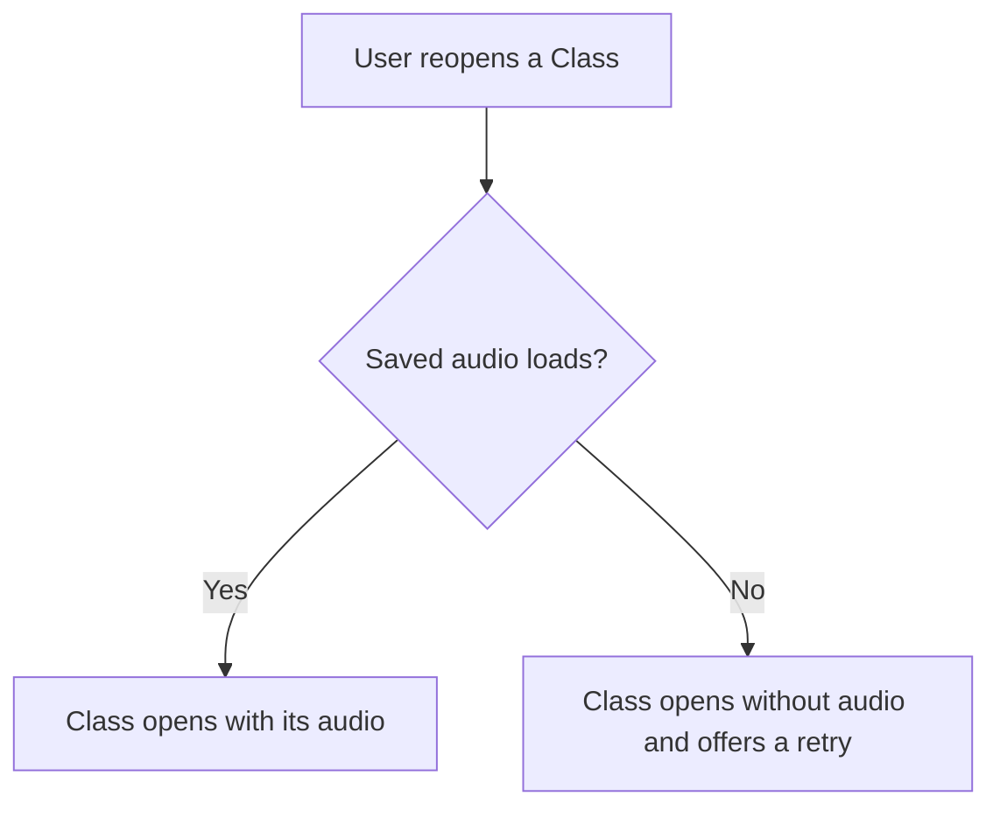

# Mermaid Image

Draw diagrams that read well everywhere. In a chat reply, send each diagram as a PNG image, or as ASCII where an image can't be sent, never as Mermaid text. In a file such as a spec, keep the Mermaid text, because GitHub draws it, and check it with the same script.

**Why:** a Mermaid code block shows as plain code on the phone and in a terminal. On the desktop it shrinks to fit the chat, with no way to zoom. A sent image shows on both, and both can zoom it. Sending uploads a copy into the conversation, so the image keeps showing after the local file is gone.

## Make and send an image

1. Write the diagram to a `.mmd` file in a temporary folder: the session's scratchpad in Claude Code, or `$TMPDIR`. Never put it in a repository.
2. Render it with this skill's script:

   ```bash
   python3 -I <this skill's folder>/scripts/render.py restore.mmd restore.png
   ```

3. Send the PNG where the diagram belongs in the reply: write the text that comes before it, send the image, then continue. In Claude Code, use SendUserFile with `status: normal` and no `display`. If the session has no tool that sends a file, skip the image and [draw the diagram as ASCII](#draw-it-as-ascii-instead).

For example, `restore.mmd` holds:



The script prints the image's path and size, such as `/…/restore.png: 392x534 CSS pixels, saved at 2x`. A diagram takes about a second.

## Draw for a phone screen

- Draw flows top-down, with `flowchart TD`. Use left-to-right only for 4 boxes or fewer, because a wide image turns into a thin strip on a phone.
- Keep labels short. Mermaid wraps a long label onto more lines.
- Show one idea per diagram. Split a big flow into two diagrams instead of drawing one huge one.

## Draw it as ASCII instead

A chat reply shows a diagram as an image or as ASCII, never as Mermaid text. Draw it as ASCII when:

- the session can't send images, such as in Codex, a terminal, or a Claude Code session without SendUserFile, or
- the image failed, as [If it fails](#if-it-fails) lists.

The first time in a conversation, say why the diagrams come as ASCII, such as "This session can't send images, so diagrams come as ASCII."

How to draw it:

- Put it in a `text` code block, so it keeps its alignment.
- Use plain ASCII characters only, such as `|`, `-`, `>`, `v`, and `'`. Emoji and other symbols can take two columns and break the alignment.
- Keep each line under 60 characters, so it fits a phone without scrolling sideways.
- Draw top-down, one step per line. Give each branch its own line, with its label on the arrow.
- Count the characters to line up the columns, and check every line before you send it.

For example, the diagram from [Make and send an image](#make-and-send-an-image):

```text
User reopens a Class
        |
        v
Saved audio loads?
   |-- Yes --> Class opens with its audio
   '-- No ---> Class opens without audio and offers a retry
```

A sequence diagram gets one column per participant:

```text
Browser          API             Store
   |-- login ---->|                |
   |              |-- read ------->|
   |              |<-- 4 failures -|
   |<-- 423 ------|                |
```

**Why:** ASCII in a code block reads the same in a terminal, the desktop app, and the phone, and needs no rendering. Mermaid text needs a renderer, and where there is none, it's only code to decode.

## Check the syntax

Every render checks the syntax: the script stops on an error and points at the line. Check a diagram that goes in a file the same way, and don't send its image.

Common traps:

- **A semicolon in a sequence diagram:** a raw `;` in message or note text ends the statement, so `A->>B: load; then play` fails. Reword it, or write `#59;`, which shows as a semicolon.
- **`CLASS` in an ER diagram:** it's a Mermaid keyword. Give that entity another ID, with its name as a label in its own block: `CLS["Class"] { ... }`.

## If it fails

| The script says | What to do |
| --- | --- |
| `Mermaid found a syntax error` | Fix the line it points to, as [Check the syntax](#check-the-syntax) describes, and render again |
| `Chrome for Testing is not installed` | [Draw it as ASCII](#draw-it-as-ascii-instead) this time, and give the user the install command it printed |
| `The image came out blank` | Draw it as ASCII, and tell the user the script needs a fix |
| Anything else | Draw it as ASCII, and say the image failed |

## How it works

- `assets/mermaid.min.js` is Mermaid 12.2.0 from cdn.jsdelivr.net. Its MIT license is in `assets/LICENSE-mermaid`. Nothing is downloaded while rendering.
- The script opens Mermaid in a windowless, throwaway copy of the browser MCP's Chrome for Testing, which `playwright-chromium-browser/browser.sh path` finds. The copy has an empty profile and no network access. It never touches the shared browser window, its tabs, or its sign-ins, and the diagram never leaves the machine.
- It saves a screenshot at twice the normal pixel density, so text stays sharp when zoomed. Set `MERMAID_IMAGE_BROWSER` to use another Chromium.
- To update Mermaid, download a newer pinned build over `assets/mermaid.min.js`, render a flowchart, a sequence diagram, and a broken diagram, and check the results.
