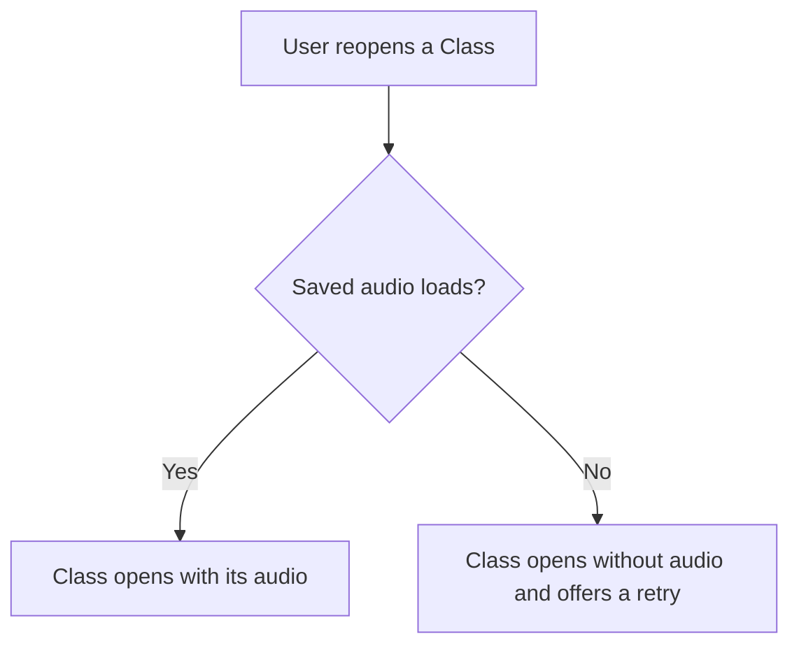

# Mermaid Image

Turn Mermaid text into a PNG image, then send the image to the chat.

**Why:** a Mermaid code block shows as plain code on the phone. On the desktop it shrinks to fit the chat, with no way to zoom. A sent image shows on both, and both can zoom it. Sending uploads a copy into the conversation, so the image keeps showing after the local file is gone.

## Make and send an image

1. Write the diagram to a `.mmd` file in a temporary folder: the session's scratchpad in Claude Code, or `$TMPDIR`. Never put it in a repository.
2. Render it with this skill's script:

   ```bash
   python3 -I <this skill's folder>/scripts/render.py restore.mmd restore.png
   ```

3. Send the PNG where the diagram belongs in the reply: write the text that comes before it, send the image, then continue. In Claude Code, use SendUserFile with `status: normal` and no `display`.

For example, `restore.mmd` holds:



The script prints the image's path and size, such as `/…/restore.png: 392x534 CSS pixels, saved at 2x`. A diagram takes about a second.

## Draw for a phone screen

- Draw flows top-down, with `flowchart TD`. Use left-to-right only for 4 boxes or fewer, because a wide image turns into a thin strip on a phone.
- Keep labels short. Mermaid wraps a long label onto more lines.
- Show one idea per diagram. Split a big flow into two diagrams instead of drawing one huge one.

## If it fails

| The script says | What to do |
| --- | --- |
| `Mermaid found a syntax error` | Fix the line it points to, and render again |
| `Chrome for Testing is not installed` | Send a Mermaid code block this time, and give the user the install command it printed |
| Anything else | Send a Mermaid code block, and say the image failed |

Where images can't be sent at all, such as in Codex or a terminal, use a Mermaid code block where Mermaid renders, and ASCII where it doesn't.

To check a diagram that goes in a file, such as a spec, render it the same way, and don't send the image.

## How it works

- `assets/mermaid.min.js` is Mermaid 12.2.0 from cdn.jsdelivr.net. Its MIT license is in `assets/LICENSE-mermaid`. Nothing is downloaded while rendering.
- The script opens Mermaid in a windowless, throwaway copy of the browser MCP's Chrome for Testing, which `playwright-chromium-browser/browser.sh path` finds. The copy has an empty profile and no network access. It never touches the shared browser window, its tabs, or its sign-ins, and the diagram never leaves the machine.
- It saves a screenshot at twice the normal pixel density, so text stays sharp when zoomed. Set `MERMAID_IMAGE_BROWSER` to use another Chromium.
- To update Mermaid, download a newer pinned build over `assets/mermaid.min.js`, render a flowchart, a sequence diagram, and a broken diagram, and check the results.
