# Spec Workflow

Keep specs and code in agreement across repositories. A change that needs a product decision gets it in the spec first. Every change is then built in its own worktree, cleaned up, reviewed with the user, and squash-merged into its parent. Interrupted work is saved, and the next task is ready when the user returns.

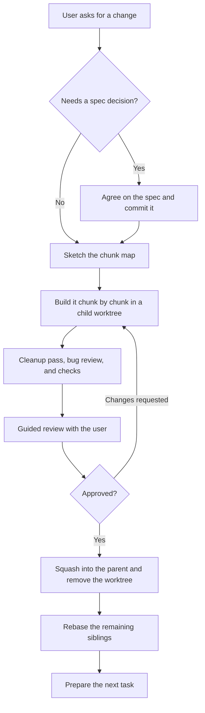

**Why this order:** a decision written in the spec can be reviewed and reused. Code written first tends to become the decision without anyone choosing it. Reviewing the finished change means the user approves exactly what lands.

Details live in reference files: [Git operations](references/git-operations.md) for commands and checks, [Writing specs](references/writing-specs.md), [Code cleanup](references/code-cleanup.md), [Bug review](references/bug-review.md), [Guided review](references/guided-review.md), [Spec and code sync](references/spec-code-sync.md), and [Project setup](references/project-setup.md). [Worked examples](references/worked-examples.md) explains every rule in more detail, with several examples each.

## Words used here

| Word | Meaning | Example |
| --- | --- | --- |
| Change | One piece of work with one name, across every repository it touches | `retained-audio` |
| Change family | That change's branches, one per repository, all with the same full name | `initial-retained-audio` in specs, backend, and frontend |
| Parent, child, sibling | A child branches from its parent and merges back into it. Siblings share a parent | `initial-retained-audio` is a child of `initial` |
| Integration branch | A branch that collects reviewed changes, such as `main` or a release branch. Nobody edits it directly; changes arrive as reviewed squashes | `main`, `001-initial` |
| Checkpoint | A commit that saves unfinished work so another branch can build on it | `initial-retained-audio: Save draft before codec fix` |
| Base | The parent commit where a branch's own work begins. Rebases use it to replay only that branch's commits | the parent SHA recorded when the branch was created |
| Chunk | One behavior or decision, built and reviewed as a unit | "Restore saved audio on reopen" |
| Work record | `WORK_RECORD.md` at the workspace root: the current state of all work | see [Keep one work record](#keep-one-work-record) |
| Cleanup pass | A tidy-up of the change before review that keeps its behavior | removing a helper the change made unused |
| Bug review | A fresh read of the change's code that looks only for bugs, run once before the guided review | `/code-review medium` on the backend change |
| Guided review | A walk through the change with the user, one chunk at a time, before they decide | the review before `initial-retained-audio` merges |
| Test merge | A trial merge of two branches that changes no branch or file. It shows a conflict before the real merge | this change against a paused sibling |

**Why:** several of these used to have two or three names, which made rules easy to misread.

## Before working in a repository

Read the repository's README before working there, and again when you switch worktrees. Follow any agent instruction file the repository already has, such as `AGENTS.md` or `CLAUDE.md`, but don't add one.

**Why:** a repository's own rules belong in its normal documents, where people find them too. For example, a backend's README may require a production-only build check after any dependency change. Rules for every project already live in the user's global instructions and in this skill, so a guide file in each repository would only repeat them, and then drift from them.

Starting a new project, or working in a spec repository that doesn't have the template's layout yet? Read [Project setup](references/project-setup.md) first. It creates the spec repository from a template, plus the workspace files this workflow uses.

## Choose the compatibility mode

The mode decides how a change replaces old behavior.

| Mode | What it does | Why |
| --- | --- | --- |
| Live, the default | Keep supported API and event formats, client behavior, and saved data working. Use transitions, deprecations, and upgrade migrations where needed. Keep the contract and decision history that explains supported versions. | Released clients and real users depend on the old behavior. |
| `--not-live` | Directly replace the specs, contracts, and code that the accepted change clearly supersedes. Update links and retire replaced requirement IDs. Carry the change into models, APIs, storage, callers, and tests. Skip old-client paths and upgrade migrations unless the user asks for them. Keep fresh setup and schema creation reproducible. | Nothing released depends on the old behavior, so compatibility code would only add weight. |

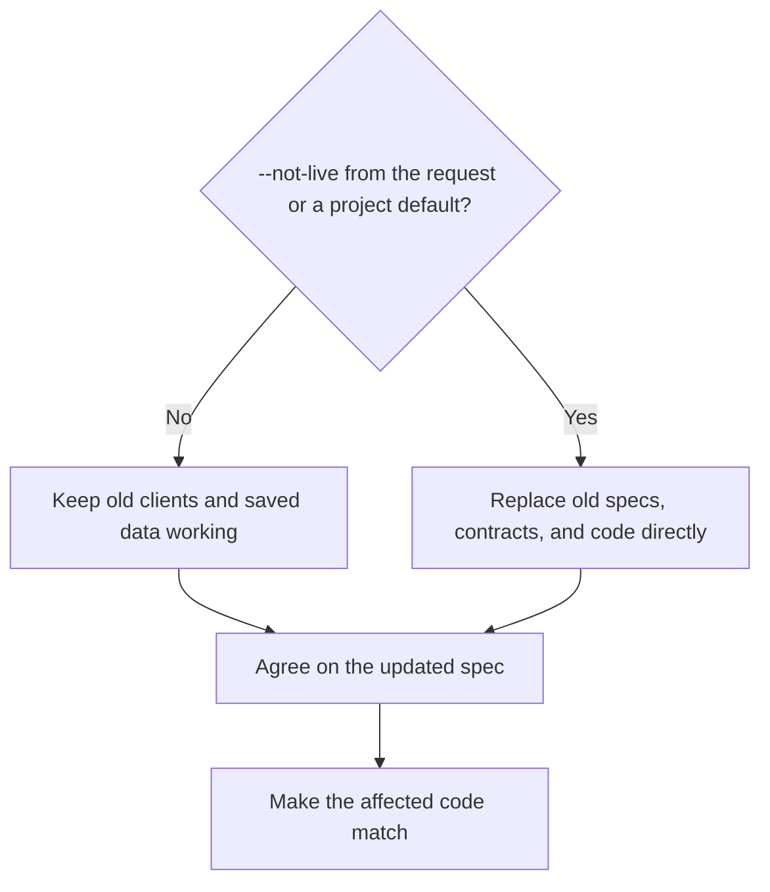

**Where the mode comes from.** The user chooses it: with the flag on the request, or with a standing user or project instruction that sets a default, such as a line in the user's global instructions or in the workspace `AGENTS.md`. Without either, the task is live, even if nothing has been released. Don't guess the mode from hints such as a branch name.

```text
$spec-workflow --not-live <change>     in Codex
/spec-workflow --not-live <change>     in Claude Code
```

These are options in the prompt, not shell commands.

**Keep it for the whole family.** Record the mode and where it came from in the work record, and keep it when resuming. A child or prerequisite keeps its family's mode. A new, unrelated task starts from the default again.

> Example: a storage fix needed by a `--not-live` feature stays `--not-live`. It shouldn't start adding migrations just because it got its own branch.

**Scope.** Both modes bring the accepted spec and the affected code into agreement, within the accepted task. Neither starts a project-wide audit. Honor a narrower request, such as a plan, an audit-only report, or docs-only work.

**What `--not-live` doesn't allow.** It's permission to replace what the accepted change clearly supersedes, nothing more. It doesn't decide unrelated feature removals or settle unclear requirements. It doesn't allow merging without review and approval. Deleting saved data, resetting a database, or removing deployed resources each needs explicit permission for that specific target. Current rules such as retry safety and data retention still apply. If a supported deployed client would break, pause that part and ask.

**Why:** "not live" means no released client depends on the old shape. It doesn't mean the current rules stop mattering.

**Old test data.** A direct replacement can leave records in old shapes in test environments, such as a test phone or a local database. Each change says what happens to them: either the new code skips or clearly rejects old shapes, or the agent proposes resetting a named test environment and waits for the user's OK.

> Example: saved Pause data changes shape, so old Classes on the test phone can't resume. The change either shows those Classes as ended, or proposes "reset the local test database" and waits for a yes.

**Going live.** At the first release, tag the spec repository, for example `release-1`, and change the project default to live. From then on, live mode keeps what that tag defines working.

**Why:** live mode needs to know which formats shipped. Without a tag, "supported versions" has no fixed meaning.

Read [Spec and code sync](references/spec-code-sync.md) when checking or repairing mismatches, including cleanup that a replacement causes. More examples: [Choosing the mode](references/worked-examples.md#choosing-the-mode).

## When to return to specs

Decide whether the request needs a spec decision before any code.

| Change | What to do | Why |
| --- | --- | --- |
| New or unclear behavior, API rule, or shared domain term | Update the spec, glossary, or contract that defines it. Review and commit that decision before writing code that depends on it. | Otherwise the code becomes the decision without anyone choosing it. |
| Build or fix behavior the spec already defines | Use the accepted spec version. No spec edit is needed. | The decision already exists. |
| Local rename, proven dead code, internal restructuring, or a clear internal bug | Code-only work is fine if it needs no new product, contract, or domain decision. | Nothing a user or another system sees changes. |

> Example: renaming a local variable `tmp` to `audioChunk` is code-only. Renaming the domain term Class to Lesson is a spec decision first, because every repository, API, and table uses that word. Aligning code with a term the spec already uses needs no new decision.

Before calling code dead, check supported callers, configuration, contracts, and unfinished work.

**If the spec is missing or unclear,** show the relevant code, link the document that should define it, and propose a small wording change or clear options. Pause code that depends on the decision, including in other branches. Independent, authorized work can continue unless the user paused everything.

**Don't change a spec just to justify existing code.** Keep each requirement in the document that owns it. Keep requirement IDs when only the wording changes. Record deferred work only when agreed.

**Why:** the spec is the decision. If code can rewrite it, nobody decided anything.

**Record why, in the right place.** A choice that crosses features or is hard to reverse gets a decision record in the spec repository, in the form [Writing specs](references/writing-specs.md#decisions) describes. A smaller reason goes in the squash commit message. Under `--not-live`, rewrite a replaced decision to the current one, and add a short "Why we changed" note if the old option might come up again.

> Example: "keep recorded Class audio for replay" affects recording, recovery, history, and storage, so it gets a decision record. "Clear the request timer when headers arrive" is local, so its reason goes in the commit message.

**Why:** people and agents read files, not Git history. A decision record can be linked from every feature it affects. A commit message can only be found by someone who already knows which commit to look at.

More examples: [Deciding whether the spec changes first](references/worked-examples.md#deciding-whether-the-spec-changes-first).

## Write specs for readers

Before writing or revising a spec, read [Writing specs](references/writing-specs.md). In short: easy, concise words with enough detail and plenty of examples; a diagram where it explains the idea; one owner for every fact; and one testable rule per requirement ID, each with an example.

What only one project knows stays in its own documents: the spec repository's README lists its files, and each feature document's header names its requirement ID prefix. [Project setup](references/project-setup.md) creates both from the template.

**Why:** the general rules are the same in every project, so they live once, in this skill. A project's own facts change along with its files, so they live in its repository and change in the same commit.

## Map domain language into code

Use the names agreed in the spec or glossary throughout models, IDs, services, APIs, database mappings, storage, UI models, and tests. Keep each concept's meaning, relationships, and rules as well as its name.

Choose familiar, concrete words for new concepts. If two names are equally accurate, use the easier one. Explain necessary specialist terms in the spec or glossary. Keep different concepts distinct. Agree on any change to an existing term in the spec before renaming it in code.

For example, a spec concept named **Class** could map to:

| Spec term | Code and APIs | Storage |
| --- | --- | --- |
| Class | `Class`, `ClassId`, `ClassRepository`, `ClassDto`, `classId` | ORM entity `Class`, table or collection `classes` |

Casing, plural forms, namespaces, and suffixes can follow project conventions. Don't introduce `Course` or `Session` as unexplained names for the same Class. Keep those names when the spec defines them as different concepts.

**Why:** when the spec says Class and the code says Course, every reader has to translate, and over time the two words drift into two meanings.

For concepts the change touches, add a small mapping when useful: term → code symbol and path → API or storage name, with key relationships. Put it where the spec repository keeps its domain terms, such as a glossary or the `architecture/domain-model.md` file from the [setup template](references/project-setup.md). Explain differences required by a language, framework, third party, or older supported version.

Link to the existing definition instead of making another catalog. A noun doesn't always need its own entity or table. Avoid broad schema renames just to make spelling uniform. Scope any needed compatibility or migration work explicitly.

## Where should a worktree go?

### Choose the parent

Choose the parent from what the new work depends on and where its result should land. The worktree used last is a candidate, not the default: recent use, shared files, or a similar topic alone don't make a branch the right parent. Before choosing a branch with unfinished work as the parent, check what that work is, so the child doesn't inherit unrelated changes. A sibling usually starts from an integration branch such as `001-initial`, and a new root change starts from `main`. Explain the choice before creating anything, and record it in the work record. If the task and parent are already clear and authorized, no extra approval is needed.

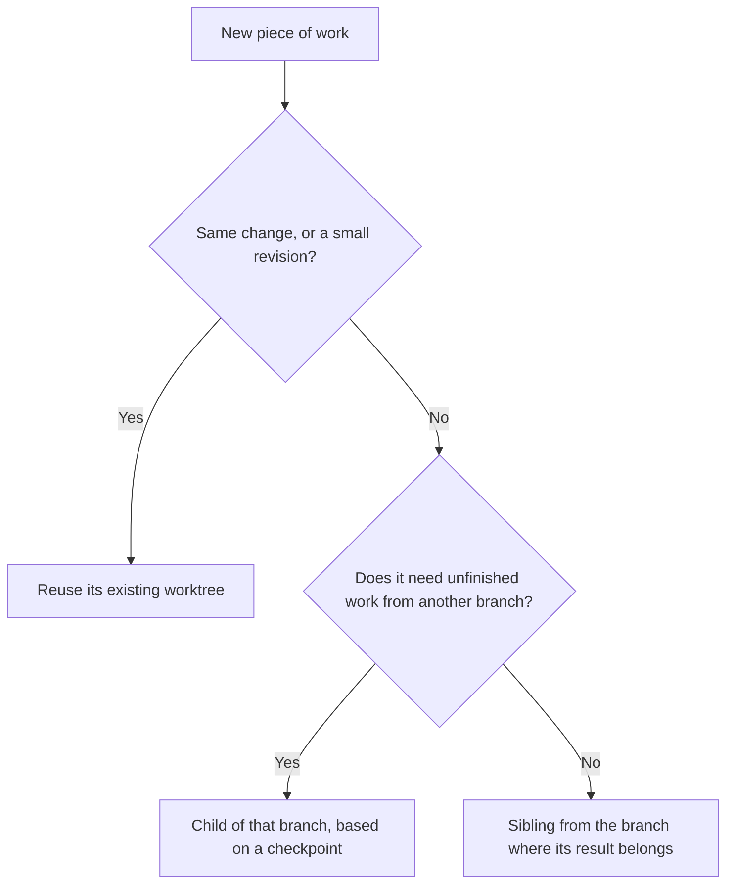

**Why:** a child inherits all of its parent's unfinished work and can't reach the integration branch before its parent does. Putting unrelated work under a busy branch ties their timelines together.

> Example: `initial-retained-audio` is active.
>
> 1. A codec fix that changes the new audio code becomes a child, `initial-retained-audio-codec-fix`.
> 2. A storage fix the audio work needs, but that doesn't touch the audio code, becomes a sibling, `initial-storage-fix`. The audio work waits, then rebases onto `initial` after the fix merges.
> 3. Unrelated profile settings become another sibling, `initial-profile-settings`. Work for a different release starts from that release's integration branch.

**Re-check before review.** Before the cleanup pass, ask again: does the change still need its parent's unfinished work, and does its result still belong there? If not, move it to the right parent first, as described in [If the actual parent changes](references/git-operations.md#if-the-actual-parent-changes).

> Example: `initial-retained-audio-codec-fix` ended up only changing a shared helper. It moves to `initial-codec-fix` under `initial`, so it can merge without waiting for the audio work.

**Why:** work drifts while it's built. Checking once more before review is cheaper than untangling it after the merge.

More examples: [Choosing a parent](references/worked-examples.md#choosing-a-parent).

### Name the branch and folder

The root branch uses `<change>`. Each child adds `-<change>` to its parent's full name. Every repository in the family uses the same full name. Worktree folders sit side by side as `<repo>-<full-branch-name>`:

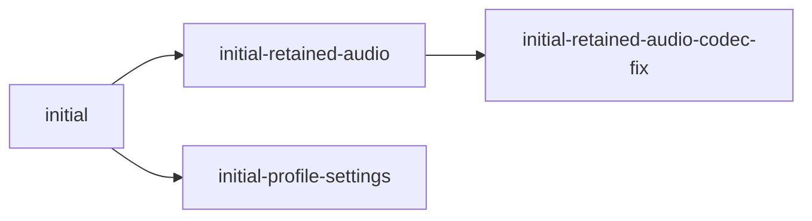

```text
workspace/
  specs-initial/
  backend-initial/
  specs-initial-retained-audio/
  backend-initial-retained-audio/
  frontend-initial-retained-audio/
```

**Why:** the name shows the lineage at a glance, and the same name in every repository shows which worktrees belong together. Flat folders keep paths short.

Existing prefixes such as `001-initial` stay in the name. New roots need no number or category. A code-only change needs no empty spec branch; record why the other repositories are unaffected.

Names help you find things, but they never decide merge or rebase targets. Record exact repository paths, branches, parents, and parent SHAs in the work record. Priority changes and new parent commits don't change names. If the actual parent changes, rename the family across its repositories before more review or merge.

### Write commit subjects

On change branches, a commit subject starts with the full change branch name.

| Commit | Subject |
| --- | --- |
| Work or checkpoint on a change branch | `001-initial-class-recovery: Save recovery draft` |
| Squash of a child into its parent change branch | The child's name, even though it lands on the parent: `001-initial-class-recovery: Add recovery rules` on `001-initial` |
| Commit made directly on a parent change branch, such as a checkpoint | The parent's own name: `001-initial-class-recovery: Save draft before codec fix` |
| Squash into `main` | A plain subject with no prefix |

Don't use the repository or folder name as the prefix. The squash commit body says what changed and why, in a few lines.

**Why:** after squashing, the prefix is what tells you which change a commit came from.

### Set up and keep branches clean

After creating a worktree, copy the parent's `.env` when present and add the worktree to the root `.code-workspace` file, following [Git operations](references/git-operations.md#prepare-or-branch).

Keep integration branches, including `main`, clean outside merges. Make spec and code edits in short-lived child worktrees.

**Why:** then every commit on an integration branch is a reviewed squash, and a bad change can be reverted in one step.

## Plan the chunks

Before building, sketch a **chunk map**: the pieces of behavior the change adds, in the order you'll build them. For each chunk, name its behavior, its requirement IDs when the spec has them, and the repositories it touches. Mark the riskiest chunk, and build it as early as its dependencies allow. Keep the map in the work record, and share it when building starts. The user can reorder or split it; wait for their OK only if they asked to approve plans first. While building, keep the map current with the same marks the [guided review](references/guided-review.md#one-chunk-then-a-pause) uses: ✓ built, ▶ being built, ○ planned.

**Why:**

- Building in a planned order gives the user a path they can follow, instead of a finished change they see all at once.
- The review later starts from a map the user has already seen, so its chunks make sense.
- An early look at the riskiest chunk catches a wrong direction before the rest is built on top of it.

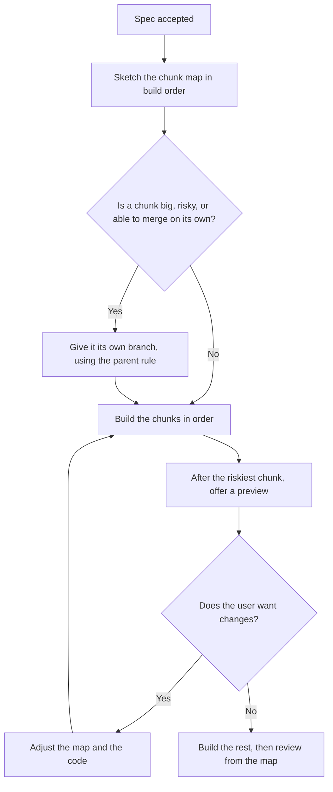

For example, the chunk map for `initial-class-recovery`:

```text
○ Save audio during a Class          REC-010, REC-011   backend             riskiest: saved format
○ Restore saved audio on reopen      REC-012            backend, frontend
○ Offer a retry when loading fails   REC-013            frontend
```

After chunk 1 is built and its tests pass: "Saving audio is ready for a quick look before I build restore and retry. Want a preview?"

- **Split what doesn't fit.** A chunk that is big, risky, or useful on its own becomes its own branch, placed by the [parent rule](#choose-the-parent), with its own review and squash. For example, if the saved audio format is still uncertain, chunk 1 becomes a child branch, so restore and retry build on a settled format.
- **Preview, don't approve.** After the riskiest chunk is built and its checks pass, offer a preview: a [guided review](references/guided-review.md) of that chunk, in this same conversation. A preview is only a look: it approves nothing, and the final review still covers the whole change. Wait for the answer before building on top of that chunk; work that doesn't depend on it can go on. If the user declines, keep building. If the riskiest chunk got its own branch, that branch's own review replaces the preview.
- **Keep the map current.** When building shows the plan was wrong, because a chunk merges into another, splits, or a new one appears, update the map in the work record. The review starts from the final map and says how it differs from the plan, and why.

More examples: [Planning chunks](references/worked-examples.md#planning-chunks).

## What if work is interrupted?

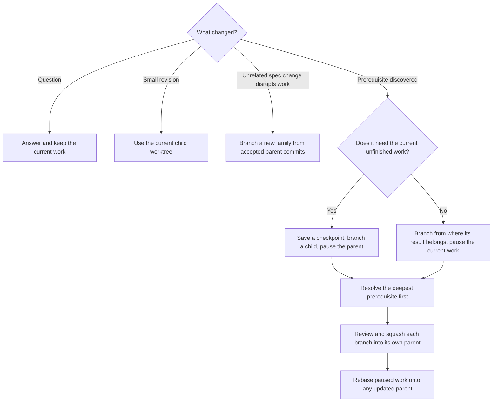

A checkpoint saves unfinished work so a prerequisite can build on it. **Why:** uncommitted files don't appear in a new worktree, and a commit keeps them safe. Reviewing the child approves only what it changes relative to that checkpoint, not the unfinished work it inherited.

If several branches share a prerequisite, or depend on each other in a cycle, settle where the work belongs before continuing. Don't merge across siblings or skip parents to get around that decision.

More examples: [Handling interruptions](references/worked-examples.md#handling-interruptions).

## Clean up code before merging

Run the [cleanup pass](references/code-cleanup.md) before every merge in this workflow: child into parent, code-only changes, and the final merge into `main` or another release destination. Run it before the final review starts.

**Why:** cleanup after approval would change what the user approved. Running it first means the review sees the final code.

Scope the pass to the change's diff against its immediate parent, plus affected callers and tests. For a final release, use the whole diff against the destination. Keep the accepted behavior and domain terms, and leave unrelated code and inherited unfinished work alone.

A pass may make no edits. For docs-only or verified unaffected repositories, assess the scope and record that no code cleanup applies. Don't invent edits or empty commits.

> Example: the change made a helper `saveTmp` unused. The pass removes it and reruns the tests. The removal then appears in the review, inside the chunk that stopped using the helper.

Cleanup edits go in the worktree that owns the change. If the pass finds a behavior bug or an unclear requirement, route it through the spec or implementation steps first. [Code cleanup](references/code-cleanup.md) covers cleanup on an integration branch, what to record, and when a pass must run again. More examples: [The cleanup pass](references/worked-examples.md#the-cleanup-pass).

## Find bugs before review

After the cleanup pass, run one [bug review](references/bug-review.md) of each repository's code change, such as `/code-review medium` in Claude Code. Fix confirmed bugs with a test before the review starts, then re-review only the fixed files, once. If the same code breaks again, stop and ask the user instead of patching it again. Attach each plausible issue to the chunk it belongs to, with a suggested change, for the user to decide. Skip docs-only repositories and record why.

**Why:** the agent that built the change also explains it, so it tends to defend its own choices. A bug review reads the code fresh, and nothing else here hunts for bugs: the cleanup pass may not change behavior, and tests only catch what they test. One run on the whole change, before the review, also catches bugs that cross chunks, and the code doesn't change while the user reviews it. The limit on reruns stops fixing and reviewing from looping: when the same code keeps breaking, its design needs another look, not another patch.

More examples: [Bug review](references/worked-examples.md#bug-review).

## Review and merge

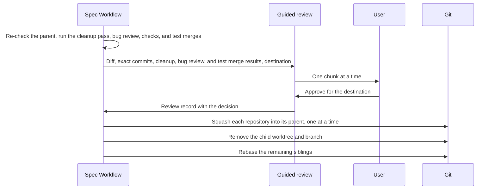

1. **Spec first.** For a change with specs and code, accept the spec on its child branch first, and record that spec commit for each code repository. Accepting a spec allows building; it doesn't approve the code or the merge. **Why:** the code review then checks code against a fixed spec version.
2. **Every repository is ready.** Each required repository is current, tested, and approved, or has evidence that it's unaffected. When the spec repository asks tests to cite requirement IDs, each rule the change adds or alters needs a test that names its ID.
3. **Re-check the parent and run the cleanup pass** for the proposed scope, before the final review.
4. **Run the bug review,** as described in [Find bugs before review](#find-bugs-before-review).
5. **Test-merge with the other open branches,** as described in [Check for conflicts before review](#check-for-conflicts-before-review).
6. **Review.** Run the [guided review](references/guided-review.md) in this conversation, from the repositories, the exact parent, head, and spec commits, the cleanup, bug review, and test merge results, the chunk map, and the destination. Reuse a review only while its approval still matches those inputs. **Why:** approval covers exact commits. If they change, nobody approved the new ones.
7. **Squash** each child into its immediate parent as one commit, including the final release merge, following [Git operations](references/git-operations.md). **Why:** the parent's history then shows one reviewed commit per change.
8. **Children first.** A parent can merge into its own parent, or be removed, only after all its children are resolved and removed, at every depth.
9. **Rebase the survivors,** as described in [Rebase after a merge](#rebase-after-a-merge).

### Check for conflicts before review

Before the review, test-merge the change with every open branch that will be rebased after it merges: its siblings and their children, in each repository the change touches. Include paused branches and branches in review. Take the list from the work record and Git, not from branch names alone. A test merge changes no branch, index, or working tree; [Git operations](references/git-operations.md#test-merge-with-open-branches) has the command.

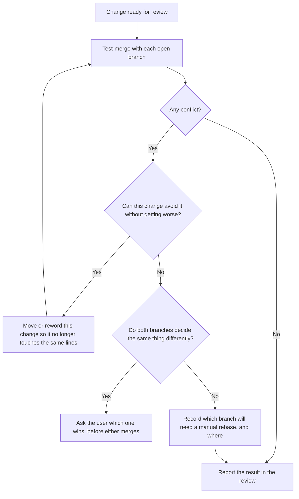

**Why:** a conflict found now costs a small edit while this change is still open. Found later, it lands on whoever rebases the other branch, often a paused branch whose context is gone.

Adjust only when the result reads and works as well as before, such as a new README section or list entry that can sit elsewhere. Don't make this change worse to spare another branch. Conflicts that a branch also has with the parent alone aren't caused by this change: record them for that branch's rebase, and leave this change as it is.

> Example: this change adds a "Production build check" section to the backend README, right before "Class issue decisions". The paused `initial-production-config` adds a "Production release" section in the same spot, so the test merge reports a conflict in `README.md`. Moving the new section to the end of the README keeps it as easy to find, and the next test merge is clean.

More examples: [Test merges before review](references/worked-examples.md#test-merges-before-review).

### Rebase after a merge

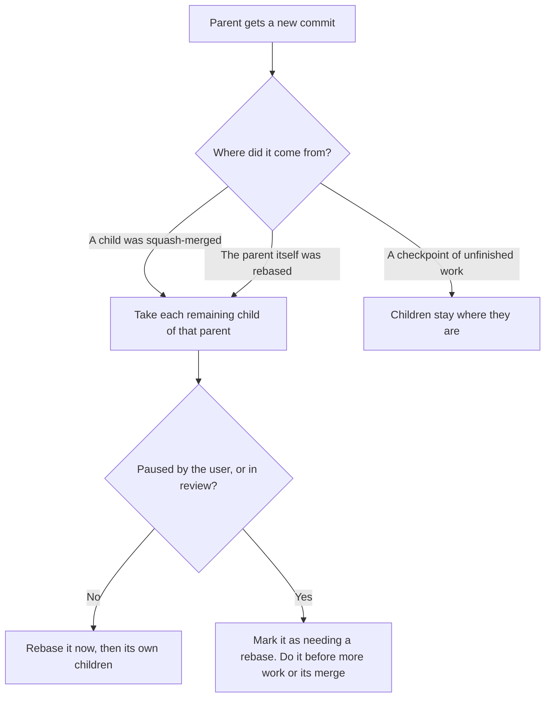

For example, after `initial-storage-fix` is squash-merged into `initial`:

```text
initial                                   ← the squash lands here
├── initial-storage-fix                   merged, then removed
├── initial-retained-audio                rebased now
│   └── initial-retained-audio-codec-fix  rebased right after its parent
└── initial-profile-settings              paused by the user: marked, rebased later
```

Only repositories where the parent changed are rebased. Record the needed rebase in the work record for any branch that waits.

**Why:**

- Siblings should build on what is really in the parent now, and rebasing soon surfaces conflicts while the context is fresh.
- A paused branch should stay as the user left it, and a review shouldn't shift in the middle of a chunk.
- A checkpoint is unfinished work, and siblings shouldn't pick it up.

A clean rebase doesn't prove the code still matches the spec. Check changed requirements, APIs, and callers separately. Adapt code within accepted decisions and test it. If a conflict needs a new decision, leave that work blocked and explain the decision needed.

### Finish the family and the release

Repositories merge one at a time. Record each success so a retry skips it. The family is complete only when every required merge or no-change check, worktree removal, and sibling rebase is done.

Keep an integration branch until its planned changes are done or the user changes the scope. The final release needs its own approval and verified results on every required destination branch. Record each change's name and result SHAs in the work history. Deployment and publication are separate actions.

More examples: [Review and merge](references/worked-examples.md#review-and-merge) and [Rebasing after a merge](references/worked-examples.md#rebasing-after-a-merge).

## Which task comes next?

After an interruption, review decision, merge, cleanup, rebase, failure, or resumed session, compare the work record with Git.

A question doesn't count. Answer it from the work record and Git, keep the current work and review position, and change nothing. For a status question, say where things stand, for example "review paused at chunk 2 of 5 in `backend-initial-retained-audio`".

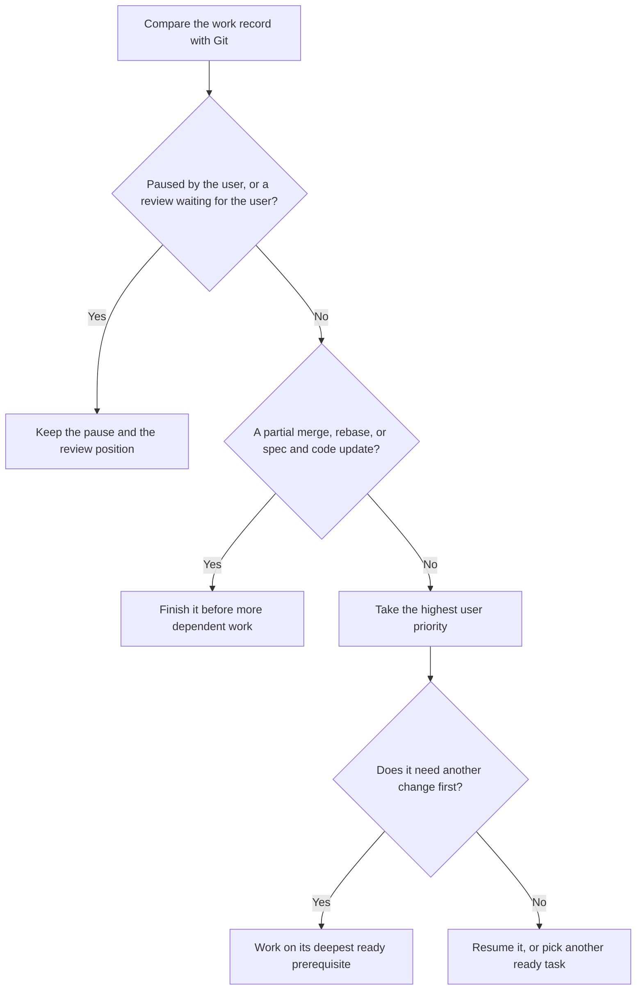

1. Honor an explicit pause or a review waiting for the user. Save the review position if it's interrupted or its inputs change.
2. Finish any repairable partial merge, rebase, or spec and code update before more dependent work. If it's blocked, consider only unaffected, authorized tasks. **Why:** a half-finished merge or rebase blocks everything that depends on it.
3. Follow the user's highest priority, and work on its deepest ready prerequisite first. **Why:** that unblocks the priority soonest.
4. Resume interrupted work when it's ready; otherwise choose another ready task. Break ties by what unblocks the release, then by context already loaded, then by a stable order. Branch names and discovery dates alone don't set priority.

Prepare that worktree. **Every next-task summary MUST include:**

- **What:** the specific change or problem and the result we want. A branch name or task label alone is not enough.
- **Why next:** the priority, prerequisite, or unfinished operation that makes this the next action, and what it unblocks.
- **Example:** at least one concrete scenario showing the current and intended behavior. For review or Git tasks, show what the action means for the affected changes. Ground examples in the checked specs and code; clearly label hypothetical examples and unknown behavior.
- **Next action:** the immediate step and how we will know it is done. State any decision needed from the user.

Put the **change name, worktree folder name, repository, branch, and absolute worktree path** after that explanation. Open the relevant file or diff when possible.

Hypothetical handoff:

> **What:** Make reopening a Class restore its saved audio.
>
> **Why next:** Class recovery is your highest priority, and its storage fix has merged. We can now finish recovery.
>
> **Example:** Record a minute, close the app, then reopen the Class. Today the recording is missing; the accepted spec says that saved minute should be available.
>
> **Next action:** Check where reopening loses the saved recording, fix that step, and run a test that closes and reopens the Class.

Use the actual task's facts in the handoff. Give as many examples as it takes to make the task clear, and never omit them. Continue coding only within the user's authorization; otherwise leave the worktree ready. Don't ask what comes next when recorded priorities already answer it.

Independent work can use many worktrees. Coordinate who writes to each one, and keep one review conversation active with the user.

More examples: [Picking the next task](references/worked-examples.md#picking-the-next-task).

## Keep one work record

Keep the current state of all work in `WORK_RECORD.md` at the workspace root, outside every repository. Start it from [the work record template](assets/work-record.md). Each entry holds the change's names and paths; its parent and why; what it depends on; its mode; what the user has authorized; the accepted spec commit and whether spec and code agree; per-repository commits, including checkpoints and merge progress; the chunk map; cleanup and review state; recovery refs; blockers; and the next action.

**Why:** the next-task choice starts by reading this file, so it must stay short and current. A long log makes the agent guess which entry is current.

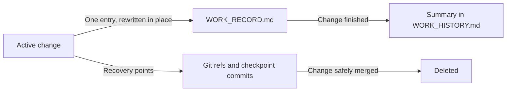

- Give each active change one entry. When its state changes, rewrite the entry instead of adding a new one.
- When a change is finished, move a short summary to `WORK_HISTORY.md` and delete its entry: its name, destination, each repository's squash SHA, the date, and when its recovery refs were deleted. Read the history only when you need an old detail.
- Keep recovery points in Git, as refs under `refs/recovery/` and checkpoint commits, and list them in the entry. Don't copy files into a separate folder. [Keep recovery data in Git](references/git-operations.md#keep-recovery-data-in-git) says what to save and when it can go.

If the workspace has only an older log, such as `COMMIT_REVIEW_QUEUE.md`, leave it unchanged as history. The first time you need the record, build `WORK_RECORD.md` from Git and the log's most recent entries, which may not be in date order. Tell the user you did this.

More examples: [The work record](references/worked-examples.md#the-work-record).

## Check accumulated differences when asked

Normal work only updates the code affected by the accepted change. A project-wide comparison runs only when the user asks for an audit or a broader sync. It checks both ways: code with no spec, and specs with no working code. Read [Spec and code sync](references/spec-code-sync.md). `--not-live` doesn't widen the scope.

## Stay within the request

Questions and plans are read-only. Authorized workflow work includes scoped setup, checkpoints, required rebases, code changes within accepted decisions, work record updates, and preparing the next worktree.

Merges, new product decisions, and external actions need their own authorization. Reuse authorization already given for the same action and scope.

**Why:** the user should never find a merge or a decision they didn't make.
