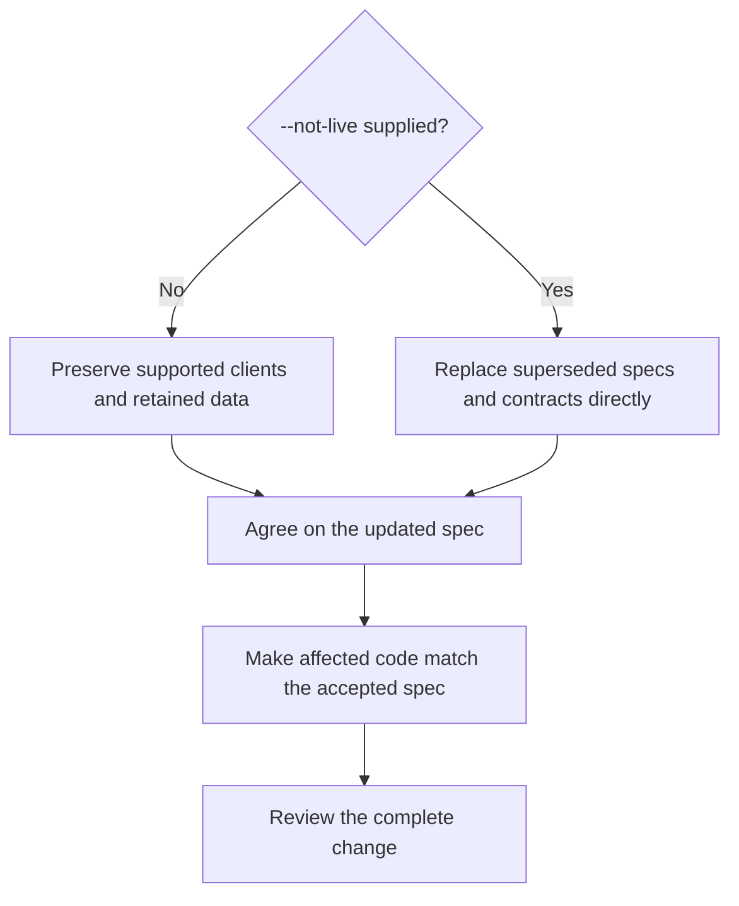
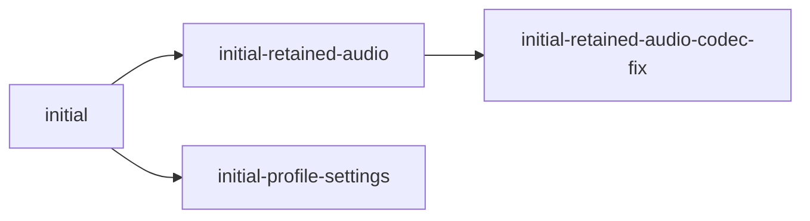
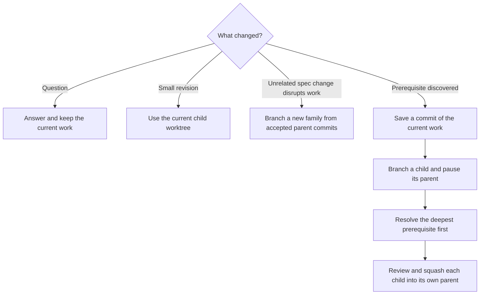

# Spec Workflow

Keep specs and code in agreement. Save interrupted work and prepare the next worktree for the user.

1. Agree on and commit any needed spec edits.
2. Build the matching code.
3. Clean up the proposed changes and check the result.
4. Review the complete change together.
5. When approved, squash it into the parent.
6. Remove completed worktrees and rebase siblings and their children.
7. Prepare the next task.

This skill chooses what to do next and includes code cleanup. [Git operations](references/git-operations.md) explains the commands and checks. [Guided Code Review](../guided-code-review/SKILL.md) handles the review conversation.

Read each repository or worktree's `CONTRIBUTING.md`, when present, before working there. Repeat this when switching worktrees.

## Choose the compatibility mode

Use `--not-live` directly on Spec Workflow when the task has no released-client compatibility requirement:

```text
$spec-workflow <change>
$spec-workflow --not-live <change>
```

These are prompt options, not shell commands. Without the flag, treat the task as live even if the project is known to be before its first release.



| Mode | What it means |
| --- | --- |
| Default: live | Keep supported API/event formats, data, and client behavior compatible. Keep the contract and decision history needed to explain supported versions. Use transitions, deprecation plans, and upgrade migrations where needed. |
| `--not-live` | Revise or remove documents and contracts clearly superseded by the accepted change. Update links and retire replaced requirement IDs. Carry that change into models, APIs, storage, callers, and tests. Replace old definitions directly without old-client paths or upgrade migrations unless the user requires them. Keep fresh setup and schema creation reproducible. |

Both modes bring accepted spec changes and affected code into agreement. The flag includes that implementation within the accepted task's scope; it does not start an unrelated whole-project audit. Honor a narrower request such as planning, audit-only, or docs-only work.

Record the chosen mode and scope in the work record and keep them when resuming that task. The next task defaults to live again. `--not-live` is permission to replace clearly superseded definitions, not to decide unrelated feature removals or resolve unclear requirements. It does not authorize deleting retained data, resetting a database, or merging without the normal review and approval.

Read [Spec and code sync](references/spec-code-sync.md) when checking or repairing mismatches, including cleanup caused by a replacement.

## When to return to specs

Decide whether the requested change needs a spec decision before writing code.

| Change | What to do |
| --- | --- |
| New or unclear behavior, API rule, or shared domain term | Update the spec, glossary, or contract that defines it. Review and commit that decision before writing dependent code. |
| Build or fix behavior the spec already defines | Use the accepted spec version. No new spec edit is needed. |
| Local rename, proven dead code, internal restructuring, or an established internal bug | Code-only work is allowed if it needs no new product, contract, or domain decision. |

A local variable rename differs from renaming a shared domain concept. Aligning code with an existing spec term needs no new naming decision. Before calling code dead, check supported callers, configuration, contracts, and unfinished work.

If a spec is missing or unclear, show the relevant code, link the document that should define it, and propose a small wording change or clear options. Pause code that depends on that decision, including work in other affected branches. Independent, authorized cleanup may continue unless the user paused everything.

Do not change a spec just to justify existing code. Keep each requirement in the document that defines it. Preserve requirement IDs during wording changes, and record deferred work only when agreed.

## Write specs for readers

When writing or revising a spec, use familiar words and short sentences. Start with what the user sees or can do. Put distinct rules, conditions, and outcomes in separate bullets or short paragraphs. Use agreed domain terms consistently and explain unfamiliar terms.

Use a focused Mermaid diagram to clarify a workflow, sequence, state change, data flow, or relationship. Give actions and decisions simple labels. Keep exact, testable requirements in nearby prose and make sure the diagram agrees with them. Preserve the document's structure and requirement IDs. Before finishing, simplify any sentence that needs a second read.

## Map domain language into code

Use the names agreed in the spec or glossary throughout models, IDs, services, APIs, database mappings, storage, UI models, and tests. Preserve each concept's meaning, relationships, and rules as well as its name.

Choose familiar, concrete words for new concepts. If two names are equally accurate, use the easier one. Explain necessary specialist terms in the spec or glossary. Keep different concepts distinct. Agree on any change to an existing term in the spec before renaming it in code.

For example, a spec concept named **Class** could map to:

| Spec term | Code and APIs | Storage |
| --- | --- | --- |
| Class | `Class`, `ClassId`, `ClassRepository`, `ClassDto`, `classId` | ORM entity `Class`, table or collection `classes` |

Normal casing, plural forms, namespaces, and suffixes can follow project conventions. Do not introduce `Course` or `Session` as unexplained names for the same Class. Keep those names when the spec defines them as different concepts.

For concepts touched by the change, add a small mapping to the owning spec or glossary when useful: term → code symbol and path → API or storage name. Include key relationships. Explain differences required by a language, framework, third party, or older supported version.

Link to the existing definition instead of making another catalog. A noun does not always need its own entity or table. Avoid broad schema renames just to make spelling uniform. Explicitly scope any needed compatibility or migration work.

## Where should a worktree go?

A **change family** is one change across all relevant repositories. Each repository uses the same full branch name. A **parent** is the branch a child will merge back into; a **sibling** is another child of that parent.

Before creating a worktree, choose its parent from the new change's dependencies and intended merge destination. Compare it with the last active change; recent use, shared files, or a similar topic alone do not make that worktree the right parent. Reuse an existing worktree when continuing the same change. Follow the [parent selection steps](references/git-operations.md#prepare-or-branch), record the reason, and explain the choice in the handoff before creating anything.

Build the branch name from its ancestors, called its **lineage**:



The root uses `<change>`. Each child appends `-<change>` to its parent's full name. Keep worktree folders beside one another as `<repo>-<full-branch-name>`:

```text
workspace/
  specs-initial/
  backend-initial/
  specs-initial-retained-audio/
  backend-initial-retained-audio/
  frontend-initial-retained-audio/
```

Existing prefixes such as `001-initial` stay in the name. New roots need no category tag or number. A code-only change needs no empty spec branch; record why other repositories are unaffected.

On change branches, commit subjects start with the full change branch name, then a short description, for example `001-initial-class-recovery: Save recovery draft`. Do not use the repository or worktree folder name as the subject prefix. When squashing a child into a parent change branch, keep the child's full change name in the squash subject, even though the commit lands on the parent. Commits made directly on the parent use the parent branch name. For a merge into `main`, use a plain descriptive subject without a branch or repository prefix.

Record exact repository paths, branches, parent branches, and parent commit IDs (SHAs). Names help navigation, but never determine merge or rebase targets by splitting a name.

Priority changes and new parent commits do not change names. If the actual parent changes, rename the family across its repositories before further review or merge. Follow [Git operations](references/git-operations.md#prepare-or-branch), including VS Code workspace updates.

After creating a worktree, copy its parent's `.env` when present, then add the worktree to the existing root `.code-workspace` file and sort its folder paths. Follow the setup steps in that reference.

Keep main and branches used to collect reviewed changes clean outside merge operations. Make spec and code edits in short-lived child worktrees.

## What if work is interrupted?



A saved commit, or **checkpoint**, preserves unfinished work so a prerequisite can build on it. Reviewing the child approves only what it changes relative to that parent commit. It does not approve the unfinished work it inherited.

If several branches share a prerequisite, or depend on each other in a cycle, settle where the work belongs before continuing. Do not merge across siblings or skip parents to bypass that decision.

## Clean up code before merging

Read [Code cleanup](references/code-cleanup.md) and run that pass before every merge through this workflow. This includes child-to-parent merges, code-only changes, and the final merge into main or another release destination. Run it before freezing the final guided-review inputs.

Scope the pass to the proposed diff against the immediate parent, plus affected callers and tests. For a final release, use its complete diff against the destination. Preserve the accepted behavior and domain terms. Avoid unrelated refactors or inherited unfinished work. Under `--not-live`, the accepted replacement remains the target while cleanup removes its already-approved leftovers.

A pass may make no edits. For docs-only or verified unaffected repositories, assess the scope and record that no code cleanup applies. Do not manufacture edits or empty commits. Record each repository's parent/head/spec SHAs, scope, outcome, and checks in the existing work record.

Make cleanup edits in the short-lived worktree that owns the change. If the release source collects reviewed changes, create or reuse a cleanup child of that source branch. Review and squash it into that parent, clean up the child, and update siblings through the normal workflow. Then reassess the release at its new source commit before the final review.

If cleanup makes edits, check them, capture the updated candidate, and include them in guided review. Changes after approval invalidate affected approvals. If it finds an unclear requirement or a behavior defect, route that issue through the spec or implementation workflow before continuing.

At merge time, verify that the cleanup result still covers the candidate. Changed content, bases, spec inputs, or a wider merge scope require a fresh assessment of the affected work. Reuse unchanged check evidence where valid. Expected source-to-squash SHA changes with verified identical approved content do not require duplicate passes. If required checks remain unresolved, hold the affected merge and report the limitation.

## When can we merge and clean up?

1. For a change involving specs and code, accept the spec on its child branch first. Record that exact spec commit in each code repository's work record.
2. Before merging, check every required repository. Its change must be current, tested, and covered by approval, or have evidence that it is unaffected. Accepting a spec allows dependent implementation within scope; it does not approve the code or the merge.
3. Complete the [cleanup pass](#clean-up-code-before-merging) for the proposed scope before the final review.
4. Load [Guided Code Review](../guided-code-review/SKILL.md) in this conversation. Pass the repositories, cleanup result, exact parent/head/spec commits, and destination. Reuse a review only while its approval still covers those inputs.
5. Squash each child into its immediate parent as one commit. This also applies to the final release merge. Follow [Git operations](references/git-operations.md) for setup, checkpoints, merges, rebases, and worktree cleanup.
6. A parent can return to its own parent, or be removed, only after all its children are resolved and cleaned up. This rule applies at every depth.
7. After a child merges and is cleaned up, rebase every remaining sibling, then its children, onto their updated immediate parents. Check the results before another dependent merge.

A clean rebase does not prove the code still matches the spec. Check changed requirements, APIs, and callers separately. Adapt code within accepted decisions and test it. If a conflict needs a new decision, leave the affected work blocked and explain the decision needed.

Repositories merge one at a time. Record each success so a retry does not repeat it. The family is complete only when all required merges or no-change checks, child cleanup, and sibling updates are done.

Keep a branch that collects a release until its planned changes are done or the user changes the scope. The final release needs separate approval and verified results on every required destination branch. Keep shared change names and result SHAs in the release record after squash and cleanup. Deployment and publication are separate actions.

## Which task comes next?

After an interruption, review decision, merge, cleanup, rebase, failure, or resumed session, compare the work record with Git. Choose the next action in this order:

1. Honor an explicit pause or a review waiting for the user. Save the review position if it is interrupted or its inputs change.
2. Finish any repairable partial merge, rebase, or spec/code update before more dependent work. If blocked, consider only unaffected, authorized tasks.
3. Follow the user's highest priority. Work on its deepest ready prerequisite first.
4. Resume interrupted work when ready; otherwise choose another ready task. Break ties by what unblocks the release, context already available, then a stable order. Branch names and discovery dates alone do not set priority.

Prepare that worktree. **Every next-task summary MUST include:**

- **What:** the specific change or problem and the result we want. A branch name or task label alone is not enough.
- **Why next:** the priority, prerequisite, or unfinished operation that makes this the next action, and what it unblocks.
- **Example:** at least one concrete scenario showing the current and intended behavior. For review or Git tasks, show what the action means for the affected changes. Ground examples in the checked specs and code; clearly label hypothetical examples and unknown behavior.
- **Next action:** the immediate step and how we will know it is done. State any decision needed from the user.

Put the **change name, worktree folder name, repository, branch, and absolute worktree path** after that explanation. Open the relevant file or diff when possible.

Hypothetical handoff:

> **What:** Make reopening a Class restore its saved audio.
>
> **Why next:** Class recovery is your highest priority, and its storage fix has merged. We can now finish recovery.
>
> **Example:** Record a minute, close the app, then reopen the Class. Today the recording is missing; the accepted spec says that saved minute should be available.
>
> **Next action:** Check where reopening loses the saved recording, fix that step, and run a test that closes and reopens the Class.

Use the actual task's facts in the handoff. Keep the example short, but never omit it. Continue coding only within the user's authorization; otherwise leave the worktree ready. Do not ask what comes next when recorded priorities already answer it.

Independent work can use many worktrees. Coordinate who writes to each one, and keep one review conversation active with the user.

## Keep one work record

Use the existing workspace ledger, normally `COMMIT_REVIEW_QUEUE.md`. A ledger is the current work record. Keep it outside the specs and implementation commits.

| Record | What to keep |
| --- | --- |
| Work map | Shared names, repositories and paths, parents and reasons for choosing them, dependencies, priorities, interrupted work to resume, required and unaffected repositories |
| Versions and recovery | Parent/base/head/spec SHAs, saved tips and old replay boundaries, checkpoints, original-to-squash commit mappings, completed merge or rebase steps |
| Progress | Every child, each repository's state, spec/code agreement, cleanup scope/result/input SHAs and checks, family and release completion, exact blockers |
| Review and next task | [Review record](../guided-code-review/SKILL.md#review-record), current review position, authorized action, next worktree and reason |

The old replay boundary is the saved parent commit that separates inherited work from a child's own commits. Keep it before any history rewrite; [Git operations](references/git-operations.md) uses it to avoid replaying work twice.

## Choose agents and reasoning effort

Keep coordination, interactive review, user decisions, and the work record in the main conversation. The user controls its model and thinking level in the picker. The table below supplies defaults for delegated jobs:

| Job | Default model | Thinking |
| --- | --- | --- |
| Write specs from accepted decisions | `gpt-6.1-sol` | Medium |
| Resolve domain or requirement decisions | `gpt-6-astra` | High |
| Implement code | `gpt-6.1-sol` | High |
| Clean up code before integration | `gpt-6.1-sol` | High |
| Analyze a diff for guided review | `gpt-6.1-sol` | High |
| Perform a clean, approved integration | `gpt-6.1-sol` | Medium |
| Investigate conflicts or recover interrupted operations | `gpt-6.1-sol` | High |
| Process substantial batches of simple lookups | `gpt-6-luna` | High |

Apply this routing automatically within the authorized task:

1. **Respect explicit choices.** User and project model/effort choices override the defaults. A custom agent can pin these settings; use a role whose settings agree with the selected choice.
2. **Reuse useful context.** Handle small jobs in the current agent when it already has the needed context. Delegate substantial, separate jobs when a worker helps, or when project instructions require it. Keep one analysis worker through a review when possible; each extra agent adds context and token cost.
3. **Select settings when starting the worker.** Pass the model ID and reasoning effort explicitly, using `low`, `medium`, `high`, or `xhigh` for the corresponding levels. Give it the relevant repositories, accepted spec commit, worktree scope, decisions, and limits on what it may do. Use a focused handoff rather than a full-history fork so the selected settings can apply. Review-analysis workers inspect and report; the main conversation handles the walkthrough and approval.
4. **Reclassify when the job changes.** Unexpected conflicts, dirty state, changed commits, or stale approval turn a clean integration into an investigation. Increase effort or use Astra when difficult reasoning remains unresolved. This changes the worker choice, not permission to merge, change requirements, or remove work. Verify the result before continuing.

Use the effort guide to adjust these defaults to the actual difficulty:

| Reasoning effort | Use when |
| --- | --- |
| Low | A small, repeatable lookup has an objective answer |
| Medium | The scope and expected result are clear |
| High | The work crosses components or needs careful checks of assumptions and edge cases |
| Extra High | A difficult decision, migration, recovery, or conflict has several plausible solutions and could affect much of the system |

Extra High is for difficult cases where the added reasoning is useful; it is not the permanent default. If a table default is unavailable or the tool cannot apply its settings, explain the limitation and use the current main agent when suitable. If the user or project requires an unavailable agent, model, or effort, preserve the work and report it instead of silently substituting another choice.

Settle the spec before dependent implementation. Run only independent jobs in parallel.

## Check accumulated differences when asked

Normal work updates code affected by the accepted spec change. A whole-project comparison starts only when the user asks for an audit or a broader spec/code sync. Read [Spec and code sync](references/spec-code-sync.md) for the rules.

Check both directions: code without a spec, and specs without working code. Keep coverage, decisions, and the selected compatibility mode in the work record. `--not-live` changes how accepted replacements are delivered; it does not widen the requested scope.

## Stay within the request

Questions and plans are read-only. Authorized workflow work includes scoped setup, checkpoints, required rebases, code adaptations within accepted decisions, work-record updates, and preparing the next worktree.

Merges, new product decisions, and external actions need the applicable authorization. Reuse authorization already given for the same action and scope. The review handoff is a skill instruction, not a Git hook or background monitor. Editing this skill does not run the workflow on live repositories or create new Codex tasks.
