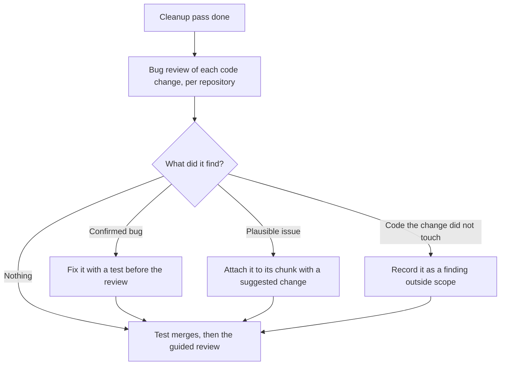

# Bug review

Use these rules for Spec Workflow's [bug review](../SKILL.md#find-bugs-before-review). It runs after the cleanup pass and before the test merges and the guided review. The goal is to find bugs while the change is still open, so the user reviews code that's already fixed.

## Run it

- Run it in each repository with code changes, on the committed change: `/code-review` in Claude Code, or the host's own code review command elsewhere.
- Review exactly this change, from its recorded base to its head. Give the tool that comparison as its target, or name both commits in the request if it can't take one. Afterwards, check that each finding falls inside that diff.
- Run it without a level, so it uses the user's usual one. Use `max` or `ultra` only when the user asks for them, because they start many reviewers.
- Don't pass `--fix` or `--comment`. Fixes follow the rules below, and nothing is posted to a PR.
- Skip repositories whose change is docs only, and record why. The checks in [Writing specs](writing-specs.md#before-merging-a-spec-change) cover spec changes.

**Why:** the agent that built the change also explains it in the review, so it tends to defend its own choices. A bug review reads the code fresh. One run on the whole change, rather than one after each chunk, costs less and also catches bugs that cross chunks, such as a backend function and the frontend call that misuses it.

## Act on each finding

| Finding | What to do | Why |
| --- | --- | --- |
| Confirmed bug in the change | Fix it with a test, as part of building the change. If the fix needs a product decision, return to specs first | The user should review code that's already correct. A fix during the review would reopen chunks they already accepted |
| Plausible issue in the change | Don't fix it on your own. Attach it to its chunk with a suggested change, and the user decides in the review | It may not be a real problem, and changing behavior on a guess is the user's call |
| Anything in code the change didn't touch | Record it under findings outside scope, and tell the user. Don't fix it in this change | Fixing it here would slip unrelated work into this review |

A fix changes the change. Rerun the affected tests, and reassess the [cleanup pass](code-cleanup.md#when-the-pass-must-run-again) for the changed lines. A large fix gets a second bug review of the files it changed.

> Example: the bug review confirms that `resumeClass()` releases the device lock before the save finishes, so a second phone can open the same Class. The agent fixes it, adds a test that resumes from two devices, and the resume chunk explains the fix.

## Record the result

For each repository, record in the work record the level, each fix and its commit, each plausible issue and its chunk, the findings outside scope, and the heads the review covered. Pass the same to [Guided Code Review](../../guided-code-review/SKILL.md).

If the code changes after the bug review, for example through an edit the user asks for during the review, run it again on the changed files before merging.
