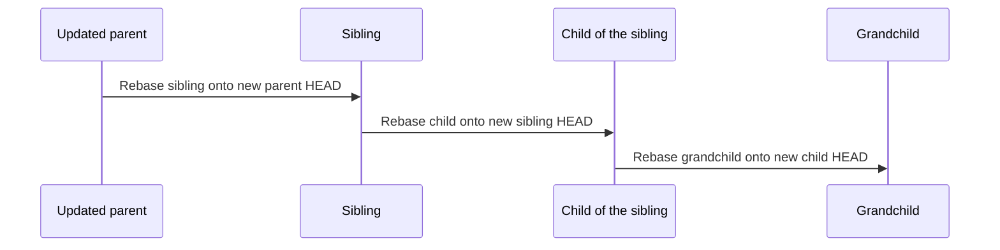

# Git operations

Use these steps for work chosen by [Spec Workflow](../SKILL.md). The goal: saved work stays recoverable, and only what was approved in [Guided Code Review](../../guided-code-review/SKILL.md) gets merged.

## Prepare or branch

Read the repository's instructions. Inspect worktrees, branches, HEADs, staged and unstaged edits, untracked files, and saved recovery refs. Check the recorded paths and name collisions. Reuse the correct worktree, and don't force a branch that's checked out elsewhere. A folder name alone doesn't prove which branch is its parent.

**Why:** a branch created on top of a misunderstood state carries that mistake into every later step.

Choose the parent as described in [Where should a worktree go?](../SKILL.md#where-should-a-worktree-go), then verify it against Git and the work record in every affected repository. Create the branch from:

- a checkpoint commit, for a child that builds on unfinished work
- the current HEAD of the branch where its result belongs, for a sibling or a new root change: usually an integration branch such as `001-initial`, or `main` for a new root

Record the parent's worktree path, branch, base SHA, and why the change belongs there. Explain the choice before creating anything.

Name branches as described in [Name the branch and folder](../SKILL.md#name-the-branch-and-folder). Check branch and path lengths before creating them. If a name is too long, choose one shared replacement for every repository.

If commit messages must be corrected later, keep the old tips, verify that the trees are unchanged, and update affected review SHAs. Don't force-push as part of a local correction.

### Save a checkpoint

Include intended new files, renames, deletions, and executable bits. Before committing, save the original staging state so it can be restored, for example with `git diff --cached --binary` into the change's recovery folder. A child can inherit unfinished work, but its review doesn't approve that work.

**Why:** uncommitted files don't appear in a new worktree. Without the checkpoint, the child can't see the work it builds on.

> Example: `initial-retained-audio` has two new files and one staged rename, and a codec fix must build on them. Commit all three as `initial-retained-audio: Save draft before codec fix`. The child branches from that commit and sees all of it.

If `main` or an integration branch has uncommitted development edits, keep them and move them into the right child. Don't add a WIP commit to that branch just to make it clean. Keep unrelated user work recoverable on its own.

Git checkpoints don't save external databases, devices, or every ignored file. Keep any specifically needed exceptions without copying credentials, caches, dependencies, or build outputs; see [Keep recovery data small](#keep-recovery-data-small).

### Copy the parent's local environment

After creating a worktree from a parent branch, use that repository's recorded parent worktree path. If its root `.env` exists and the new worktree has no `.env`, copy the file into the new worktree root and keep its permissions. Skip a missing source, and leave an existing destination unchanged, including on retries.

Keep the copied file out of Git using the repository's ignore rules or a local Git exclusion. Never print its contents, stage it, or include it in any commit. Record only whether the copy was made or skipped. Other environment files are outside this automatic copy rule.

**Why:** the new worktree needs the same local settings to run, but secrets must never reach Git or the chat.

### Update VS Code

After creating a worktree, look for an existing `.code-workspace` file in the shared workspace root.

1. Use the active file if there are several. Ask which file to use only if the active one can't be found. If no file exists, skip this step; only [project setup](project-setup.md) creates one.
2. Add the worktree to `folders` with a path relative to that file. Compare resolved paths first to avoid duplicates.
3. Sort the folder entries that have a string `path` in ascending lexical order by that value, comparing the paths as plain strings. Keep display names and comments attached to their entries. Keep other keys, formatting, and the relative order of entries without `path`. The file may contain JSON comments.
4. Validate the file and check that the new entry resolves to the created worktree.
5. When a worktree is removed, remove its entry the same way and validate the file again.

**Why:** the workspace file is how the user sees every worktree in one window. A stale entry points at a folder that no longer exists.

### If the actual parent changes

A new parent commit or a priority change doesn't rename anything. A change to the actual parent branch does.

1. Pause writers and save the current state.
2. Rename the branches consistently across the family, including any children, because their names start with the old name.
3. Rebase onto the new parent with `git rebase --onto <new-parent-head> <old-base> <branch>`.
4. Move the worktrees with `git worktree move`, and update the paths in the work record and `.code-workspace`.
5. Check the result with `git worktree list --porcelain`.

Record which repositories were updated so a partial rename can resume safely. Reopen affected reviews when their recorded branch or path changes.

> Example: `initial-retained-audio-codec-fix` turns out not to need the audio work. In every repository it becomes `initial-codec-fix`, is rebased onto `initial` using its recorded base, and its folder moves from `backend-initial-retained-audio-codec-fix` to `backend-initial-codec-fix`.

## Freeze the review inputs

Complete the [cleanup pass](../SKILL.md#clean-up-code-before-merging) first. Record its scope, result, checks, and input versions. Any edits it made belong in the snapshot below.

Save the complete child change in a commit, within the user's authorization. Record the exact base and the head to review:

```text
git diff <base> <head>
```

Check `git status` so intended uncommitted or untracked files aren't left out. Pass Guided Code Review the repositories, the base, head, and spec SHAs, the scope, the checks, the chunk map, and the destination. A checkpoint doesn't approve a merge. If the work is already committed, don't create an empty commit to mark it approved.

**Why:** the review must cover exact commits. Anything uncommitted, or changed afterwards, isn't what the user reviewed.

Before merging, verify that:

- the [review record](../../guided-code-review/SKILL.md#review-record) covers the current inputs and destination
- the cleanup result covers the same inputs and merge scope, or records why no code cleanup applies
- the parent is clean, and every child below the merging branch is resolved and removed
- every required repository is current, checked, and approved, or verified unaffected

Unexpected changes to the parent, child, or spec need a fresh cleanup assessment of the affected work, and they cancel affected approvals. Update and check the work, then review the changed version. Never put a newer tip under an old approval.

## Squash into the immediate parent

A **squash merge** puts the child's approved changes into one new commit on the parent, and keeps the parent's earlier history.

```text
Before:  initial ── P
                    └── initial-storage-fix: a ── b ── c
After:   initial ── P ── S          S holds a + b + c as one commit
```

**Why:** the parent's history gets one reviewed commit per change, and reverting a change takes one step.

Save the child tip under a durable recovery ref in `refs/recovery/`, so it stays reachable after the child is removed. Pause other writers to the branches being merged. In the clean parent worktree, run:

```text
git merge --squash <approved-child-sha>
```

Inspect the staged result, then create **one** commit. Its only parent must be the parent HEAD recorded before the merge. It must contain the whole approved child change, including changes merged into the child earlier from its own children. Don't fast-forward, and don't copy the child's WIP commits into the parent. If the approved diff is empty, record that no change was needed instead of creating a dummy commit.

For a child based on the exact current parent, check that:

- the resulting tracked files match the reviewed child tree
- the staged change was the approved change, and exactly one new commit was added
- relevant checks pass on the combined result

Record the parent-before, original-child, and squash-result SHAs, what was checked, and the recovery refs.

### Merge across repositories

Before starting, freeze every ready repository's inputs and the merge order. Merge the spec first by default. Record each successful result right away.

Squashing creates new commit IDs. When the approved content is verified unchanged, those expected new IDs don't cancel the remaining approvals in the batch. Unexpected changes to content or inputs do.

A partly finished batch is still incomplete. When resuming, continue from the recorded results without repeating a successful squash.

**Why:** one repository's squash can succeed while the next one fails. Recording each success lets a retry continue instead of repeating it.

If a squash fails, save its index, working files, and recovery points before resolving or restoring it. Don't rely on `git merge --abort`: a squash doesn't record a merge in progress, so there is nothing to abort. Review any materially different conflict resolution, and check the result before dependent work continues.

## Remove the child, then rebase the survivors

1. Check the squash result in the parent.
2. Remove the completed child's worktree and branch.
3. Rebase the remaining siblings and their children.
4. Check the results and reopen affected reviews.
5. Choose the next task.

Remove a child only when its approved changes are verified in the parent, all its descendants are resolved and removed, and no unique edits, untracked files, commits, or other needed files are unaccounted for. Keep source and checkpoint history reachable through recorded recovery refs.

A paused, blocked, or merged-but-not-removed child still keeps its parent from merging or being removed. Canceling work, or moving it elsewhere, needs an authorized decision about who owns it and how to recover it. Never remove `main` as part of child removal.

Use `git worktree remove`, respecting dirty state and locks. A squash usually leaves the original child tip outside the parent's history. So after proving its content is in the parent and keeping a recovery ref, a precisely targeted `git branch -D <completed-child>` may be needed. Don't use branch deletion in place of those checks. Recovery-only refs aren't active child tasks.

### Rebase recursively, from parent to child

[Rebase after a merge](../SKILL.md#rebase-after-a-merge) says which branches to rebase now and which wait. This section says how.

Before the first rebase, save the old tips, old bases, and current edits for the **whole affected subtree**. Then, in each branch's worktree, replay only its own commits:

```text
git rebase --onto <new-parent-head> <old-base> <branch>
```

Rebase the sibling first, then its children onto their updated parents, at every depth.



**Why the recorded base matters:** a rebase gives the rebased commits new IDs. Git can then mistake the old copies for new work and replay them a second time. The recorded base tells Git exactly where a branch's own work starts.

```text
Before:   initial ── X ── S                        S = squash of a sibling
                     └── audio: a1 ── a2
                                       └── codec-fix: c1        base = a2

Step 1:   git rebase --onto S X initial-retained-audio
          initial ── X ── S ── a1' ── a2'

Step 2:   git rebase --onto a2' a2 initial-retained-audio-codec-fix
          initial ── X ── S ── a1' ── a2' ── c1'                 new base = a2'
```

In step 2, a plain `git rebase` would treat `a1` and `a2` as new work, because their rebased copies `a1'` and `a2'` have different IDs, and try to replay them again. Don't guess a new merge base after rewriting history. Inspect any unclear existing merge history before choosing what to replay.

After each rebase:

- Confirm that the new parent HEAD is an ancestor of the branch.
- Compare the old and new changes relative to their parents, using content checks and `range-diff` where helpful. Check that unique work survived without duplication.
- Check changed specs, APIs, callers, and relevant tests separately.
- Record the new parent HEAD as the branch's new base.
- Reopen affected reviews: new heads, bases, or spec inputs make earlier approvals stale.

This local workflow doesn't authorize force-pushing.

If a rebase or check fails, keep the stopped state and record completed and remaining steps. Don't skip commits, throw away conflict evidence, or repeat completed work. Hold further dependent merges until the affected branches are updated and checked. Repair the failure, or return unaffected, authorized work to the next-task choice.

## Recovery and verification

Before removing or replacing content, verify that saved copies can recover it. A successful command alone isn't proof. When bringing in older work, inspect each source and restore only the intended changes, checked against current decisions. Keep the sources until their content is verified elsewhere and their removal is authorized. [Keep recovery data small](#keep-recovery-data-small) says when the workflow's own recovery data can go.

Stashes may hold older saved work, but they aren't part of the normal worktree flow. Honor an explicit instruction not to create checkpoint commits, and explain any dependent step this prevents.

Use checks that fit the change: focused behavior tests, relevant type, lint, and build checks, then the affected paths through the combined system. Report what actually ran. Keep local checks, live services, and phone or device tests apart in the report. Testing a child doesn't test all the parent work it inherited, and a clean rebase doesn't prove spec agreement.

Record evidence when a repository is unaffected instead of creating an empty counterpart commit. Keep source and result SHAs and actual results for each repository through the final release merge and worktree removal.

### Keep recovery data small

Save only what Git and a reinstall can't bring back:

- Use Git refs under `refs/recovery/` for old tips and bases. They cost almost nothing.
- Copy an untracked file only when it is needed and can't be recreated. Never copy dependency folders such as `node_modules`, build output such as `dist` or `build`, or caches. Record the install or build command instead.
- If a save would copy more than about 100 MB, stop and check what is being copied.

**Why:** without limits, saved copies grow without end. One workspace collected 16 GB of saved folders, mostly dependency and build folders that a reinstall would have recreated.

List each change's recovery data in its work record entry. Delete the recovery data this workflow created for a change once all of these hold:

1. Its content is in the integration branch, or in `main`.
2. Checks there have passed.
3. Its worktrees are removed.

Note the deletion in the change's history summary. Ask the user before deleting anything else: data this workflow didn't create, data not listed in the work record (such as folders saved before the record existed), or data for a change that is paused, blocked, or still in review.

More examples: [Recovery data](worked-examples.md#recovery-data).
