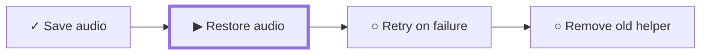
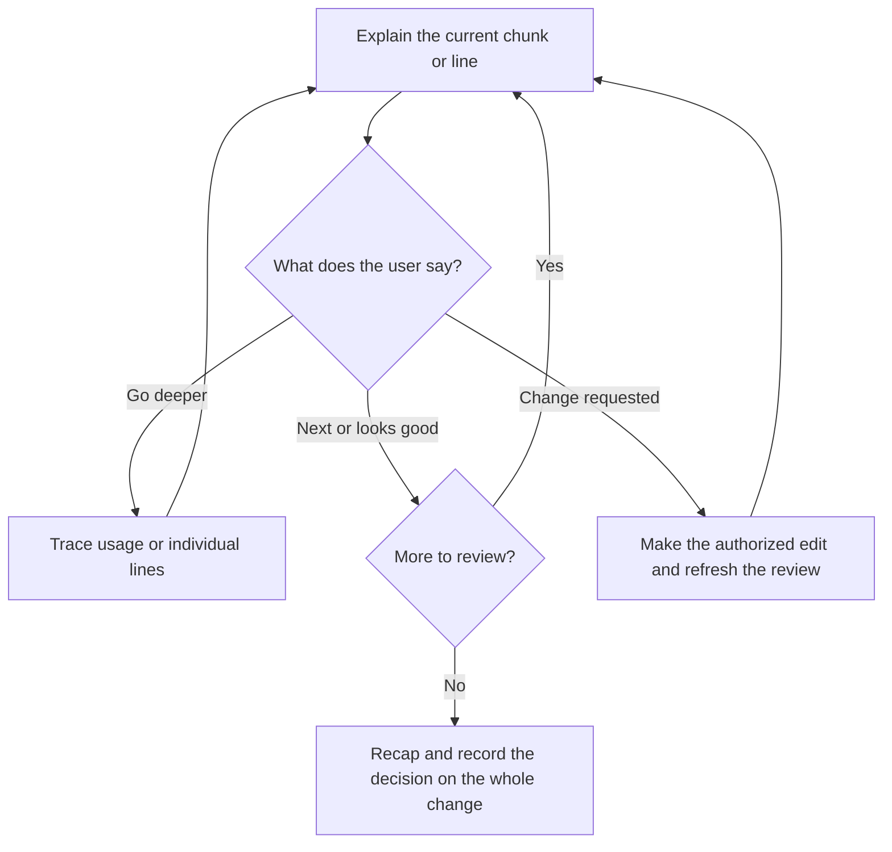

# Guided review

Use these rules for Spec Workflow's guided review: a walk through a change with the user, one chunk at a time, so they can question it and decide. It runs for a preview of the riskiest chunk, for a spec before it's accepted, and before every merge, as [Review and merge](../SKILL.md#review-and-merge) describes. Stay in the current conversation.

## Establish the comparison

Take the exact base, head, and spec commits from the work record, and verify them in Git. Read the whole change before explaining any of it, including callers, contracts, tests, new and deleted files, and file permission changes. Separate inherited parent work, earlier approved changes, and new or changed work.

**Why:** the user should judge only what this change adds, and nothing in the diff should surprise you halfway through.

Name the change, its repositories and their worktree paths, and the review scope: spec acceptance, one repository, a coordinated merge, or the final release. A spec review can come before the code, but it doesn't approve the implementation. Code-only work needs no invented spec counterpart. A preview, such as a look at the first built chunk of the chunk map, can discuss unfinished work without calling it ready to merge.

For a merge review, check that the [cleanup pass](code-cleanup.md), the [bug review](bug-review.md), and the [test merges](git-operations.md#test-merge-with-open-branches) cover the exact scope and commits, including a recorded "no code cleanup" result or a skip reason where one applies. If one is missing or stale, say so before the first chunk. Include all cleanup edits and bug fixes in the reviewed diff. A preview comes before these steps, so it has none of them, and the review doesn't run them itself.

For a [spec and code sync](spec-code-sync.md), include the finding, the accepted decision, and the change's [mode](spec-code-sync.md#use-the-tasks-mode). Explain the affected APIs, consumers, and data, and why old contracts or migrations are kept or removed. `--not-live` allows replacements within the accepted scope; unrelated feature decisions and merge approval still need their usual review.

Open the matching diff, and give verified source and line links when possible. If the checkout has moved on, explain the recorded commits rather than the current lines.

## One chunk, then a pause

Start with the purpose, the exact comparison, the checks including the test merges, and a short chunk map, then explain the first chunk right away. Start from the [chunk map planned before building](../SKILL.md#plan-the-chunks), and say where the final chunks differ from the plan and why. A chunk is one meaningful decision or behavior. It may connect a spec rule, a contract, a backend caller, a frontend use, and tests. Follow the behavior or data path rather than file order, and cover the complete diff and every required repository.

**Why one chunk at a time:** a whole diff at once is too much to question. One chunk lets the user push back before the next one builds on it.

**Start every new or resumed chunk with a progress map, then the current worktree folder name and branch, then the chunk's title.** Don't use a bare counter such as "2/5": it shows the position, but not what's done or what comes next.

- Draw the map as a left-to-right Mermaid strip when there are six chunks or fewer and Mermaid renders. Otherwise, use a text map, one chunk per line with its repositories.
- Mark each chunk: ✓ accepted, ▶ now, ○ not yet, ↷ skipped, ✎ needs a change.
- Repeat the worktree and branch even when unchanged, and link the folder name to its absolute path. If a chunk spans repositories, name each worktree and its repository. Take the worktrees from the work record and Git, not from the chat's working directory.
- In line-by-line steps, repeat the worktree and branch line and name the lines being explained, such as `restoreClass.ts`, lines 40–52. The map comes back with the next chunk.

**Why:** the map shows the whole review at a glance, by name: what's covered, where you are, and what's left. With many worktrees open, the worktree line means the user never has to guess which copy of the code they're reading.

For the current chunk, explain each of these in detail, in easy words, with as many concrete examples as it takes, such as before and after values, a sample request, or a user scenario:

- **What changed:** before and after, with source links.
- **Why:** the requirement, defect, or tradeoff. Separate evidence from guesses about past intent.
- **How it's used:** real callers, data movement, side effects, and failure paths.
- **How to judge it:** simpler alternatives, the checks that actually ran, the bug review's findings for this chunk, and open questions. Say what the bug review confirmed and how it was fixed. Give each plausible issue with a suggested change, for the user to accept or reject.

A chunk might start like this (made up):



Where Mermaid doesn't render, the same map as text:

```text
✓ Save audio            backend
▶ Restore audio         backend, frontend
○ Retry on failure      frontend
○ Remove old helper     backend
```

> **Worktree:** backend-initial-class-recovery, linked to its folder · **Branch:** initial-class-recovery
>
> **Restore saved audio on reopen**
>
> **What changed:** `restoreClass()` now loads saved audio. Before, a reopened Class had no recording. Now it gets its saved chunks back in order.
>
> **Why:** `REC-012` says saved audio must survive closing the app.
>
> **How it's used:** Home calls `resumeClass()`, which calls `restoreClass()`, which calls `AudioStore.load()`. If loading fails, the Class opens without audio and offers a retry.
>
> **How to judge it:** a simpler option is loading audio on first play. `restoreClass.test.ts` ran with 3 passing tests. The bug review found one plausible issue: if one saved chunk is missing, the restore stops early. Suggested change: skip that chunk and offer a retry. Accept it, or keep the current behavior?

For a domain-related chunk, check the [domain mapping](../SKILL.md#map-domain-language-into-code). Show how the spec term maps to the real model, storage, and contract names, and how its relationships and rules are represented. Flag unexplained synonyms or missing links. Use a small table or model diagram when it helps.

Use a small Mermaid diagram when it helps: a call hierarchy for usage, a sequence diagram for ordering, a data-flow diagram for transformations, or a state diagram or flowchart for lifecycle choices. Label real calls, payloads, and failure paths, and mark anything unverified. Don't invent a call graph, defend unnecessary complexity, or force a diagram onto a trivial rename. Check changed diagrams where tooling allows, and don't claim a diagram renders if you haven't checked.

> For the chunk above, a sequence diagram would show Home, `resumeClass()`, `restoreClass()`, and `AudioStore`, with the failed load drawn as its own arrow back to Home.

**After one chunk, end the response and wait.** Don't explain the whole diff at once, and don't treat silence as agreement. Adapt the detail to the user, and keep your place through their questions.



| What the user says | What happens |
| --- | --- |
| Next / continue | Move on by one line in line mode, or one chunk in chunk mode. This never implies merge approval |
| Why / show callers / what if it fails | Stay on this chunk and explain the requested path |
| Line by line | Explain each changed line or tightly linked group, waiting between steps |
| Looks good / approve this chunk | Record this chunk as accepted and present the next one. It covers only this chunk, not the merge |
| Change this, or accept a suggested change | Pause the review. Make only the requested edit in the change's worktree, check it as [Limit the reruns](bug-review.md#limit-the-reruns) describes, and refresh the affected chunks |
| Skip / pause | Record the skipped part, or save the position. Neither is approval |
| Approve this change for the named destination | Record that exact decision. Recognize an explicit waiver if the user deliberately skips the rest |

A question about an alternative isn't an edit request. New behavior or shared terms missing from the specs follow the [spec guardrail](../SKILL.md#when-to-return-to-specs): keep the existing code, and pause dependent merges. Don't silently fix code while explaining it, or rewrite specs to justify it.

## Review record

Keep the review record in the change's entry in the work record:

| Record | Content |
| --- | --- |
| Identity and scope | Change name; repositories, and evidence for unaffected ones; worktree folder names, branches, and paths; purpose; destinations; the mode, live or `--not-live`; for a sync, the finding and the accepted decision |
| Commits | Per repository: base, head, and accepted spec SHAs; relevant checks and whether they're still current; the cleanup, bug review, and test merge results |
| Progress | Stable chunk IDs, paths and hunks, each chunk's status (discussed, accepted, skipped, or needs change), the current chunk or line, questions, edits, and the user's decision on each bug review finding |
| Decision | Spec accepted, changes requested, paused, rejected, deferred, walkthrough complete, or exact merge approved, plus any explicit waiver |

After edits, rebases, or unexpected changes in other repositories or the spec, regenerate the affected chunks and mark the earlier merge decision stale. Keep useful discussion of unchanged code, but get a decision that covers the current commits. The new commit IDs a squash creates don't count as a change when the content is verified unchanged, as [Merge across repositories](git-operations.md#merge-across-repositories) describes.

**Why:** an approval belongs to the exact code the user saw.

When coverage is complete or explicitly waived, recap the scope, open issues, checks, and limits. **Finishing the walkthrough isn't merge approval.** Recognize clear approval of the concrete whole-change proposal without asking twice. Then continue with [Review and merge](../SKILL.md#review-and-merge), which checks merge readiness and does only the authorized action. Approving one repository doesn't approve the others, the parent branches, or the final release. Keep the user's review position until they move on, for example with "next" or "looks good".
