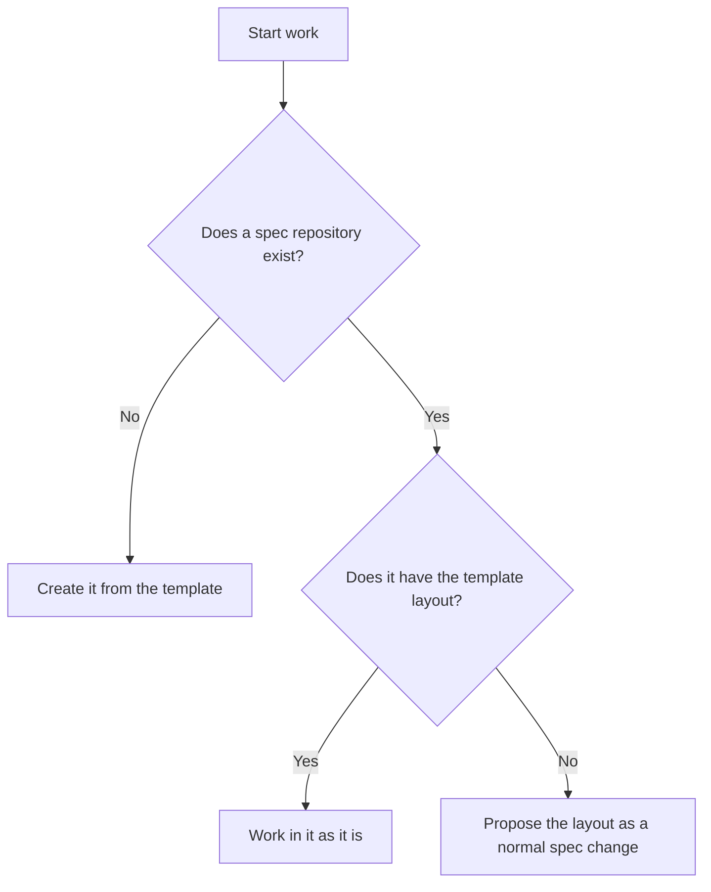

# Project setup

Use this when the user asks to start a project, or when a spec repository doesn't have the template's layout yet.



## Workspace layout

Every repository has one main checkout. Each change adds a worktree beside it for every repository it affects. The folders stay flat; the branch name carries the hierarchy, as described in [Where should a worktree go?](../SKILL.md#where-should-a-worktree-go).

```text
<workspace>/
  <project>.code-workspace
  WORK_RECORD.md                         current work
  WORK_HISTORY.md                        finished changes
  <project>-specs/                       main checkout of the spec repository
  <project>-backend/                     main checkout of a code repository
  <project>-specs-checkout/              root change `checkout`
  <project>-backend-checkout/             root change `checkout`
  <project>-backend-checkout-tax-fix/    child `checkout-tax-fix`, backend only
```

The spec repository starts with this layout. Each feature document's header names its ID prefix. The general writing rules are in [Writing specs](writing-specs.md), so the repository has no `AGENTS.md` or `CONTRIBUTING.md`:

```text
<project>-specs/
  README.md                product brief
  features/                one document per feature, each with its own ID prefix
  contracts/               API and event shapes (OpenAPI, JSON Schema)
  architecture/
    domain-model.md        domain terms and their names in code
  decisions/               choices that cross features or are hard to reverse
  research/                dated evidence
```

## Create a new project

1. Confirm the project name, the workspace folder, and which code repositories exist or are planned. The user creates code repositories; this setup creates only the spec repository.
2. Create `<workspace>/<project>-specs/` with `git init -b main`. Copy everything in [the spec repository template](../assets/spec-repo/) into it, including the `.gitkeep` files that keep empty folders in Git.
3. Fill in the placeholders. Write the README from what the user has said, and leave a placeholder in place rather than inventing facts. Put today's date in `architecture/domain-model.md`.
4. Commit on `main` with a plain subject, such as `Set up the specification`.
5. In the workspace root, create `WORK_RECORD.md` from [the work record template](../assets/work-record.md), and a `WORK_HISTORY.md` with only a title, unless they exist.
6. If the workspace root has no `.code-workspace` file, create `<project>.code-workspace` with one `folders` entry per main checkout, sorted by path. Later worktrees are added to it as [Set up the new worktree](git-operations.md#set-up-the-new-worktree) describes.

Don't add remotes, push, or create hosted repositories unless the user asks. **Why:** publishing is the user's call, and a local repository can be published at any time later.

The first change then starts like any root change: agree on its spec, then create its worktrees.

## Add the layout to an existing spec repository

If a spec repository has documents in a different layout, don't move or rewrite them on your own. Propose the template's missing folders as a normal spec change, and list the documents that would move. Apply it only after the user agrees, through the usual review. **Why:** moving a document breaks every link to it, and deciding where facts live is a spec decision.

## New documents

Start a feature document from [the feature template](../assets/templates/feature.md). Save it as `features/<feature-name>.md` and give it a prefix no other feature uses. Start a decision record from [the decision template](../assets/templates/decision.md) and save it as `decisions/<NN>-<short-title>.md`.

Keep these templates in the skill. Copies inside the repository would put sample IDs into every ID search.
