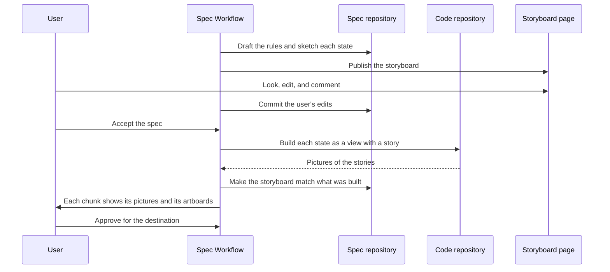
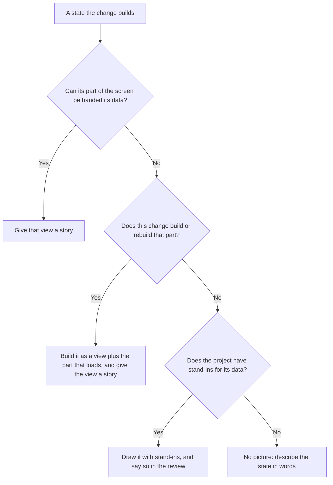

# Storyboards and screen pictures

Use this page when a change adds or changes a screen, one of its states, or the words a user reads on it. The user then judges screens, not descriptions of them. Before the spec is accepted, the [guided review](guided-review.md) shows a sketch of each state on the feature's storyboard. Before the merge, it shows a picture that the app's own code drew.



This page doesn't apply when no screen looks different afterwards. For example, a button that now saves to another table looks the same, so it needs no sketch and no picture.

## Words used here

| Word | Meaning | Example |
| --- | --- | --- |
| State | What a screen, or a part of it, shows in one situation. A rule usually describes it | The saved-audio part of a Class, after loading failed |
| Storyboard | A feature's states drawn as screens, in the order a user meets them. Its files live in the spec repository | Loading, then Failed |
| Artboard | One screen on a storyboard | Failed, at 390 by 844 |
| Sketch | An artboard drawn before its state is built | Failed, with a drawn Retry line under the real player |
| View | A component that draws only what it's handed. It loads nothing, saves nothing, and goes nowhere. It isn't the platform's own `View` type | `SavedAudio`, handed `status: 'failed'` |
| Story | A named example that hands a view sample data, so it draws one state. The word comes from Storybook, but any tool that draws a named state counts, such as a SwiftUI preview | `Failed`, under Class / Saved audio |
| Picture | An image of a story, drawn by the app's own code | `Failed` in the dark theme, drawn by Chrome |
| Run | One call of the project's picture command, and the folder of pictures it filled | The run at `9b3e1d4` |
| Design folder | `design/` in the spec repository: the rules for the look and the wording, and the token values | "One primary button on a screen", `palette-accent` |
| Page | A published view of a storyboard or of the design folder. It's never a source | A Claude Design canvas |
| Stand-in | A fake that takes the place of a data source while pictures are drawn, and returns canned data | A fake API client that returns one saved Class |

## Who owns what

| Fact | Owner |
| --- | --- |
| What a state must show | The rule's row in the feature document, in words |
| What a state looks like, and where it sits in the flow | Its artboard on the feature's storyboard, in the spec repository |
| The look and the wording of the whole app | The design folder, in the spec repository |
| The built state: its sample data, and the requirement IDs it cites | A story, in the repository that owns the screen |
| How this app draws its screens | That repository's README, and one command |
| When screens are drawn, what keeps them true, and how a review shows them | This page |

**Version what draws a picture, never the picture.** Storyboard files, design files, and stories are committed. Pictures, pages, and a tool's copies of other files are not.

**Why:** a source can be reviewed, compared, and drawn again. An image shows one moment, and it's out of date after the next restyle.

## What a project provides

**The spec repository** says in its README whether it has a design folder and storyboards, and which tool draws a storyboard's page, such as a Claude Design canvas with the project's design system.

**The repository that owns the screen** says how it draws in its README, in a section named **Screen pictures**. The section gives one command. It also says what the command needs, how to pick the stories and the output folder, and which device and themes it draws. If the app's components and stories can be shown on a storyboard, it says how. Spec Workflow needs to know nothing else about the app's tools.

The command:

- draws with the app's own components and theme, and with sample data only
- draws the stories it's asked for, by requirement ID or by story ID, in each theme the README names
- needs no phone and no emulator where the app allows that, and otherwise starts what it needs and stops it again
- reads and writes none of the app's saved data, and calls no backend or other outside service
- sends nothing off the machine, so it turns off its tools' usage reporting, often called telemetry
- on a person's own device, changes no setting, and takes a picture only while its stories are in front
- stops with an error that names a story it can't draw, instead of saving a picture of something else
- writes each run into its own folder, `<output folder>/<commit>/`: one PNG for each story and theme, with a `pictures.json` that lists exactly what this run drew:

```json
[
  {
    "story": "class-saved-audio--failed",
    "title": "Class / Saved audio / Failed",
    "rules": ["REC-013"],
    "theme": "dark",
    "device": "Chrome, 390×844",
    "commit": "9b3e1d4",
    "picture": "class-saved-audio--failed.dark.png"
  }
]
```

`story` is the story's ID in the project's tool, and `title` is its name for people. `rules` can be empty. `device` names what drew it, such as "Chrome, 390×844", an emulator, or a phone. `commit` is `git rev-parse --short HEAD`, with `-dirty` added when `git status --porcelain` prints anything, so uncommitted and untracked work shows as `9b3e1d4-dirty`. A project can add fields of its own.

**Why a contract:** every app draws its screens with other tools, such as a browser for a React Native app or golden tests for a Flutter app. One command and one list keep those tools in the project, where they change with the app, and this page stays the same for all of them.

**Why no real data:** the same story then draws the same state on any machine, and a run is safe on a phone that holds a real account.

**Why without a phone where possible:** a browser or a test runner is quick and works on any machine. A browser also draws the storyboard's page, so a picture and its sketch can be compared. A phone or an emulator is for what they can't show, such as the keyboard or the status bar.

## Keep the storyboard in the spec repository

A storyboard sits beside its feature document, in a folder named after it. The folder holds the files that the storyboard tool reads. For a Claude Design canvas, that's `canvas.json` for the layout and one `.dc.html` file for each artboard:

```text
features/
  class-recovery.md
  class-recovery.storyboard/
    canvas.json
    Main.dc.html
    Failed.dc.html
```

- **One row for each flow, one artboard for each state,** in the order a user meets them, at the device size the README names.
- **Name each artboard** by its place in the row, its state, its requirement IDs, and `sketch` or `built`, such as `2 Failed · REC-013 · sketch`.
- **Use the real parts.** Where the project's design system offers the app's real components to the tool, use them for every part that exists. Draw only the new part, in the design folder's colours and sizes.
- **Copy each text from its owner,** letter for letter: the rule's example, the contract, or the code that produces it. Don't put a rule's own wording on the storyboard. Its ID is enough.
- **Commit only sources.** Leave out what the tool copies in or generates, such as its copy of the design system, and images that were uploaded to the page.

**Why real parts:** the sketch then looks like the app, and only the new part can be wrong.

**Why in the spec repository:** a sketch is part of the proposal. One commit then holds the rules and their screens, and "accept the spec" covers both.

## Treat the page as a view

1. **Write the files in the change's spec worktree,** and commit them like any other spec edit. A canvas tool treats its files as scratch by default. Here they're spec files.
2. **Publish them as a page,** one for each storyboard and change, named `<feature> storyboard · <change>`. Put its link in the change's work record entry.
3. **Read the page back before each chunk, and before you record a decision.** The user can move, edit, and add artboards on the page. When its files differ from the worktree's, say what changed and commit it.
4. **Treat a comment on the page as a question** for the chunk that its artboard belongs to.
5. **Follow the tool's own rules about opening a page.** If they say not to look at it unless the user asks, say in the review's opening that the sketches are unchecked.

**Where no page can be made,** such as in a tool without canvases, don't edit a storyboard's files blind. Describe each state in words, as [When a state has no sketch or picture](#when-a-state-has-no-sketch-or-picture) says, and note in the work record that the storyboard needs an update.

**Why a view:** a page can be edited by hand, and it lives outside Git. If it were the source, an accepted spec could change after the user accepted it.

## Stories cite requirement IDs

A story names the ID of each rule whose state it shows, where the project's tool can read it, such as a Storybook tag:

```ts
/** The saved audio failed to load, so Retry is offered. */
export const Failed: Story = {
  tags: ['REC-013'],
  args: { status: 'failed' },
}
```

To find a rule's screens, search for its ID: the artboard's name and the story both carry it. A rule about a screen that no story cites has no picture yet. This is the same idea as [Tests cite requirement IDs](writing-specs.md#tests-cite-requirement-ids), but a story isn't a test: a rule that only a story cites isn't proven yet.

## Choose what to draw

**Which states get an artboard:** each state that a new or changed rule describes. When an existing state changes, change its artboard. Don't add a copy.

**Which stories a change draws:** each state that the change builds, and each existing story that draws a part the change's code touches.

> Example: a fix to the paused Class card changes no rule. It still draws all of that card's stories again.

**An artboard shows the whole screen. A picture shows the smallest view that shows the whole change.** Add the screen around it only when the change moves or resizes something there.

> Example: one new line on the paused Class card needs only the card's story. A taller card that pushes Home's list down also needs a picture of Home.

A story can't draw a part that loads its own data, so such a part takes one of these paths:



The project's README lists its stand-ins. A stand-in costs more than a view: it can describe a state the real code never reaches, and it must follow every change to the real source. A good one has the real source's type, so a change to the source fails the build instead of quietly drawing an old shape. Don't split a part that the change doesn't build or rebuild. Tell the user when one could be split later.

## Use the design folder

- **Sketch with it.** Take every colour, size, and text style from its tokens, and follow its rules for each component.
- **Change it first.** A change that needs a new colour, a new wording rule, or a new component rule edits the design folder on the same spec branch, before any code. That's a spec decision, as [When to return to specs](../SKILL.md#when-to-return-to-specs) describes.
- **Check against it.** In the spec review, check each text on a sketch against the wording rules. Before the merge review, check each picture against the rules for the look. Route a break as [Act on each finding](bug-review.md#act-on-each-finding) says, and cite the design rule's ID, such as `DESIGN-004`.
- **Keep the code's tokens equal to it.** A token value in code that differs from the design folder is a difference between spec and code. Route it as [Route each finding](spec-code-sync.md#route-each-finding) says.

> Example: a sketch's button says "Play Recording". The design folder asks for sentence case, so the finding is "Play recording", in the chunk that shows the button.

Where the spec repository has no design folder, sketch in the app's own colours and sizes, read from its theme code, and skip the checks above.

## Keep sketches and pictures true

A sketch shows a proposal. A picture counts only when it shows what the app would really show.

- **Never call a sketch a picture.** Its artboard's name says `sketch`, and so do your notes, such as "the sketch of *Failed*".
- **The app's own code draws every picture.** A mock-up made in another tool is a sketch.
- **Text from elsewhere has a source.** Text that reaches the screen from outside the view, such as a status line the backend writes, is copied from the spec, the contract, or the code that produces it. The story names that source.
- **Only states the app can reach.** A story can hand a view any mix of values, such as "ready" together with an error. Draw only states that a rule describes or the code can produce.
- **Look at every picture before you show it.** Check it against its story: the right state, the right theme, nothing cut off, and nothing on top of it, such as a system dialog. If the story is wrong, fix it and draw again. Don't show a wrong picture with an excuse.
- **A fault in a picture is a finding.** Route it as [Act on each finding](bug-review.md#act-on-each-finding) says: a clear break of an accepted rule counts as a confirmed bug, and anything else, such as cut-off text that no rule covers, as a plausible issue for its chunk.
- **The storyboard and the built screen agree at the merge.** Where they differ, fix the code, or change the artboard and show that change in its chunk.
- **A picture shows what a state looks like, not how the app gets there.** It doesn't prove that the app reaches the state, or that a button works. Tests prove that.
- **Compare by eye, and only like with like.** Clocks, countdowns, and animations can differ on every run, so two files that differ may still show the same screen. A phone and a browser draw fonts and shadows differently, so say which device drew each picture, and what differs for that reason.
- **A person's device stays theirs.** Never unlock it or enter its PIN. If it's locked, ask the user.
- **Leave nothing running.** Stop what you started, with the README's stop command. Don't touch what you didn't start, such as another session's dev server.

> Example: a story's sample said "Getting things ready". The backend really writes "Preparing your Class…", so the first picture showed a card no user would ever see. Drawn again with the backend's wording, the screen showed that same line three times. No rule covers that, so it went into its chunk as a plausible issue.

## Before the spec review

1. **Check what the project provides.** Read the spec repository's README. Without a storyboard tool, follow [When a state has no sketch or picture](#when-a-state-has-no-sketch-or-picture) and skip the steps below.
2. **Draft the rules** in the spec, with a rule and an example for each state, as [Requirements](writing-specs.md#requirements) describes.
3. **Sketch each state on the feature's storyboard,** as [Keep the storyboard in the spec repository](#keep-the-storyboard-in-the-spec-repository) describes. For a screen with many states, sketch the one that settles the most questions first, and publish it before you sketch the rest. Don't wait for an answer: seeing it approves nothing, as [Plan the chunks](../SKILL.md#plan-the-chunks) says.
4. **Commit the storyboard with its rules,** and publish its page, as [Treat the page as a view](#treat-the-page-as-a-view) describes.
5. **Give the review its artboards,** as [Show them in a review](#show-them-in-a-review) describes.
6. **Publish again after an edit.** When the review changes a rule about a state, change its artboard to match, commit both, publish the page, and refresh the chunk.
7. **Record the page with the accepted commit** once the user accepts the spec. That commit holds the rules, the storyboard, and any design folder edits.

**Why no code before the spec is accepted:** a sketch takes minutes and touches no code, so "spec before code" in [When to return to specs](../SKILL.md#when-to-return-to-specs) needs no exception. A view built only to be judged is thrown away as soon as the rule changes.

## While building

Build each state as a view with a story, and draw its picture whenever the screen changes: it's the quickest way to see a fault. Compare it with its artboard as you go.

## Before the merge review

1. **Check that the project can draw.** Read the README of the repository that owns the screen. Without a way to draw, follow [When a state has no sketch or picture](#when-a-state-has-no-sketch-or-picture).
2. **Draw the change's states at the frozen head,** after the cleanup pass and the bug review, as [Freeze the review inputs](git-operations.md#freeze-the-review-inputs) describes. Both can change a screen, so the pictures come after them.
3. **Check the pictures,** as [Keep sketches and pictures true](#keep-sketches-and-pictures-true) describes. A fix is a new head: check it as [Limit the reruns](bug-review.md#limit-the-reruns) describes, freeze again, and draw again.
4. **Compare each picture with its artboard.** Note each difference and its cause for the chunk, such as "Retry moved under the message, because the title now takes two lines". A difference that breaks a rule is a finding. One you can't explain goes in the chunk as a question.
5. **Make the storyboard match what was built.** Where the README says the app's stories can be shown on a storyboard, switch each built artboard from its sketch to its story, and rename it from `sketch` to `built`. Otherwise, correct a sketch where the built screen differs and is right. Commit that on the spec branch and publish the page again.
6. **Give the review its pictures,** as [Show them in a review](#show-them-in-a-review) describes.

A change with no spec review, such as a fix that makes a screen match a rule the spec already has, sketches nothing. Show its pictures, and update an artboard only where the fix changes what it shows.

**Why switch to the story:** an artboard that draws the story shows the app's current code. A later restyle then can't leave it out of date.

## Show them in a review

- **In a spec review,** name the chunk's artboards and link the page, right after the What changed sentence. Add one line that says which parts are real components, which are sketched, and that the data is sample data.
- **In a merge review,** send the chunk's pictures at the same place, the way [mermaid-image](../../mermaid-image/SKILL.md#make-and-send-an-image) sends an image: one for each state, in the first theme the README names. Add another theme only for a state whose colours the change touches. Then say in one line what they are: sample data, any stand-ins, the device, and the commit. Then say what differs from the artboard the user accepted, and why.
- **The heading, the map, and the location line still come first,** as the guided-review skill's [chunk format](../../guided-review/SKILL.md#start-every-chunk-with-a-heading-a-map-and-a-location-line) describes.
- **Call a state by the name on its artboard,** in notes and in questions, such as "In *Failed*, Retry sits under the message".
- **Tell the review in the brief.** Name the storyboard or the run under [Checks](guided-review.md#fill-the-brief), with the commit it covers, such as "Storyboard: 2 artboards at `4020d91`, sketches unchecked" or "Screen pictures: 2 states at `9b3e1d4`, drawn by Chrome, 1 finding". Add "show each chunk's artboards and pictures, as Storyboards and screen pictures describes" to Extra rules. If the head changes later, they're stale like any other check.
- **Where images can't be sent,** give the run folder's path, and describe each state as [When a state has no sketch or picture](#when-a-state-has-no-sketch-or-picture) says.

The What changed part of a spec review chunk might look like this (made up):

> **What changed:** a Class whose saved audio fails to load now says so, and offers Retry.
>
> Artboards *1 Loading* and *2 Failed* on the Class recovery storyboard, linked to its page. The player and the buttons are the app's real components. The message and the Retry line are sketched. Sample data.
>
> `REC-013`, new: "When saved audio fails to load, the Class MUST offer Retry."

## Keep the pictures until the merge

Give the command `<workspace>/.screen-pictures/<change>/` as its output folder, beside the work record and outside every repository. Each run then lands in its own folder there, named after its commit. A run with uncommitted work lands in a folder such as `9b3e1d4-dirty`, so it never lands over a run that a review showed. In the change's work record entry, name the storyboard's page, the change's picture folder, and the latest run with its commit and device. When the change has merged, move the picture folder to the Trash, or delete it where there is no Trash.

## After the merge

- **The change's page now shows an old branch.** Say so. Delete it only when the user asks.
- **Offer to publish the design system again** when the change edited the design folder, or a component that the published design system shows. The README says how. Publishing needs the user's OK, so name it when you ask for the merge approval, such as "approve for `initial`, and publish the design system".

## When a state has no sketch or picture

A state has no sketch when the spec repository's README names no storyboard tool, or when no page can be made where you work. A state has no picture when the README has no Screen pictures section, when the command fails for a reason this change didn't cause, such as an emulator that won't start, or when a part loads its own data and the project has no stand-in for it. A story of this change that can't be drawn is different: that's a fault in the change, so fix it.

- **Write no code before the spec is accepted** to get a picture in place of a sketch.
- **Say so in the review's opening,** with the checks, such as "Screen pictures: none, because the README has no Screen pictures section".
- **Describe the state in its chunk.** List what the user sees, top to bottom: each text in quotes, each button, and what's hidden.
- **Offer the setup or the repair once,** as a change of its own. Don't build it inside the current change.

> Example: "*Failed* has no picture, because Home has no stand-ins. It shows the title, "Couldn't load your recording", and a Retry button. The player is hidden."

## Check before you show a screen

- **Each new or changed state** has an artboard that names its requirement IDs, or a description in words that says why not.
- **Each built state** has a story that cites its requirement IDs, and a picture that you looked at, from the project's command, at a commit with nothing uncommitted.
- **Each text** on a sketch or in a story has a named source, and each state is one the app can reach.
- **The storyboard's files are committed,** the page shows that commit, and the user's edits on the page are read back.
- **A merge review** draws at the reviewed head, says what differs from the accepted artboards, and leaves the storyboard matching what was built.
- **Never** call a sketch a picture, unlock a person's device, or leave running what you started.
