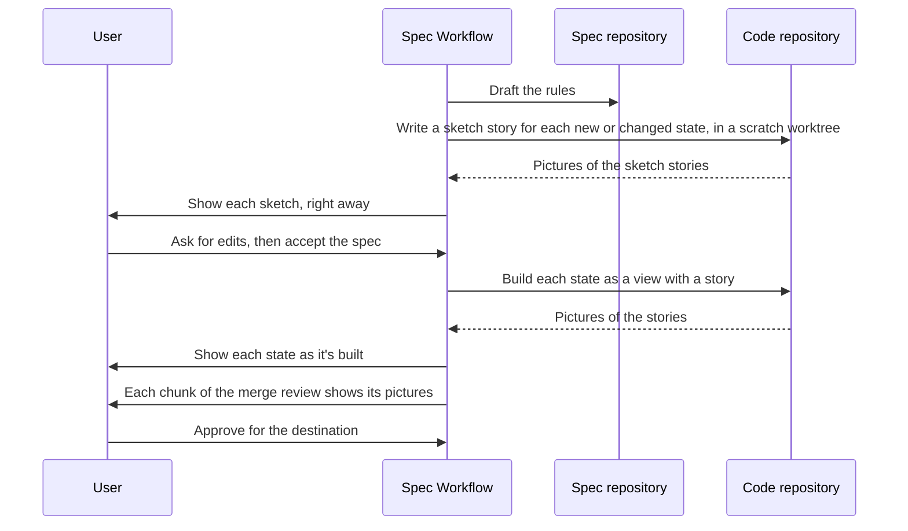
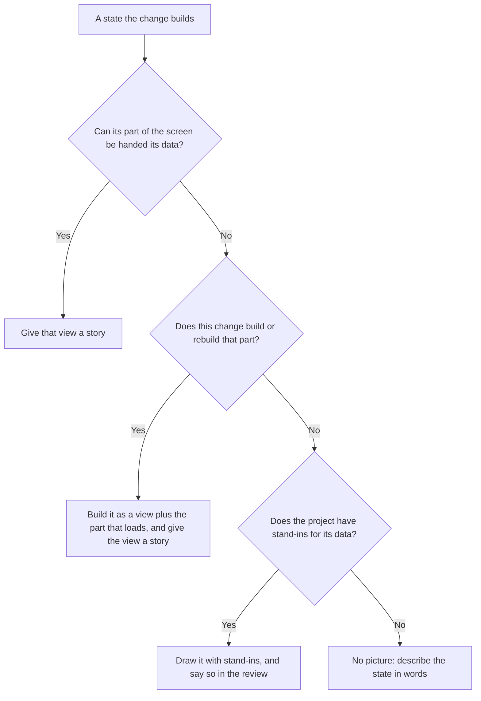

# Screen pictures

Use this page when a change adds or changes a screen, one of its states, or the words a user reads on it. The user then judges screens, not descriptions of them, and sees each one as soon as it's drawn, without asking. Every picture is drawn by the app's own code, from a story, with one command in the repository that owns the screen. It's sent as an image, and the user asks for edits on it.



This page doesn't apply when no screen looks different afterwards. For example, a button that now saves to another table looks the same, so it needs no picture.

## Words used here

| Word | Meaning | Example |
| --- | --- | --- |
| State | What a screen, or a part of it, shows in one situation. A rule usually describes it | The saved-audio part of a Class, after loading failed |
| View | A component that draws only what it's handed. It loads nothing, saves nothing, and goes nowhere. It isn't the platform's own `View` type | `SavedAudio`, handed `status: 'failed'` |
| Story | A named example that hands a view sample data, so it draws one state. The word comes from Storybook, but any tool that draws a named state counts, such as a SwiftUI preview | `Failed`, under Class / Saved audio |
| Sketch story | A story for a state that isn't built yet. It lives in a scratch worktree, draws the new part from the app's existing components, and never merges | `Failed`, with a Retry line drawn inside the story file |
| Picture | An image of a story, drawn by the app's own code. A sketch is the picture of a sketch story | `Failed` in the dark theme, drawn by Chrome |
| Flow sheet | One image of a stories file: all its states side by side, in the file's order, each under its name | The saved-audio states in a row: Loading, Failed, Ready |
| Run | One call of the project's picture command, and the folder of pictures it filled | The run at `9b3e1d4` |
| Stand-in | A fake that takes the place of a data source while pictures are drawn, and returns canned data | A fake API client that returns one saved Class |

## Who owns what

| Fact | Owner |
| --- | --- |
| What a state must show | The rule's row in the feature document, in words |
| What a built state looks like: its sample data, and the requirement IDs it cites | A story, in the repository that owns the screen |
| How this app draws its screens | That repository's README, and one command |
| When screens are drawn and shown, what keeps them true, and how a review shows them | This page |

**Version what draws a picture, never the picture.** Stories are committed with the code. Pictures and sketch stories are not.

**Why:** a story can be reviewed and drawn again. An image shows one moment, and it's out of date after the next restyle.

## What a project provides

The repository that owns the screen says how it draws in its README, in a section named **Screen pictures**. The section gives one command. It also says what the command needs, how to pick the stories and the output folder, and which device and themes it draws. Spec Workflow needs to know nothing else about the app's tools.

The command:

- draws with the app's own components and theme, and with sample data only
- draws the stories it's asked for, by requirement ID or by story ID, in each theme the README names
- needs no phone and no emulator where the app allows that, such as a headless browser for a React Native app, and otherwise starts what it needs and stops it again
- reads and writes none of the app's saved data, and calls no backend or other outside service
- sends nothing off the machine, so it turns off its tools' usage reporting, often called telemetry
- on a person's own device, changes no setting, and takes a picture only while its stories are in front
- stops with an error that names a story it can't draw, instead of saving a picture of something else
- draws a flow sheet when asked: one PNG for a stories file and theme, with every story of the file side by side, in the file's order, each under its name
- writes each run into its own folder, `<output folder>/<commit>/`: one PNG for each story and theme, with a `pictures.json` that lists exactly what this run drew:

```json
[
  {
    "story": "class-saved-audio--failed",
    "title": "Class / Saved audio / Failed",
    "rules": ["REC-013"],
    "theme": "dark",
    "device": "Chrome, 390×844",
    "commit": "9b3e1d4",
    "picture": "class-saved-audio--failed.dark.png"
  }
]
```

`story` is the story's ID in the project's tool, and `title` is its name for people. `rules` can be empty. `device` names what drew it, such as "Chrome, 390×844", an emulator, or a phone. `commit` is `git rev-parse --short HEAD`, with `-dirty` added when `git status --porcelain` prints anything, so uncommitted and untracked work shows as `9b3e1d4-dirty`. A flow sheet is listed too, with `sheet` in place of `story`, and the `stories` it shows, in order. A project can add fields of its own.

**Why a contract:** every app draws its screens with other tools, such as a browser for a React Native app or golden tests for a Flutter app. One command and one list keep those tools in the project, where they change with the app, and this page stays the same for all of them.

**Why no real data:** the same story then draws the same state on any machine, and a run is safe on a phone that holds a real account.

**Why without a phone where possible:** a headless browser or a test runner is quick, works on any machine, and needs nobody watching. A phone or an emulator is for what they can't show, such as the keyboard or the status bar.

**Suggested setup for an app that can run in a browser,** such as a React Native app with react-native-web: Storybook builds the stories, and a script opens each one in a headless browser, such as Playwright with Chrome, and saves its PNG. A flow sheet is one page that shows all the stories of a file, saved the same way.

## Stories cite requirement IDs

A story names the ID of each rule whose state it shows, where the project's tool can read it, such as a Storybook tag:

```ts
/** The saved audio failed to load, so Retry is offered. */
export const Failed: Story = {
  tags: ['REC-013'],
  args: { status: 'failed' },
}
```

To find a rule's screens, search for its ID: its stories carry it. A rule about a screen that no story cites has no picture yet. This is the same idea as [Tests cite requirement IDs](writing-specs.md#tests-cite-requirement-ids), but a story isn't a test: a rule that only a story cites isn't proven yet.

## Choose what to draw

**Which states get a sketch story:** each state that a new or changed rule describes. When an existing state changes, its sketch story starts from the state's existing story.

**Which stories a change draws:** each state that the change builds, and each existing story that draws a part the change's code touches.

> Example: a fix to the paused Class card changes no rule. It still draws all of that card's stories again.

**Which changes get a flow sheet:** a flow change. A change is a flow change when it adds, removes, or reorders states, or changes which state follows which. Draw the sheet of each stories file whose flow changed. A change to the look only, where the states and their order stay as they are, needs only the pictures of the states it touches.

> Example: a Retry button that moves under the message is a change to the look, so *Failed* before and after is enough. A new *Retrying* state between *Failed* and *Ready* is a flow change, so the sheet of the saved-audio stories comes first, and then *Retrying* up close.

**A flow across screens gets its own stories file,** with whole screens as its stories, in the order a user meets them, such as the Class screen, then Home with the paused Class, then End confirmation. Its sheet shows the journey.

**A picture shows the smallest view that shows the whole change.** Add the screen around it only when the change moves or resizes something there.

> Example: one new line on the paused Class card needs only the card's story. A taller card that pushes Home's list down also needs a picture of Home.

A story can't draw a part that loads its own data, so such a part takes one of these paths:



The project's README lists its stand-ins. A stand-in costs more than a view: it can describe a state the real code never reaches, and it must follow every change to the real source. A good one has the real source's type, so a change to the source fails the build instead of quietly drawing an old shape. Don't split a part that the change doesn't build or rebuild. Tell the user when one could be split later.

## Keep sketches and pictures true

A sketch shows a proposal. A picture of a built state counts only when it shows what the app would really show.

- **Never call a sketch the built app.** Say "the sketch of *Failed*" until the state is built.
- **The app's own code draws every picture,** through the project's command. Don't draw a screen in another tool.
- **Text from elsewhere has a source.** Text that reaches the screen from outside the view, such as a status line the backend writes, is copied from the spec, the contract, or the code that produces it. The story names that source.
- **Only states the app can reach.** A story can hand a view any mix of values, such as "ready" together with an error. Draw only states that a rule describes or the code can produce.
- **Look at every picture before you show it.** Check it against its story: the right state, the right theme, nothing cut off, and nothing on top of it, such as a system dialog. If the story is wrong, fix it and draw again. Don't show a wrong picture with an excuse.
- **A fault in a picture is a finding.** Route it as [Act on each finding](bug-review.md#act-on-each-finding) says: a clear break of an accepted rule counts as a confirmed bug, and anything else, such as cut-off text that no rule covers, as a plausible issue for its chunk.
- **The built screen and its sketch agree at the merge.** Where they differ, fix the code, or explain the difference in its chunk.
- **A picture shows what a state looks like, not how the app gets there.** It doesn't prove that the app reaches the state, or that a button works. Tests prove that.
- **Compare by eye, and only like with like.** Clocks, countdowns, and animations can differ on every run, so two files that differ may still show the same screen. A phone and a browser draw fonts and shadows differently, so say which device drew each picture, and what differs for that reason.
- **A person's device stays theirs.** Never unlock it or enter its PIN. If it's locked, ask the user.
- **Leave nothing running.** Stop what you started, with the README's stop command. Don't touch what you didn't start, such as another session's dev server.

> Example: a story's sample said "Getting things ready". The backend really writes "Preparing your Class…", so the first picture showed a card no user would ever see. Drawn again with the backend's wording, the screen showed that same line three times. No rule covers that, so it went into its chunk as a plausible issue.

## Before the spec review

1. **Check what the project provides.** Read the README of the repository that owns the screen. Without a Screen pictures section, follow [When a state has no sketch or picture](#when-a-state-has-no-sketch-or-picture) and skip the steps below.
2. **Draft the rules** in the spec, with a rule and an example for each state, as [Requirements](writing-specs.md#requirements) describes.
3. **Write a sketch story for each new or changed state,** in a scratch worktree of that repository, made with the [git-worktrees](../../git-worktrees/SKILL.md) skill from the branch the change will build on. Use the app's existing components for every part that exists, draw only the new part inside the story file, and change no app file. Copy each text from its owner, letter for letter: the rule's example, the contract, or the code that produces it. For a flow change, keep the sketch stories in the order a user meets them, so their flow sheet shows the new flow.
4. **Draw them with the project's command,** and show each sketch right away, as [Show each change right away](#show-each-change-right-away) describes. For a screen with many states, draw the one that settles the most questions first, and show it before the rest. Don't wait for an answer: seeing it approves nothing, as [Plan the chunks](../SKILL.md#plan-the-chunks) says.
5. **Edit and draw again** when the user asks for a change on a sketch, or when the review changes a rule about a state. Show the new sketch, and refresh the chunk.
6. **Give the review its sketches,** as [Show them in a review](#show-them-in-a-review) describes.
7. **Keep the accepted sketches** once the user accepts the spec: name their run in the work record, with the accepted spec commit. Then delete the sketch stories and remove the scratch worktree.

**Why a sketch story is the only code before the spec is accepted:** it's drawn from the app's real parts, so only the new part can look wrong, and it changes no app file and never merges. A view built only to be judged would be thrown away as soon as the rule changes.

## While building

Build each state as a view with a story, and draw its picture whenever the screen changes: it's the quickest way to see a fault. Compare it with its sketch as you go. Show the user each state when it's first built, and again when its look changes, as [Show each change right away](#show-each-change-right-away) describes.

## Before the merge review

1. **Check that the project can draw.** Read the README of the repository that owns the screen. Without a way to draw, follow [When a state has no sketch or picture](#when-a-state-has-no-sketch-or-picture).
2. **Draw the change's states at the frozen head,** after the cleanup pass and the bug review, as [Freeze the review inputs](git-operations.md#freeze-the-review-inputs) describes. Both can change a screen, so the pictures come after them.
3. **Check the pictures,** as [Keep sketches and pictures true](#keep-sketches-and-pictures-true) describes. A fix is a new head: check it as [Limit the reruns](bug-review.md#limit-the-reruns) describes, freeze again, and draw again.
4. **Compare each picture with its accepted sketch.** Note each difference and its cause for the chunk, such as "Retry moved under the message, because the title now takes two lines". A difference that breaks a rule is a finding. One you can't explain goes in the chunk as a question.
5. **Give the review its pictures,** as [Show them in a review](#show-them-in-a-review) describes.

A change with no spec review, such as a fix that makes a screen match a rule the spec already has, draws no sketch. Show its pictures before and after.

## Show each change right away

Whenever a change makes a screen look different, show it in your next message, without being asked: a new or changed sketch, and a state that was just built or restyled. Don't wait for the review.

- **Send it as an image,** the way [mermaid-image](../../mermaid-image/SKILL.md#make-and-send-an-image) sends an image. Look at each one first. Several at once go in one message.
- **Show a changed state beside its earlier look,** where a picture of that exists or is quick to draw, and say in one line what differs.
- **Show a flow change as a flow sheet first,** then its changed states up close. A change to the look only needs its pictures.
- **Say what it is,** in one line: a sketch or the built app, that the data is sample data, any stand-ins, and the device and commit.
- **Show each change once.** Don't send an image again when nothing in it changed. A review still shows each one in its chunk, because that's where the user decides.
- **Seeing approves nothing.** The decision comes in the review, or in the comparison that follows a draft from code.
- **A draft from code shows each flow once.** Its screens already exist, so nothing looks different: it sends the flow sheet of each stories file it adds, as the flow as built. Its comparison then sends a picture only for a row about a screen, as [After a draft from code](spec-code-sync.md#after-a-draft-from-code) describes.

> Example: a change adds a Retry line to the saved-audio part of a Class. Its next message shows *Failed* before and after, and says: "Sketch, drawn from the app's own player and buttons at `9b3e1d4`, with sample data. Retry sits under the message."

**Why right away:** a wrong direction costs minutes when the user sees the first sketch, and days when they first see it in the merge review.

**Why an image:** "Retry sits under the message" can't show whether the line fits. The picture does. An image also shows on a phone.

## Show them in a review

- **In a spec review,** send each of the chunk's sketches as an image, right after the What changed sentence. Add one line that says they're sketches, which part each one draws new, and that the data is sample data.
- **In a merge review,** send the chunk's pictures at the same place: one for each state, in the first theme the README names. Add another theme only for a state whose colours the change touches. Then say in one line what they are: sample data, any stand-ins, the device, and the commit. Then say what differs from the sketch the user accepted, and why.
- **For a flow change, the flow sheet comes first,** in both reviews: the sheet of each stories file whose flow the chunk changes, before and after where the earlier sheet is quick to draw. Then the changed states up close.
- **The heading, the map, and the location line still come first,** as the guided-review skill's [chunk format](../../guided-review/SKILL.md#start-every-chunk-with-a-heading-a-map-and-a-location-line) describes.
- **Call a state by its story's name,** in notes and in questions, such as "In *Failed*, Retry sits under the message".
- **Tell the review in the brief.** Name the run in the brief's [Pictures](guided-review.md#fill-the-brief) field, with the commit it covers, such as "Sketches: 2 states, run `4020d91-dirty`" or "2 states at `9b3e1d4`, drawn by Chrome, 1 finding". If the head changes later, they're stale like any other check.
- **Where images can't be sent,** give the run folder's path, and describe each state as [When a state has no sketch or picture](#when-a-state-has-no-sketch-or-picture) says.

The What changed part of a spec review chunk might look like this (made up):

> **What changed:** a Class whose saved audio fails to load now says so, and offers Retry.
>
> Two images: the sketches of *Loading* and *Failed*. The player and the buttons are the app's own components. The message and the Retry line are drawn in the sketch story. Sample data.
>
> `REC-013`, new: "When saved audio fails to load, the Class MUST offer Retry."

## Keep the pictures until the merge

Give the command `<workspace>/.screen-pictures/<change>/` as its output folder, beside the work record and outside every repository, and `<workspace>/.screen-pictures/<change>/sketch/` for sketches. Each run then lands in its own folder there, named after its commit. A run with uncommitted work lands in a folder such as `9b3e1d4-dirty`, so it never lands over a run of committed work. In the change's work record entry, name the picture folder, the accepted sketch run, and the latest run with its commit and device. When the change has merged, move the picture folder to the Trash, or delete it where there is no Trash.

## When a state has no sketch or picture

A state has no sketch or picture when the README of the repository that owns the screen has no Screen pictures section, when the command fails for a reason this change didn't cause, such as an emulator that won't start, or when a part loads its own data and the project has no stand-in for it. A story of this change that can't be drawn is different: that's a fault in the change, so fix it.

- **Say so in the review's opening,** with the checks, such as "Screen pictures: none, because the README has no Screen pictures section".
- **Describe the state in its chunk.** List what the user sees, top to bottom: each text in quotes, each button, and what's hidden.
- **Offer the setup or the repair once,** as a change of its own. Don't build it inside the current change.

> Example: "*Failed* has no picture, because Home has no stand-ins. It shows the title, "Couldn't load your recording", and a Retry button. The player is hidden."

## Check before you show a screen

- **Each new or changed state** has a sketch before the spec review, or a description in words that says why not.
- **Each built state** has a story that cites its requirement IDs, and a picture that you looked at, from the project's command, at a commit with nothing uncommitted.
- **Each text** in a story has a named source, and each state is one the app can reach.
- **Each new or changed screen** was shown when it changed, as an image where one can be made, and not only in the review.
- **Each flow change** was shown as a flow sheet, and each change to the look as its pictures.
- **A merge review** draws at the reviewed head and says what differs from the accepted sketches.
- **Never** call a sketch the built app, unlock a person's device, or leave running what you started.
