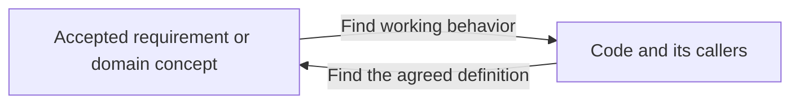
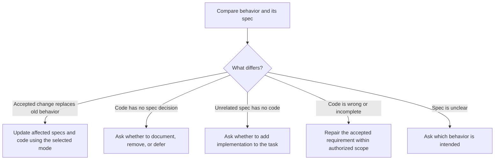

# Spec and code sync

Make the affected code match the accepted spec, including its domain terms, APIs, storage, and behavior. This happens in every task, in both modes. The direction is always spec to code: code changes to match an accepted decision, and code never changes the spec on its own.

## Use the task's mode

Apply the task's [compatibility mode](../SKILL.md#choose-the-compatibility-mode) across every repository in the change family. Record the accepted spec commits, scope, decisions, and checks.

- **Live:** if a required change can't stay compatible, explain the break and settle that decision before dependent code.
- **`--not-live`:** revise or remove the specs, contracts, and decision records the new decision clearly replaces. Update incoming links, diagrams, and requirement references together. Retire replaced requirement IDs instead of giving their identity to a different rule. Git keeps the old text, so don't keep a second active definition, or an obsolete document, just to explain history. Then update all affected first-party code, callers, schema definitions, fixtures, and tests, and remove the code and old-client paths that exist only for the replaced decision. Build missing behavior within the accepted task's scope without asking again.

**Why:** with two active definitions of one rule, every reader has to guess which one is current.

> Example (made up): under `--not-live`, a new rule replaces `PAUSE-003`. The old ID disappears and is never reused. The new rule gets a new ID, links that pointed at `PAUSE-003` now point at it, and the code path that served only the old rule is deleted.

If evidence contradicts the mode, such as a supported deployed client that would break, pause that part and settle it with the user. Don't ask again just because an accepted replacement breaks old behavior.

## Audit existing differences when asked

A whole-project audit starts only when the user asks to compare existing specs and code broadly. `--not-live` alone doesn't start it or widen the scope. An audit-only request allows findings, not repairs.

**Why:** differences pile up quietly, and a broad check is the only way to find code nobody specified and specs nobody built. It's large, so it runs only on request.

Identify the repositories, the authoritative spec versions, and the code branches and commits to compare. Account for relevant uncommitted work without resetting it. Keep the chosen implementation separate from alternate worktrees and older saved work. Settle unclear starting versions before claiming a mismatch.

Read every in-scope feature spec, contract, and domain definition. Separately, inspect the project's code through entry points, callers, storage, configuration, and tests. Where tests cite requirement IDs, start by searching the code repositories for each in-scope ID; this shows which requirements have tests and which have none. Check both directions:

Don't limit the check to the current diff. A matching name or helper function doesn't prove a feature works through its real callers. Don't count vendor or generated code as undocumented product features.

> Example (made up): the spec has `REVIEW-014`, "a Review exercise can be retried once". No test cites it. The code has a `retryExercise()` helper, but no screen calls it. Finding: specified, but not working.

Keep findings in the work record: the requirement or code feature, evidence, current state, proposed action, API and data impact, user decision, and verification result. Track areas checked and areas still unknown. Group findings with one cause into one coherent change; don't open a worktree for every helper.

## Route each finding

| Finding | What to do |
| --- | --- |
| An accepted task decision clearly replaces a definition or implementation | Apply the task's mode. With `--not-live`, replace or remove the old definition and its code directly. With live, keep required compatibility and plan the transition. Don't ask again about the same accepted replacement. |
| A feature or domain concept exists only in code, with no accepted decision | Show what it does, where it's used, its impact, and the missing spec. Ask whether to keep and document it, remove it, or defer it. **Why:** keeping or removing a feature is a product decision. |
| A spec has no implementation outside the accepted task | Ask whether to include its implementation. Planned or deferred requirements aren't automatically new work. |
| Code partly or wrongly implements an accepted spec | An authorized sync or repair task includes fixing it through Spec Workflow, using the accepted requirement and the task's mode. |
| The spec is outdated, contradictory, or unclear, and no accepted replacement settles it | Ask which behavior or spec is authoritative before changing dependent code. |
| Internal helper, proven dead code, or code-only maintenance | Explain why no feature spec is needed. Clean it up only within the authorized scope. |
| Spec and code agree | Record the evidence and continue. |

Handle one coherent decision at a time. Keep inspecting independent areas while waiting, but leave undecided product choices alone. Reuse decisions already made.

For a feature the user wants to keep, revise, review, and commit its spec before changing dependent code. For an approved removal, define the affected callers, contracts, and data. Start a wholly missing feature only when its implementation is within the accepted task scope.

All repairs use the usual shared branches, guided reviews, one squash commit per repository, and sibling rebases. Separate repositories can't share one Git commit.

### Where cleanup fits

Spec Workflow's [code cleanup rules](code-cleanup.md) cover proven dead code and restructuring that keeps behavior. Run the [pre-merge pass](../SKILL.md#clean-up-code-before-merging) before every merge. Missing documentation doesn't make code dead. Removing a feature needs an accepted decision; cleanup can remove its leftovers once that scope is agreed.

## Verify and close

After each accepted repair, update the mappings and tests. Recheck findings affected by later spec or code edits.

Show remaining undocumented features, missing implementations, incomplete behavior, deferred decisions, and unchecked areas separately. Mark a finding resolved only with evidence for the version actually reviewed or merged. A deferred finding is still open. Where tests cite requirement IDs, a requirement that no test cites is not proven. A passing helper test doesn't prove the complete feature works.

Finish only when the agreed scope is verified, or report clearly what remains open.
