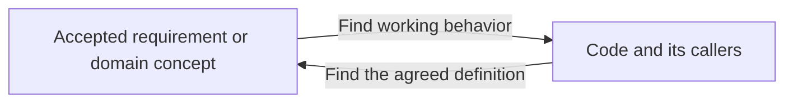
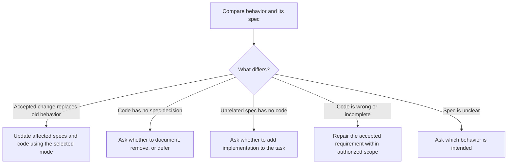

# Spec and code sync

Make the affected code match the accepted spec, including its domain terms, APIs, storage, and behavior. This happens in every task, in both modes. The direction is spec to code: code changes to match an accepted decision, and code never changes the spec on its own. The one exception is a scope the user names with `--from-code`, as [Spec from code](spec-from-code.md) describes.

## Use the task's mode

Apply the task's [compatibility mode](../SKILL.md#choose-the-compatibility-mode) across every repository in the change family. Record the accepted spec commits, scope, decisions, and checks.

- **Live:** if a required change can't stay compatible, explain the break and settle that decision before dependent code.
- **`--breaking`:** revise or remove the specs, contracts, and decision records the new decision clearly replaces. Update incoming links, diagrams, and requirement references together. Retire replaced requirement IDs instead of giving their identity to a different rule. Git keeps the old text, so don't keep a second active definition, or an obsolete document, just to explain history. Then update all affected first-party code, callers, schema definitions, fixtures, and tests, and remove the code and old-client paths that exist only for the replaced decision. Build missing behavior within the accepted task's scope without asking again.

**Why:** with two active definitions of one rule, every reader has to guess which one is current.

> Example (made up): under `--breaking`, a new rule replaces `PAUSE-003`. The old ID disappears and is never reused. The new rule gets a new ID, links that pointed at `PAUSE-003` now point at it, and the code path that served only the old rule is deleted.

If evidence contradicts the mode, such as a supported deployed client that would break, pause that part and settle it with the user. Don't ask again just because an accepted replacement breaks old behavior.

## Compare spec and code when asked

A comparison starts only when the user asks for it: with `--compare`, or in words, such as "compare the specs with the code". With no scope, it's a full scan: every document in the spec repository, and all the code. A scope after the option narrows it, such as `--compare the Review feature`. One comparison starts by itself: the one that follows each draft from `--from-code`, scoped to that draft, as [After a draft from code](#after-a-draft-from-code) describes. `--breaking` alone doesn't start it or widen the scope. A comparison finds differences, explains them, and asks. It changes nothing by itself.

**Why:** differences pile up quietly, and a broad check is the only way to find code nobody specified and specs nobody built. A full scan reads everything, so it's the most expensive thing this workflow does. It runs only on request, now and then, to see what has drifted between spec and code, in both directions, and to bring them back in step.

Identify the repositories, the authoritative spec versions, and the code branches and commits to compare. Account for relevant uncommitted work without resetting it. Keep the chosen implementation separate from alternate worktrees and older saved work. Settle unclear starting versions before claiming a mismatch.

Read every in-scope feature spec, contract, and domain definition. Separately, inspect the project's code through entry points, callers, storage, configuration, and tests. Where tests cite requirement IDs, start by searching the code repositories for each in-scope ID; this shows which requirements have tests and which have none. Check both directions:

Don't limit the check to the current diff. A matching name or helper function doesn't prove a feature works through its real callers. Don't count vendor or generated code as undocumented product features.

> Example (made up): the spec has `REVIEW-014`, "a Review exercise can be retried once". No test cites it. The code has a `retryExercise()` helper, but no screen calls it. Finding: specified, but not working.

A feature's [journey map](writing-specs.md#the-journey-map) is part of its spec, so compare it too: each box and arrow against what a user can really reach, and each state a user can reach against the map.

> Example (made up): the journey map shows Try again after a failed load, but the Failed screen has no such button. Finding: specified, but not working.

### Show the table first

List every difference in one table, numbered and grouped by feature, before you explain any of them:

| # | Difference | Where | Evidence |
| --- | --- | --- | --- |
| 1 | `REVIEW-014`: a Review exercise can be retried once | Spec only | No test cites it, and nothing calls `retryExercise()` |
| 2 | A Class can be exported as CSV | Code only | `GET /classes/{id}/export`, called from Settings |
| 3 | The Pause limit: the spec says 3, the code allows 5 | Both, but different | `PAUSE-003`, and `canPause()` in `PauseLimit.ts` |

- **A planned spec isn't a difference.** A rule whose feature document says `implementation: backlog` is listed under the table as planned, not as a row.
- **Internal code is never a row.** A helper, vendor code, and generated code need no spec.
- **Say what wasn't read.** Name the areas the comparison didn't reach, under the table.

**Why a table first:** the user sees how much there is to decide, and can choose where to start and where to stop.

### Walk the differences one at a time

Then go through the rows one at a time, in the style of a [guided review](../../guided-review/SKILL.md): explain one difference in detail, then stop and wait. Don't run that skill for this. A comparison only reads: it runs no cleanup pass, no bug review, and no tests. Its purpose is that the user understands each difference and decides what happens to it.

Start each difference with a heading that has its number and its title from the table, such as `## Difference 2 of 7: A Class can be exported as CSV`. Then explain in detail and in easy words, with examples:

- **What differs:** what the spec says, quoted with its ID, and what the code does, shown as the code itself: the file, the commit, and a line number in front of each line. Where one side has nothing, say so.
- **Why:** what the history shows about how it came about, such as the commit that added the code, or the change that wrote the rule. Separate evidence from guesses.
- **How it's used:** who calls it, what data it touches, and who would notice a change.
- **Before you decide:** each option that fits, from [Route each finding](#route-each-finding), with what it would change in the spec, the code, the API, and saved data. Then your recommendation, and the reason for it.

Then stop and wait. Stay on this difference while the user asks about it, such as "show the callers" or "what breaks if it goes". The user decides each difference:

| Decision | What it starts later |
| --- | --- |
| Keep it and write it down | The rule is written from the code, as [Spec from code](spec-from-code.md) describes |
| Remove it | A change that removes the code, in the task's [mode](#use-the-tasks-mode) |
| Build it | A change that builds what the spec describes |
| Change the code | A repair that makes the code match the spec |
| Change the spec | A spec change that states the behavior the user wants |
| Defer | Nothing. The row stays open in the work record |

Don't decide for the user, and don't apply anything during the walk. Write each decision next to its row in the work record as soon as it's made, so a walk that stops loses nothing. The user can stop the walk at any row, and the rows that are left stay open. Show the table again, with the decisions so far, when the user asks and when the walk ends.

One difference might look like this (made up):

> ## Difference 2 of 7: A Class can be exported as CSV
>
> **What differs:** the code can export a Class as CSV. No rule in the spec describes an export. The route is `GET /classes/{id}/export`, in `ClassRoutes.ts`, lines 88 to 104, at `9b3e1d4`.
>
> **Why:** commit `4c1a2f7` added it as "temporary export for the pilot". No decision record mentions it.
>
> **How it's used:** the Settings screen has an Export button. No test covers the route.
>
> **Before you decide:** keep it and write it down, which adds one rule to Class history and the route to the contract. Or remove it, which deletes the button, the route, and two helpers. I'd remove it: it was added as temporary, and nothing tests it.

**Why in this style:** keeping or removing a feature is a product decision, and the user can only make it with the code, its history, and the cost of each option in front of them.

### Turn the decisions into changes

A decision in the walk changes nothing yet. It's the user's answer for one row. When the walk ends, or the user stops it:

1. **Group the decided rows** that have one cause into one change. Don't plan a change for every row.
2. **Show the changes** the decisions lead to: each with its rows, the repositories it touches, and a suggested order. Add them to the work record's priorities.
3. **Start a change when the user says so.** It then runs through the usual workflow: the spec first where it changes, then the code, with the usual reviews and the merge approval.

> Example: rows 2 and 5 are the export's route and its button. Both are decided "remove it", so they become one change. Row 3 is decided "change the spec", and becomes a second change, in the spec only. Row 1 is deferred and stays open.

**Why not right after each decision:** rows often belong together, and a later row can change what an earlier answer means. Carrying one out also takes a worktree, a build, and a review, which would stop the walk for a long time after every row.

Keep each row in the work record: the difference, its evidence, the decision, the change that carries it out, and the verification result. Track the areas read and the areas still unknown.

### After a draft from code

A [`--from-code` run](spec-from-code.md) compares each feature's draft with the code as soon as it's written, without being asked. The comparison covers that draft's scope only, and it takes the place of a guided review. Everything above applies, with these differences:

- **Only the draft's scope.** Read the drafted documents, and the code that the run read for them. **Why:** a full scan is expensive, and the draft is what's new. The rest of the product waits for a `--compare` with no scope.

- **Compare fixed commits:** the draft's head, and the code commits that the run read. **Why:** the draft describes those commits. Newer code would show differences that the draft never saw.
- **Read the code a second time, from the spec's side.** Check each rule, and each arrow of a journey map, against the code that its evidence names, and each entry of the run's map against the rules. Where a rule says something the code doesn't do, correct the draft before you show the table, and name the correction under it. That isn't a difference to decide: a draft only describes.
- **Start the table with the run's findings and questions,** and add what the second read found, and what the run's [flow tests](spec-from-code.md#prove-the-rules-end-to-end) found, if it has them. A row from a flow test names the flow and its step, so the user can look at its picture. A place that breaks a rule is "both, but different". A finding or a question with no rule yet is "code only".
- **Rules that agree get no row.** Under the table, name them by evidence, and link the drafted documents, so the user can read any rule. The parts nobody read go there too.
- **A draft needs only three decisions:** keep it as built, fix it later, or defer. "Keep it as built" changes the draft: a rule is added, or a rule names its exception. An answer to a question adds the rule the user chose, and code that differs from it is fixed later. "Fix it later" leaves the draft as it is, and becomes a change after the spec is accepted, such as a repair or a removal, as [Turn the decisions into changes](#turn-the-decisions-into-changes) describes.
- **Walk every row, one at a time,** like any other comparison, and change nothing during the walk. When it ends, the run [finishes the draft](spec-from-code.md#the-run) and asks the user to accept the spec.

The table might look like this (made up):

| # | Difference | Where | Evidence |
| --- | --- | --- | --- |
| 1 | `PAUSE-003` allows 5 pauses, but a new Class shows "3 pauses left" | Both, but different | `canPause()` in `PauseLimit.ts`, and `PauseScreen.tsx` |
| 2 | `PAUSE-005` shows the time left in minutes, but the last minute counts down in seconds | Both, but different | `formatTimeLeft()` in `PauseTimer.ts` |
| 3 | A paused Class ends after 24 hours in the app, and after 48 in the nightly job | Code only: a question | `PauseScreen.tsx`, and `expirePausedClasses()` |
| 4 | After the fifth pause, the Pause button stays enabled until the Class is reopened | Code only: a finding | The flow test "Pause a Class five times", step 6 |

> Proven: `PAUSE-001` and `-002`. Read: `PAUSE-004` and `-006`. Corrected in the draft: `PAUSE-004` said a pause lasts 10 minutes, and the code gives 15. Not read: the recording module's native code. Draft: `features/pausing-a-class.md`.

## Route each finding

Use this table for the options in each chunk of a comparison's walk, and for a difference that turns up during normal work.

| Finding | What to do |
| --- | --- |
| An accepted task decision clearly replaces a definition or implementation | Apply the task's mode. With `--breaking`, replace or remove the old definition and its code directly. With live, keep required compatibility and plan the transition. Don't ask again about the same accepted replacement. |
| A feature or domain concept exists only in code, with no accepted decision | Show what it does, where it's used, its impact, and the missing spec. Ask whether to keep and document it, remove it, or defer it. **Why:** keeping or removing a feature is a product decision. |
| A spec has no implementation outside the accepted task | Ask whether to include its implementation. Planned or deferred requirements aren't automatically new work. |
| Code partly or wrongly implements an accepted spec | An authorized sync or repair task includes fixing it through Spec Workflow, using the accepted requirement and the task's mode. |
| The spec is outdated, contradictory, or unclear, and no accepted replacement settles it | Ask which behavior or spec is authoritative before changing dependent code. |
| Internal helper, proven dead code, or code-only maintenance | Explain why no feature spec is needed. Clean it up only within the authorized scope. |
| Spec and code agree | Record the evidence and continue. |

Handle one coherent decision at a time. Keep inspecting independent areas while waiting, but leave undecided product choices alone. Reuse decisions already made.

For a feature the user wants to keep, revise, review, and commit its spec before changing dependent code. For an approved removal, define the affected callers, contracts, and data. Start a wholly missing feature only when its implementation is within the accepted task scope.

All repairs use the usual shared branches, guided reviews, one squash commit per repository, and sibling rebases. Separate repositories can't share one Git commit.

### Where cleanup fits

Spec Workflow's [code cleanup rules](code-cleanup.md) cover proven dead code and restructuring that keeps behavior. Run the [pre-merge pass](../SKILL.md#clean-up-code-before-merging) before every merge. Missing documentation doesn't make code dead. Removing a feature needs an accepted decision; cleanup can remove its leftovers once that scope is agreed.

## Verify and close

After each accepted repair, update the mappings and tests. Recheck findings affected by later spec or code edits.

Show remaining undocumented features, missing implementations, incomplete behavior, deferred decisions, and unchecked areas separately. Mark a finding resolved only with evidence for the version actually reviewed or merged. A deferred finding is still open. Where tests cite requirement IDs, a requirement that no test cites is not proven. A passing helper test doesn't prove the complete feature works.

Finish only when the agreed scope is verified, or report clearly what remains open.
