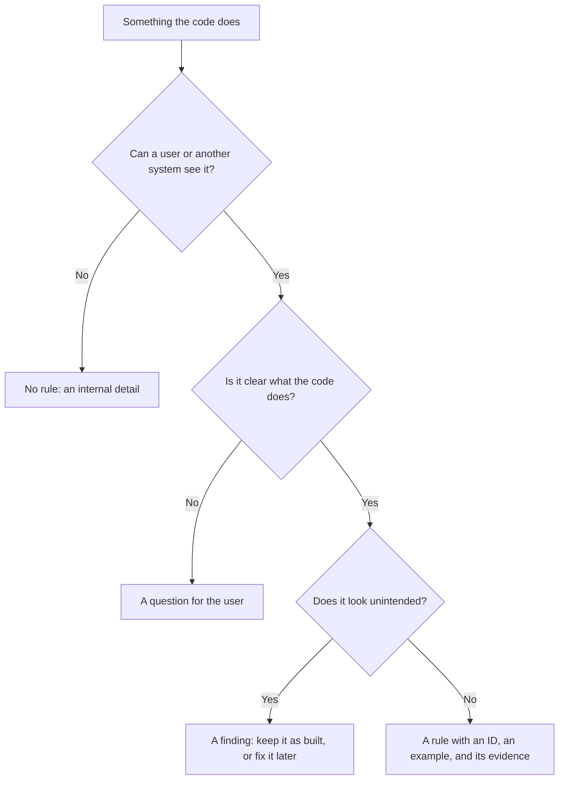
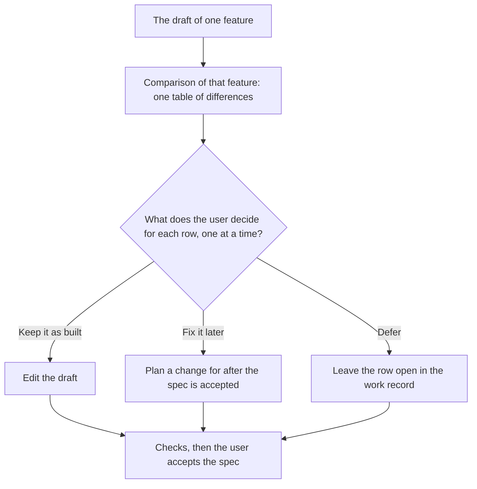
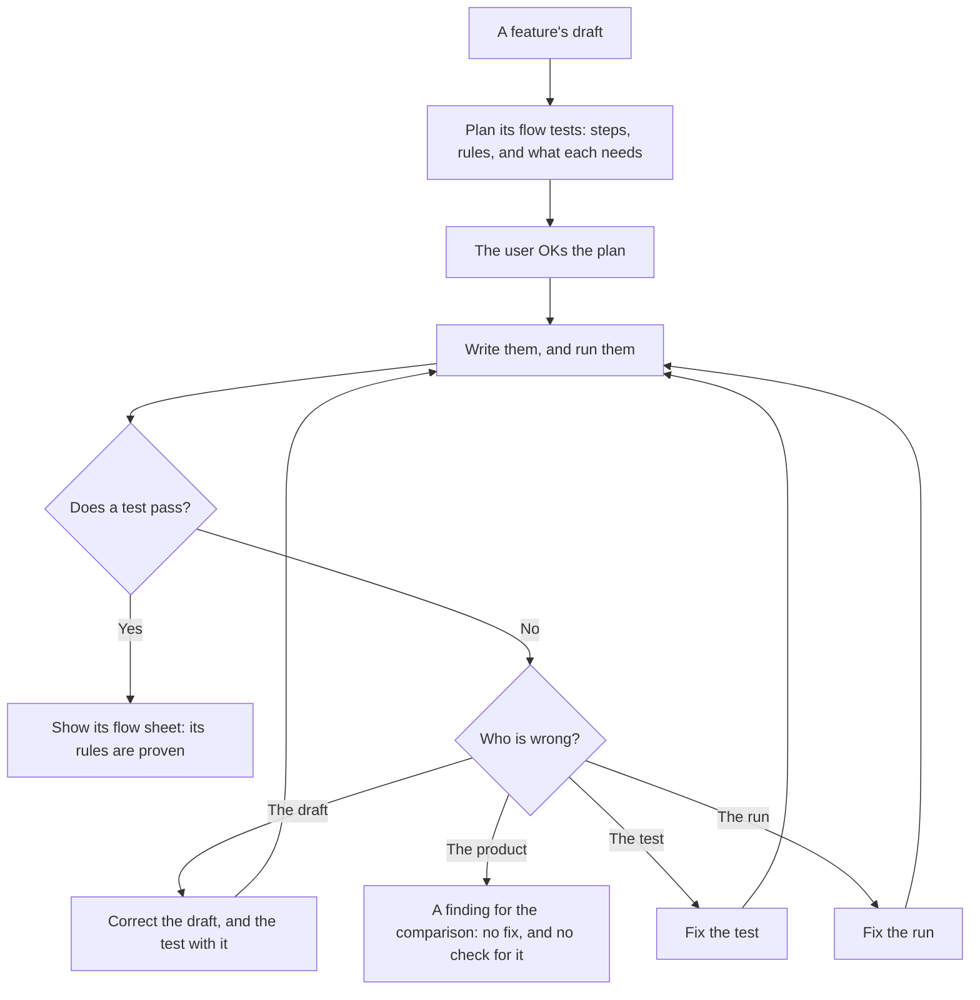

# Spec from code

Use this page when the user asks to build a spec from existing code, with `--from-code` and a named scope. It's for code that nobody knows well, or whose spec is missing or can't be trusted. For that scope, the usual direction turns around: the code at one commit is the source, and the spec describes what it does today. Once the user accepts that spec, the usual direction applies again. Without a scope, map the whole product first, as step 2 describes, say which features already have an accepted spec, and let the user pick which ones to draft. Draft nothing before they pick.

```text
$spec-workflow --from-code the Review feature           in Codex
/spec-workflow --from-code the Class screens            in Claude Code
/spec-workflow --from-code the sign-up screens, with flow tests
/spec-workflow --from-code                              maps the whole product first
```

Each thing the code does takes one of these paths:



**Why a switch:** [When to return to specs](../SKILL.md#when-to-return-to-specs) says "Don't change a spec just to justify existing code". That holds for every normal change. Here the user asks for the opposite on purpose, for one scope, and decides every difference before accepting the result.

## Words used here

| Word | Meaning | Example |
| --- | --- | --- |
| As built | What the code does today, whether or not anyone meant it | A Class can be paused 5 times |
| Evidence | Where a rule was read: the file and the symbol, and the test that shows it, if one does | `PauseLimit.ts`, `canPause()`, and `pauseLimit.test.ts` |
| Proven | A rule that a test shows | A test pauses a sixth time and expects a refusal |
| Read | A rule seen in the code that no test shows | The limit is in the code, but no test reaches it |
| Journey map | A feature's Main flow as one diagram of what the user sees, as [Writing specs](writing-specs.md#the-journey-map) describes | Reopen a Class: loading, then ready or failed |
| Flow test | An end-to-end test that walks one flow on the real product, the way a user does. Each step names the rule it proves | Sign up, then verify the email |
| Finding | Something the code does that looks unintended, or code that nothing calls | A credit is charged twice when a resume fails |
| Question | Something the code doesn't make clear | Two code paths that set different Pause limits |

## What a run may change

- **The spec repository,** for the named scope: feature documents, contracts, the domain model, and data cards.
- **No behavior.** What the code does stays as it is, including what looks like a bug.
- **Tests and tooling in the code repositories,** and nothing else there: requirement IDs in test titles, [flow tests](#prove-the-rules-end-to-end) in the e2e repository, and a test ID on a view that a flow test can't find any other way. Each is a code-only change of its own, through the usual review.
- **Nothing outside the scope.** A second scope needs its own request.

An accepted spec that already covers part of the scope stays as it is. Where it differs from the code, that's a row in the [comparison that follows the draft](spec-code-sync.md#after-a-draft-from-code). Don't overwrite it.

**Why no fixes:** a run that reads and fixes at once leaves nobody able to say what the code did before. The spec of the code as built comes first. A fix is then a normal change against it.

## Write what the code does

- **Describe, don't improve.** Write what the code does today, not what it should do.
- **Write only what can be seen from outside:** on a screen, in a message, in a contract, or in saved data that something else reads. A helper, a cache, or a retry that nobody can notice gets no rule.
- **Take every number and every text from the code,** such as a limit, a timeout, or an error message. Take each rule's example from a test where one exists.
- **Keep the evidence out of the document.** A file path in a spec is out of date after the next refactoring. What lasts is a test that cites the rule's ID. Until the draft merges, keep the evidence in `.spec-from-code/<change>/evidence.md` beside the work record, with one row for each rule, and one for each arrow of a [journey map](#screens). The comparison reads it, and it goes to the Trash after the merge.
- **Say whether each rule is proven or read.** A rule that no test shows is still a rule, but the comparison names it as read.
- **Use the code's own names, and ask.** The names of features and domain terms are decisions. Propose the names the code uses, and flag two names for one thing, as [Map domain language into code](../SKILL.md#map-domain-language-into-code) describes.
- **Never turn a finding or a question into a rule.** The user decides each one.
- **Don't read a target from the code.** A [data card](technical-changes.md#a-data-card-for-each-store) can be filled from the stores, keys, and queries in the code. A service level or a budget can't: the code doesn't know how fast it was meant to be. Leave those to the user.

> Example: the code lets a Class pause 5 times, and a test shows it. That's a rule, and it's proven. The code also charges a credit twice when a resume fails. That looks unintended, so it's a finding. The user decides: write it down as built, or fix it later.

## The run

1. **Fix the scope and the commits.** Name the scope in the user's words, each repository it covers, and the commit of each one that is read. Record them in the work record.
2. **Map it from the outside in.** List what can be reached from outside: screens, routes, jobs, messages, saved data, and switches in the configuration. List the tests beside them. Group the list into features, and show it to the user, who confirms the names and the order. With the map, ask once whether the run should also [prove the rules end to end](#prove-the-rules-end-to-end), unless the request already says.
3. **Draft one feature at a time,** on a spec branch, from the [feature template](../assets/templates/feature.md), as [Writing specs](writing-specs.md) describes. Its header says `status: draft`, and `implementation: complete` or `partial`. Write its contracts from the routes and the message shapes, and its domain terms with their names in code.
4. **Describe its screens, and draw its journey map,** when the scope has screens, as [Screens](#screens) describes.
5. **Prove its rules end to end,** when the user wants that, as [Prove the rules end to end](#prove-the-rules-end-to-end) describes: plan the feature's flow tests, and with the user's OK, write them, run them, and show each flow. What a failed test shows goes into the comparison.
6. **Compare it** right away, without being asked, as [After a draft from code](spec-code-sync.md#after-a-draft-from-code) describes. The comparison covers this draft's scope only. One table shows every difference between the draft and the code, starting with the findings and the questions, and the user goes through them one at a time. A draft gets no guided review: the comparison takes its place.
7. **Finish the draft and ask.** Apply the decisions that change the draft's text, and commit them. Run the [spec checks](writing-specs.md#before-merging-a-spec-change) and the [test merges](git-operations.md#test-merge-with-open-branches) on that commit. Show the table again with its decisions, quote each rule that changed, and ask the user to accept the spec at that commit.
8. **Record what's left** for this feature, as [Keep what is left](#keep-what-is-left) describes. Then take the next feature.

Steps 6 and 7 for one feature:



A map might look like this (made up):

| Feature | Reached through | Tests |
| --- | --- | --- |
| Pausing a Class | The Pause button, `POST /classes/{id}/pause` | 14, in `pause*.test.ts` |
| Class history | The History screen, `GET /classes` | None |

**Why one feature at a time:** nobody can review a whole product's spec in one sitting. One feature is small enough to check against its code, and its names settle before the next feature uses them.

**Why a comparison and no guided review:** the code already decided most of a draft, so most rules need only a nod. What needs the user is the list of places where the draft and the code disagree, and one table shows that list at once. The comparison also reads the code a second time, from the spec's side, which catches a rule the draft got wrong.

An accepted draft then merges like any spec change, as [Review and merge](../SKILL.md#review-and-merge) describes, but with no guided review: the user approves the destination, for the commit they accepted.

## Screens

When the scope has screens, the feature document describes each state in words, as a rule with an example. Its [journey map](writing-specs.md#the-journey-map) then joins those states into the journey a user walks:

- **Draw each arrow from the code:** what takes the user from one state to the next, such as a failed load that leads to Failed. Keep each arrow's evidence beside the rules', as proven when a test walks it, and as read when only the code shows it.
- **An arrow the code doesn't make clear is a question,** not an arrow. It stays off the journey map until the user answers.
- **Draw it as built.** When a state offers no way on where a user would expect one, such as a failure with no retry, the journey map ends there, and that's a finding.

To see the screens as built, [prove the rules end to end](#prove-the-rules-end-to-end): each flow's sheet shows one path of the journey map, with its states in the order a user meets them.

> Example: the saved-audio part of a Class has three states in the code: Loading, Ready, and Failed. The run writes a rule for each state, and the journey map joins them: Loading leads to Ready or to Failed. Failed says "Try again" but shows no button. That looks unintended, so it's a finding, and the journey map ends at Failed.

## Prove the rules end to end

A draft says what the code seems to do. A **flow test** checks that on the real product: it walks one flow the way a user does, and each step names the rule it proves. When the user wants it, write and run a feature's flow tests before its comparison, so what they show reaches the table.



- **Ask once, with the map,** unless the request already says. When the workspace has no e2e repository, say so with the question, because a yes then starts with building one. Proving rules end to end needs two things: an e2e repository, and something that drives the product. For an Android app, that's an emulator, as the [android-device-tests](../../android-device-tests/SKILL.md) skill describes. For another platform, such as a web app or iOS, first research what can drive the real product and take a picture of each step, and propose it.
- **Create the e2e repository, when the workspace has none,** with the user's OK: `<workspace>/<project>-e2e/`, with `git init -b main` and no remote, like the spec repository. Its first commit holds a README and a `.gitignore` that covers `.env` and the runs' pictures. First settle its facts, as the platform's skill says, such as [Start a new e2e repository](../../android-device-tests/SKILL.md#start-a-new-e2e-repository). Before its first test, it needs its runner and helpers: what starts the device, reads the screen, and takes the step pictures.
- **Plan one feature's flows,** after its draft. A flow is what a user does in one go, such as signing up. When the feature has a [journey map](writing-specs.md#paths-and-flow-tests), a flow is one path through it: take the path with no error first, then one more for each branch, until every arrow is on a flow. For each flow, name its steps, the rule each step proves, and what it needs, such as a seeded account. When the product itself has no way to create it, that's a question for the comparison. Plan a flow for a rule even when a unit test already shows it: a unit test with stand-ins can show a rule that the real product breaks. List the rules that no flow test can prove, and the arrows that no flow can walk, each with its reason. Show the plan, and wait for the user's OK before you write a test: they can drop a flow, or change what one needs.
- **Write each test from its rules' examples,** as the platform's skill describes, such as [Write a flow test](../../android-device-tests/SKILL.md#write-a-flow-test). A step that proves a rule carries the rule's ID in its name.
- **Check only what the rules say.** A flow test never checks a finding or a question, because the user hasn't decided those yet.
- **When a test fails, find out who is wrong** before you change anything:
  - **The run:** the device or its setup failed, such as a locked emulator. Fix the run, as the platform's skill says, and run the test again.
  - **The test:** fix it.
  - **The draft:** it says more than the code does. Correct the draft, change the test to match it, and name the correction under the comparison's table.
  - **The product:** it does something that looks unintended. That's a finding, and a row in the comparison. Don't fix it, and don't write a check for it.

  Never change a check just to make a test pass.
- **Show each flow once it passes.** Send its flow sheet as an image, moving where the platform can record that, and say in one line what it shows: which path of the journey map, when the feature has one. This is the one place where a picture comes without the user asking: seeing the flow is the point.
- **Update the evidence.** A rule that a flow test shows is proven, and so is an arrow that it walks. The evidence of each names that test.
- **Keep the tests in a change of their own:** a code-only change in the e2e repository, in its own worktree, that waits for the spec. Give it its own entry in the work record, which names the draft it waits for. Once the spec is accepted, it goes through the usual review and merge, as [Review and merge](../SKILL.md#review-and-merge) describes. When a decision in the comparison changes a rule, change its test before that review.

A plan might look like this (made up):

| Flow (one test) | Steps | Proves | Needs |
| --- | --- | --- | --- |
| Verify the email from Home | Home, not verified → tap **Verify Email** → Home says it's verified | Step 3: `VERIFY-001` | A new learner |
| Sign up with a passkey | Welcome → email → passkey sheet → Home | Step 4: `SIGNUP-002` and `-003` | A screen lock on the device |
| Sign up, and cancel the passkey | Welcome → email → passkey sheet → tap **Cancel** → Welcome says the sign-up was cancelled | Step 5: `SIGNUP-004` | A screen lock on the device |

> No flow test: the arrow to "This link has expired", `VERIFY-004`, because the link expires after 15 minutes, and a test can't wait that long. A unit test fits it better.

> Example: a draft rule said that once the email is verified, Home shows "Email verified. You can start now." and lets the learner start a Class. A unit test showed that, with a made-up learner who has credits. The flow test failed: a new learner has no credit, so the start stayed disabled. The draft was wrong, so the rule lost that clause. Home's message also promises a start that isn't possible, and that became a finding.

**Why before the comparison:** a flow test reads the product a third time, from the outside, and it catches what the code and its unit tests can hide. The comparison is where the user decides, so it should already hold what the tests found. After acceptance, the same failure would mean a wrong rule in an accepted spec.

**Why one test for a flow, and not for a rule:** a flow test starts the real product and drives it step by step, which takes most of a minute. One test for each rule would walk the same screens again and again.

**For a spec that's already accepted,** flow tests are a normal code-only change in the e2e repository. Plan and write them the same way, from the accepted rules and the journey map. When the feature document has no journey map yet, the change starts with it, in the spec: draw it from the accepted rules, settle each arrow that no rule decides, and get the journey map accepted before you plan a flow. A test that fails then shows a difference between the spec and the code, which the user decides like any other.

## Keep what is left

Keep three lists in the work record, for each feature: findings, questions, and parts that nobody read. The comparison shows the first two as rows, and names the third under its table. Keep each row's decision beside it. When the run proved rules end to end, also keep the rules that no flow test proves, and the arrows that no flow walks, each with its reason.

- **A finding** becomes a normal change when the user decides to fix it. The spec changes first then, as always.
- **A question** stays out of the spec until the user answers it.
- **A part nobody read** is named, so the spec doesn't claim more than was checked.

Finish only when the scope is drafted, compared, and accepted, or say clearly what remains open.

## Check before you finish

- **The scope and the commits** are recorded, and nothing outside the scope changed.
- **Each rule** can be seen from outside, has an example, and has its evidence on file, as proven or as read.
- **Each row of the comparison** is decided or deferred, and the user accepted the spec at the commit that holds those decisions.
- **No rule** describes something that looks unintended, unless the user decided to keep it as built.
- **The names** of features and domain terms are confirmed by the user.
- **Each journey map,** when the scope has screens, shows only what the user sees, as built. Each arrow has its evidence, and none is a guess.
- **Each flow test,** when the run has them, passes and checks only what its rules say. Its sheet was shown, and each rule that no flow test proves, and each arrow that no flow walks, has its reason.
- **No behavior changed.** IDs in test titles, flow tests, and test IDs on views are code-only changes, each with its own review.
- **Findings, questions, and parts nobody read** are listed.
