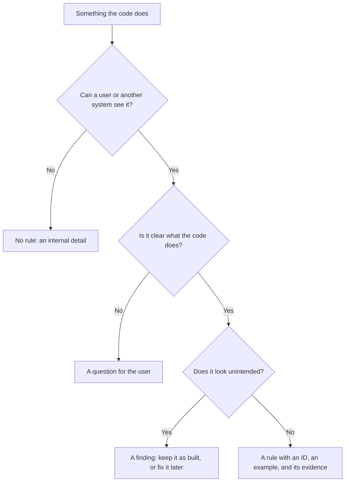

# Spec from code

Use this page when the user asks to build a spec from existing code, with `--from-code` and a named scope. It's for code that nobody knows well, or whose spec is missing or can't be trusted. For that scope, the usual direction turns around: the code at one commit is the source, and the spec describes what it does today. Once the user accepts that spec, the usual direction applies again.

```text
$spec-workflow --from-code the Review feature           in Codex
/spec-workflow --from-code the screens and the design   in Claude Code
```

Each thing the code does takes one of these paths:



**Why a switch:** [When to return to specs](../SKILL.md#when-to-return-to-specs) says "Don't change a spec just to justify existing code". That holds for every normal change. Here the user asks for the opposite on purpose, for one scope, and reviews the result.

## Words used here

| Word | Meaning | Example |
| --- | --- | --- |
| As built | What the code does today, whether or not anyone meant it | A Class can be paused 5 times |
| Evidence | Where a rule was read: the file and the symbol, and the test that shows it, if one does | `PauseLimit.ts`, `canPause()`, and `pauseLimit.test.ts` |
| Proven | A rule that a test shows | A test pauses a sixth time and expects a refusal |
| Read | A rule seen in the code that no test shows | The limit is in the code, but no test reaches it |
| Finding | Something the code does that looks unintended, or code that nothing calls | A credit is charged twice when a resume fails |
| Question | Something the code doesn't make clear | Two code paths that set different Pause limits |

## What a run may change

- **The spec repository,** for the named scope: feature documents, contracts, the domain model, the design folder, and storyboards.
- **No behavior.** What the code does stays as it is, including what looks like a bug.
- **Tooling in the code repositories,** and nothing else there: stories and stand-ins that draw existing screens, and requirement IDs in test titles. Each is a code-only change of its own, through the usual review.
- **Nothing outside the scope.** A second scope needs its own request.

An accepted spec that already covers part of the scope stays as it is. Where it differs from the code, that's a difference for [Compare spec and code when asked](spec-code-sync.md#compare-spec-and-code-when-asked). Don't overwrite it.

**Why no fixes:** a run that reads and fixes at once leaves nobody able to say what the code did before. The spec of the code as built comes first. A fix is then a normal change against it.

## Write what the code does

- **Describe, don't improve.** Write what the code does today, not what it should do.
- **Write only what can be seen from outside:** on a screen, in a message, in a contract, or in saved data that something else reads. A helper, a cache, or a retry that nobody can notice gets no rule.
- **Take every number and every text from the code,** such as a limit, a timeout, or an error message. Take each rule's example from a test where one exists.
- **Show the evidence in the review, not in the document.** A file path in a spec is out of date after the next refactoring. What lasts is a test that cites the rule's ID.
- **Say whether each rule is proven or read.** A rule that no test shows is still a rule, but the review says so.
- **Use the code's own names, and ask.** The names of features and domain terms are decisions. Propose the names the code uses, and flag two names for one thing, as [Map domain language into code](../SKILL.md#map-domain-language-into-code) describes.
- **Never turn a finding or a question into a rule.** The user decides each one.

> Example: the code lets a Class pause 5 times, and a test shows it. That's a rule, and it's proven. The code also charges a credit twice when a resume fails. That looks unintended, so it's a finding. The user decides: write it down as built, or fix it later.

## The run

1. **Fix the scope and the commits.** Name the scope in the user's words, each repository it covers, and the commit of each one that is read. Record them in the work record.
2. **Map it from the outside in.** List what can be reached from outside: screens, routes, jobs, messages, saved data, and switches in the configuration. List the tests beside them. Group the list into features, and show it to the user, who confirms the names and the order.
3. **Draft one feature at a time,** on a spec branch, from the [feature template](../assets/templates/feature.md), as [Writing specs](writing-specs.md) describes. Its header says `status: draft`, and `implementation: complete` or `partial`. Write its contracts from the routes and the message shapes, and its domain terms with their names in code.
4. **Draw its screens,** when the scope has any, as [Screens and the design folder](#screens-and-the-design-folder) describes.
5. **Review it** with the [guided review](guided-review.md), as a spec review. Each chunk shows its rules beside the code they were read from, and says which are proven and which are read. Each finding and each question comes up in the chunk it belongs to. The decision is "accept the spec".
6. **Record what's left** for this feature, as [Keep what is left](#keep-what-is-left) describes. Then take the next feature.

A map might look like this (made up):

| Feature | Reached through | Tests |
| --- | --- | --- |
| Pausing a Class | The Pause button, `POST /classes/{id}/pause` | 14, in `pause*.test.ts` |
| Class history | The History screen, `GET /classes` | None |

**Why one feature at a time:** nobody can review a whole product's spec in one sitting. One feature is small enough to check against its code, and its names settle before the next feature uses them.

## Screens and the design folder

When the scope has screens, a run also builds what [Storyboards and screen pictures](screen-pictures.md) keeps in the spec repository:

- **The design folder,** from the theme code and from how the components are used. Token values come from the theme, exactly. A rule goes in only where the code follows one pattern everywhere. A place that breaks the pattern is a finding.
- **A story for each existing state,** in the repository that owns the screen. That's tooling, so it's allowed.
- **A storyboard for each feature,** with one artboard for each state, in the order a user meets them. An artboard shows its story where the project can do that, and is named `built`. Otherwise, sketch it from the story's picture, and name it `sketch`.

> Example: the theme code has 29 colours, and every primary button uses the same one. The design folder gets the 29 token values, and the rule "a primary button uses `palette-accent`". One screen uses a literal grey that no token has. That's a finding.

## Keep what is left

Keep three lists in the work record, for each feature: findings, questions, and parts that nobody read. Show them when the run ends.

- **A finding** becomes a normal change when the user decides to fix it. The spec changes first then, as always.
- **A question** stays out of the spec until the user answers it.
- **A part nobody read** is named, so the spec doesn't claim more than was checked.

Finish only when the scope is drafted and reviewed, or say clearly what remains open.

## Check before you finish

- **The scope and the commits** are recorded, and nothing outside the scope changed.
- **Each rule** can be seen from outside, has an example, and was shown beside its code, as proven or as read.
- **No rule** describes something that looks unintended, unless the user decided to keep it as built.
- **The names** of features and domain terms are confirmed by the user.
- **No behavior changed.** Stories, stand-ins, and IDs in test titles went through their own review.
- **Findings, questions, and parts nobody read** are listed.
