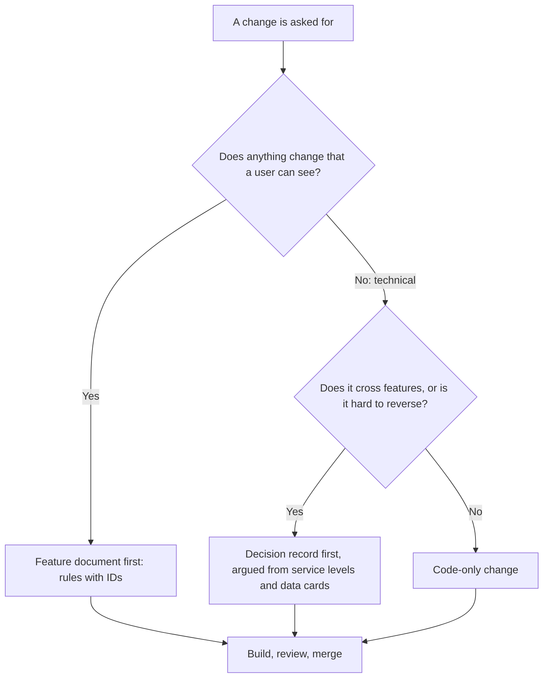

# Technical changes

Use this page for a change that no user can see, but that crosses features or is hard to reverse: a new module structure, a change to how data is stored, a data migration, or a move to other infrastructure. Such a change has no behavior rule to check against, so its target is decided in a decision record first, and the code follows that.



A small technical change stays a code-only change, as [When to return to specs](../SKILL.md#when-to-return-to-specs) describes. A change that also alters what a user sees isn't technical: its behavior goes through a feature document first.

## Words used here

| Word | Meaning | Example |
| --- | --- | --- |
| Technical change | A change to how the product is built or run, with the same behavior | Splitting the Classes table in two |
| Service level | How fast and how reliably one operation must answer. It's part of the operation's contract | 300 ms at P95, and 99.5% of calls succeed |
| Data card | One page about one store: what it holds, how it's read and written, how much, and what drives its cost | The card for the Classes table |
| Access pattern | One way the code reads or writes a store | "List a learner's Classes, newest first" |
| Step | One part of a technical change that keeps behavior and merges alone | "Add the new table, and write to both" |

## Decide the target first

1. **Write a decision record,** from the [decision template](../assets/templates/decision.md): the problem, the options, the choice, and what it costs. [Decisions](writing-specs.md#decisions) describes the form.
2. **Update the pages it changes** on the same spec branch: the data cards, the architecture pages, and the contracts. Don't change a feature document's rules. If one would have to change, the change isn't technical.
3. **Review and accept it** like any spec change, before code that depends on it.

> Example: "one module for each feature, and no module reads another one's tables" is an accepted decision record and an updated architecture page before any file moves.

**Why:** without this step, the new structure first shows up in the merge review, when 200 files have already moved and saying no is expensive.

## Argue from numbers

A decision record for a technical change says what is wrong today and how anyone will know it's fixed. Two kinds of pages give it the numbers.

### Service levels live in the contract

Each operation's contract says how fast and how reliably it must answer, beside its shape. In an OpenAPI file, that's an extension field on the operation, with the shared rules once at the top:

```yaml
x-service-levels:
  measured: at the API gateway, over 28 days
  failed-after: 2s        # a slower answer counts as failed
  default:
    latency: { p50: 200ms, p95: 500ms, p99: 2s }
    availability: 99.5%

paths:
  /classes/{id}/pause:
    post:
      operationId: pauseClass
      x-service-level:
        latency: { p50: 100ms, p95: 300ms, p99: 1s }
```

- **The contract owns the numbers.** A feature document links to its operations under Links, and doesn't repeat them.
- **`failed-after` makes slow count as down.** An answer that takes longer counts as a failed call, so a server that answers every call in 5 seconds has an availability of 0%.
- **An operation without its own field has the default.**
- **Write only a level that something checks,** such as a load test or a monitor. That check names the operation it measures, by its `operationId`. A level that nothing measures isn't proven yet.
- **A contract in another format** carries the same fields in its own way, or in a small file beside it.

**Why in the contract:** a caller depends on an answer's speed as much as on its shape. Both are promises about the same operation, so they have one owner.

### A data card for each store

A store with more than one access pattern, or with real size or cost, gets a data card under `architecture/data/`, from the [data card template](../assets/templates/data-card.md):

| Part | Example |
| --- | --- |
| What it holds | One item for each Class, about 4 KB |
| Access patterns | 1. Get a Class by its ID. 2. List a learner's Classes, newest first |
| Size and growth | 20 Classes for each learner in a month |
| Kept how long | Until the account is deleted |
| Cost drivers | 12 writes for each Class. Storage hardly matters |

The same form works for a part of the infrastructure that isn't a store, such as a queue or a speech service: what it's for, how it's used, and what drives its cost.

**Why:** a store is designed from its access patterns. Without the card, a technical change has to find them again in the code, and can't tell a pattern someone needs from one that just happens to exist.

### Keep targets and measurements apart

A service level and a budget are decisions, so they're in the spec repository. A measurement is not: today's P95, last month's bill, and a provider's price list change without anyone deciding anything. Leave them where they're produced, such as a load test's report or the provider's console. A decision record quotes the one number it argues from, with its date and its source. The `research/` folder is for research about the world outside the app, not for the app's own numbers.

> Example: "On 2026-11-18, the load test in `e2e/load/history.js` measured `listClasses` at 900 ms at P95. Its contract asks for 300 ms."

## Cut it into steps

Plan a technical change as steps that each keep behavior and merge alone. Give each step its own change, and record what it depends on in the work record. Don't build one long branch.

- **Moving code:** move first, change second. A step that only moves files is quick to review, because nothing in them changed.
- **Changing stored data in a live product:** add the new shape, write to both, copy the old data, switch the readers, stop writing the old shape, then remove it. Some of these steps are a release apart.
- **Under `--breaking`:** replace the shape in one change, as [Choose the compatibility mode](../SKILL.md#choose-the-compatibility-mode) describes. That's only for a feature that isn't released yet.

> Example: splitting the Classes table is four changes: add the new table and write to both, copy the old items, read from the new table, remove the old one. Each one merges and runs before the next starts.

**Why:** a refactor conflicts with every open branch, and a long one conflicts with all of them for a long time. A step that merges within a day or two doesn't.

## Prove that behavior stayed the same

- **Before the first step,** run the tests that cover the affected behavior. Where important behavior isn't covered, add tests that pin down what the code does today, as [Preserve behavior](code-cleanup.md#preserve-behavior) describes.
- **After each step,** run them again. They must pass unchanged. A test that had to change is a sign that behavior changed.
- **Where a service level was the reason,** run its check before the first step and after the last one, and put both numbers in the review.

## Never without the user's OK

Merging a step is not running it. Running a migration on real data, deleting saved data, and changing deployed infrastructure each need the user's OK for that exact target, as [Choose the compatibility mode](../SKILL.md#choose-the-compatibility-mode) describes for saved data. Say what the step does, whether it can be undone, and how.

## Check before you merge a step

- **The decision record is accepted,** and the step does what it says.
- **No behavior changed:** the tests from before the first step pass unchanged.
- **The data cards, architecture pages, and contracts** match the code after this step.
- **Each number in the review** has its date and its source.
- **Nothing ran on real data** without the user's OK.
