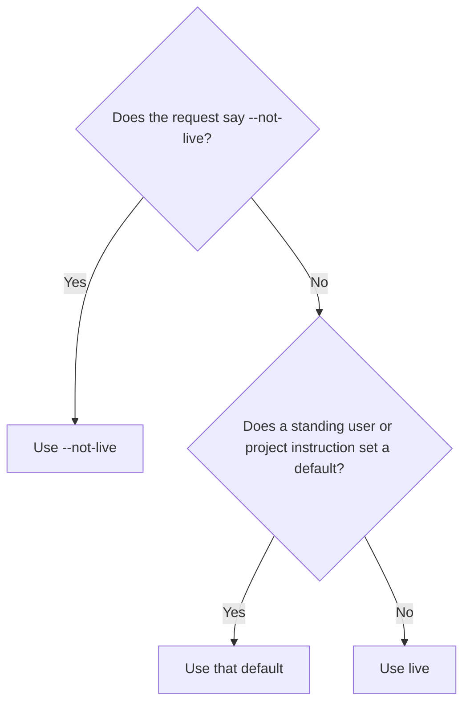

# Worked examples

This file explains Spec Workflow's rules in more detail, with several examples for each one. [SKILL.md](../SKILL.md) states the rules; read the matching section here when a rule's meaning, or how it applies to an unusual case, isn't clear.

The examples use a made-up language-class app. Its spec repository is `specs`, its code lives in `backend` and `frontend`, and its integration branch is `initial`. A **Class** is one speaking lesson, a **Pause** stops a Class for a while, and the app saves each Class's audio.

## Choosing the mode

The mode answers one question: does anything released depend on the old behavior? If something does, a change has to keep the old behavior working while it moves to the new one; that's live mode. If nothing does, the change can simply replace the old behavior; that's `--not-live`. Guessing wrong in the `--not-live` direction can break real users, so the mode always comes from the user, and the default is live.



**Example: the project sets a default.** The workspace `AGENTS.md` says "use Spec Workflow with `--not-live` by default". The user asks, "add a retention period to Class", without a flag. The mode is `--not-live`, and the work record says where it came from: `Mode: --not-live, from the project default`. The spec gets the new retention rule directly, the code adds the field, and no migration is written for old Classes.

**Example: no default.** In another project with no default, the user asks to rename the API field `duration` to `lengthSeconds`. The mode is live, so released clients that still send or read `duration` must keep working. The change adds `lengthSeconds`, keeps `duration` as a deprecated alias, and the spec records when the alias will be removed.

**Example: a child keeps its family's mode.** While building the `--not-live` audio feature, the agent finds that the storage layer needs a fix and gives it its own branch. The fix stays `--not-live`. If it switched to live, it would start writing migrations for data shapes that the parent feature is replacing anyway.

**Example: old test data.** The audio feature changes how Pause data is saved. The test phone still has Classes saved in the old shape, and they can no longer resume. Under `--not-live` there is no migration, but the agent may not delete those records on its own either. So the change says what happens to them, for example "old paused Classes show as ended", or the agent asks, "Reset the local test database? This deletes 3 test Classes," and waits for a yes.

**Example: going live.** The app ships. The user tags the spec repository `release-1` and changes the default in the workspace `AGENTS.md` to live. A month later, a change wants to rename a field that `release-1` defines. Live mode applies now: the old name keeps working until a planned removal, because the released app still uses it.

## Deciding whether the spec changes first

A spec decision is any choice about what the product does, what an API promises, or what a shared word means. Code shouldn't make those choices on its own, because whatever the code does first tends to become the rule without anyone deciding it. Everything else, such as how the code is organized inside, is code-only work.

| Request | What happens | Why |
| --- | --- | --- |
| "The Pause button stays enabled after the third Pause" | A code-only fix. `PAUSE-002` already says the button must be disabled | The decision exists; the code just doesn't follow it |
| "Show remaining Pauses on Home" | Spec first: add the rule, with a new ID, to the Pause feature document, review it, then build | It's new behavior the user will see |
| "Rename `ClassRepo` to `ClassRepository`" | Code-only | It aligns the code with the spec's existing word |
| "Call a Class a Lesson from now on" | Spec first | Every repository, API, and table uses that word |
| "Delete `formatLegacyPause()`, nothing uses it" | Code-only, after checking for dynamic uses | Removing unused internals changes nothing users see |

**Example: the spec is unclear.** The spec says "Pauses are limited" but not how many, and the code allows three. The agent doesn't pick a number. It shows the code that enforces three, links the Pause feature document, and asks:

> The spec doesn't say how many Pauses a Class allows. The code allows three (`PauseService.ts`, line 41). Option A: write "three Pauses per Class" into `PAUSE-001`. Option B: choose a different number and change the code. Which do you want?

Code that depends on the answer waits. Unrelated work, such as a cleanup in another branch, can continue.

**Example: where the reason goes.** Keeping recorded Class audio for later replay affects recording, recovery, history, and storage, and it's expensive to undo, so it gets a decision record such as `decisions/04-retained-class-audio.md`. Clearing a request timer once headers arrive affects one function, so its reason goes in the squash commit message:

```text
initial-request-timeout: Clear the timer when headers arrive

A slow response body was being cut off by the request timer even though
the server had already answered. The timer now only covers the wait for headers.
```

## Choosing a parent

A child branch starts from its parent's unfinished work, and it can only reach the integration branch after its parent does. So the question is never "which worktree did I use last?" It's "what does this work need, and where should its result land?"

**Example: the same change.** While building `initial-retained-audio`, the user asks to rename a button label in the same feature. That's a small revision of the same change, so it happens in the existing worktree.

**Example: a child.** The codec used by the new audio code needs a fix, and the fix changes that new code. The fix can't exist without the unfinished audio work, so it becomes a child, built on a checkpoint:

```text
initial
└── initial-retained-audio                 paused at a checkpoint
    └── initial-retained-audio-codec-fix   builds on the checkpoint
```

**Example: a sibling.** The audio work needs a storage fix, but the fix doesn't touch any audio code. As a child, it would have to wait for the whole audio feature. As a sibling, it can merge into `initial` as soon as it's reviewed, and the audio work then rebases onto it:

```text
initial
├── initial-retained-audio   paused, waits for the fix
└── initial-storage-fix      merges first; audio then rebases onto initial
```

**Example: a shared prerequisite.** Both the audio work and the history work need a new storage API. Neither should own it, because whichever owned it would hold the other back. It becomes a sibling of both, branched from `initial`, and both rebase onto `initial` after it merges.

**Example: the re-check before review.** The codec fix was created as a child, but by the time it's done, it only changes a shared helper and nothing in the audio code. Before review, the agent asks the question again and moves the branch: it renames it to `initial-codec-fix` in every repository, rebases it onto `initial` using its recorded base, and moves its folders. The fix can now merge without waiting for the audio work.

## Planning chunks

A chunk is one behavior or decision that the user can understand and judge on its own. The chunk map lists the chunks in build order before building starts. That way the user knows the plan, the riskiest part is built first, and the review later follows a map the user has already seen.

**Example: a chunk map.** For Class recovery, partway through building:

```text
✓ Save audio during a Class          REC-010, REC-011   backend
▶ Restore saved audio on reopen      REC-012            backend, frontend
○ Offer a retry when loading fails   REC-013            frontend
```

`✓` is built, `▶` is being built, and `○` is planned. Saving audio is the riskiest chunk, because the saved format is hard to change later.

**Example: splitting a chunk off.** The team isn't sure about the saved format yet. Instead of building restore and retry on a format that might change, the agent makes "save audio" its own child branch. It's reviewed and merged first, and the rest builds on a settled format.

**Example: the plan changes.** While building, "offer a retry" turns out to need a backend endpoint too. The agent updates the map so the retry chunk lists `backend, frontend`. When the review starts, it says, "The map changed in one place: retry also needed a backend endpoint, because the frontend can't restart a load on its own."

## Handling interruptions

Interruptions are normal. The rule is to keep everything recoverable, and to handle the new request without mixing it into unrelated work.

**Example: a question during review.** The review is at chunk 2 when the user asks, "what's the status of the audio work?" The agent answers from the work record and Git, for example, "The storage fix is merged, and audio is in review at 'Restore audio'. Nothing is blocked." Then it returns to chunk 2 without changing anything.

**Example: an unrelated spec change.** While audio is being built, the user decides that Review exercises should allow two retries instead of one. That has nothing to do with audio, so it doesn't go into the audio branch. It starts its own family from the accepted `initial`, for example `initial-review-retries`.

**Example: a prerequisite.** See [Choosing a parent](#choosing-a-parent). Whether it becomes a child or a sibling depends on whether it needs the current unfinished work.

## The cleanup pass

The cleanup pass runs before the final review, so the review sees the final code. It may only make the code easier to read and change; it never changes what the code does.

**Example: nothing to clean.** The change only edits spec documents. The agent records "no code cleanup applies: docs-only change" in the work record and moves on. It doesn't create an empty commit.

**Example: a helper left behind.** The change replaced every use of `saveTmp()` with the new audio store, so `saveTmp()` is now unused. The agent checks for dynamic uses, such as configuration, reflection, and dependency injection, finds none, removes the helper, and reruns the tests. In the review, the removal appears inside the chunk that stopped using it, so the user sees both together.

**Example: a bug found during cleanup.** While tidying `restoreClass()`, the agent notices that the last saved chunk is never loaded. Fixing that changes behavior, so it isn't cleanup. The agent reports it, fixes it as part of the implementation with a new test in the restore chunk, and then finishes the cleanup pass.

## Bug review

The bug review runs once on the whole change, after the cleanup pass and before the guided review. It's the one step that hunts for bugs, because the cleanup pass may not change behavior.

**Example: a confirmed bug.** The bug review confirms that `resumeClass()` releases the device lock before the save finishes, so a second phone can open the same Class. The agent fixes it, adds a test that resumes from two devices, reruns the affected tests, and checks the fix's lines in the cleanup pass. In the guided review, the resume chunk shows the fix: "Bug review: confirmed and fixed in `4f2c1a9`."

**Example: the same code breaks twice.** The bug review confirms that two quick saves can overwrite each other in `saveChunk()`. The agent adds a lock and a test, then re-reviews only `saveChunk.ts`, once. The re-review finds a new case: a save retried after a timeout can still land after a newer one. That's the same code breaking again, so the agent doesn't add a second patch. It asks: "Locks keep missing write orders here. Should I give each chunk a revision number, so the store rejects stale writes? Or keep the lock, and you judge the retry case in the save chunk?" Without this stop, each patch can expose one more rare order, and the fix and review loop goes on round after round.

**Example: a saved level of `max`.** The user once typed `/code-review max` for another project, and the tool remembers that level. Spec Workflow always passes `medium`, so this change's review doesn't quietly run at `max`. If the user says "use high for this one", the agent passes `high` for this change only.

**Example: a plausible issue.** The bug review says `retryUpload()` might send the same chunk twice when the first reply arrives after the 10-second limit, and marks it plausible. The agent doesn't touch the code. In the retry chunk, under "How to judge it", the user reads: "Possible double upload when the server is slow. Suggested change: send the chunk ID, so the server ignores a duplicate." The user says "do it", so the agent makes the edit, re-reviews `retryUpload.ts` once, and refreshes that chunk. Had the user said "leave it", the record would note that they kept the current code.

**Example: a docs-only change.** `initial-repo-guides` only removes guide files and adds README sections. There's no code to check, so the agent records "Bug review: skipped, docs only". The spec checks still run.

**Example: a finding outside the change.** The bug review also flags old code in `AudioStore` that this change didn't touch. The agent doesn't fix it here. It records the finding under findings outside scope and tells the user, who can make it a change of its own.

## Test merges before review

A test merge shows, before the review, what this merge will do to the branches that are still open. Each example starts after the cleanup pass, with the change committed.

**Example: a section that can move.** This change adds a "Production build check" section to the backend README, right before "Class issue decisions". The paused `initial-production-config` adds a "Production release" section in the same spot. The test merge exits with 1 and names the file:

```text
$ git merge-tree --write-tree --name-only <change-head> initial-production-config
e47a903c70102d49021eb00fbc54d8e6568c68fa
README.md

Auto-merging README.md
CONFLICT (content): Merge conflict in README.md
```

Where the new section sits doesn't matter much, so the agent moves it to the end of the README and tests again. Now Git prints only the tree ID and exits with 0. The review reports "test merge with 6 open branches: clean", and the paused branch will rebase later without a conflict.

**Example: both edits are needed.** This change, `initial-storage-fix`, adds a size check at the start of `saveChunk()`. The sibling `initial-retained-audio` rewrites the same first lines to keep a copy for replay. Moving either edit would make the code worse, and the two don't contradict each other. So the agent keeps this change as it is, and records in the sibling's entry: `Needs rebase: onto <sha>, after initial-storage-fix merged; expect a conflict in saveChunk.ts`. The review says so too. When the sibling rebases, the agent combines both edits by hand and reruns its tests.

**Example: two answers to one question.** This change sets `PAUSE-001` to three Pauses per Class. The sibling `initial-short-classes`, which is in review, changes the same requirement row to two. The test merge conflicts on that row. That isn't a merge problem but a product decision, so the agent asks the user which rule wins before either branch merges.

**Example: not this change's conflict.** The paused `initial-profile-settings` conflicts with this change, but it also conflicts with `initial` alone, because of a commit that merged last week. Changing this branch wouldn't help. The agent adds the conflict to that branch's `Needs rebase` line and leaves this change as it is.

## Review and merge

Approval is for exact commits. That's why the review comes after the cleanup pass, and why any later change to those commits sends the affected part back to review.

The [guided-review](../../guided-review/SKILL.md) skill shows what a chunk looks like, and its [examples](../../guided-review/references/examples.md) cover which code goes in the chat, a prose chunk, and "looks good" in the middle. The examples below are Spec Workflow's own.

**Example: a merge that fails halfway.** The approved change touches specs, backend, and frontend. The specs squash succeeds and is recorded, then the backend squash succeeds and is recorded, then the frontend squash hits a conflict. The agent saves the conflict state and resolves it. If the resolution changed anything the user approved, it shows that part again. When it resumes, it continues with frontend only, because specs and backend are already done.

**Example: an approval goes stale.** The user approves the backend change, but before the merge, a sibling merges into the same parent and the backend branch is rebased. The rebase changed two lines in the approved diff. The agent reopens only the chunk with those lines and asks again for that part.

**Example: pushing the parent.** The approved backend change is squashed into `initial`, which has a copy on `origin`. The agent pushes `initial` right away, with a plain `git push`. Then `remove` deletes `origin/initial-pause-limit`, and `sync` moves the siblings onto the pushed head. Without the push, `remove` would stop with `Push initial, then run remove again.`, and a sibling's pull request into `initial` would show the Pause limit change as part of its own work.

**Example: an open pull request.** `remove` stops and lists `#12 Add the Pause limit (from it)`. The change was reviewed here and squashed locally, so GitHub never merged that pull request, and deleting the branch would show it as "Closed" rather than "Merged". The agent shows the user the link. The user closes it with a comment naming the squash commit, or approves `--close-prs`, and `remove` runs again.

## Keeping children on their parent's head

Whenever a parent gets new commits, its children rebase onto them, so they build on what's really there. The git-worktrees `sync` command does it, and leaves a branch alone only when a rebase isn't safe.

```text
initial                                   ← the initial-storage-fix squash lands here
├── initial-storage-fix                   merged, then removed
├── initial-retained-audio                rebased
│   └── initial-retained-audio-codec-fix  rebased right after its parent
└── initial-profile-settings              paused by the user: rebased too
```

**Example: a paused sibling.** The user paused `initial-profile-settings` last week. After the storage fix merges, sync rebases it too. Its own commits come out unchanged, so nothing in the paused work moves. When the user resumes it, it's already current.

**Example: the user commits directly.** The user fixes a typo on `initial` and pushes it, outside any session. The next time the agent starts work in that repository, sync moves every child of `initial` onto the fix.

**Example: a checkpoint.** The agent saves a checkpoint on `initial-retained-audio` to start the codec fix. Its other child, `initial-retained-audio-waveform`, rebases onto the checkpoint. If the draft doesn't compile yet, the waveform tests fail until the audio work is fixed. The waveform work would land on that draft anyway when it merges.

**Example: someone else's commit.** A teammate pushed a commit to `origin/initial-retained-audio`. Sync leaves the local branch alone and says its remote copy has 1 commit it lacks. The agent asks the user before pulling it in, because a rebase followed by a force-push would erase the teammate's commit.

**Example: a conflict that needs a decision.** Rebasing the history branch onto the new storage format conflicts: history expects one audio file per Class, but storage now saves several chunks. Sync undoes the rebase and reports the files. How history should handle chunks is a product decision, so the agent records the branch as blocked and explains, "History needs to know whether to replay the chunks in sequence or join them into one file. Which do you want?"

## Picking the next task

The agent decides what's next by reading the work record and checking it against Git, in a fixed order. The answer then comes from the recorded priorities, not from whatever happened most recently.

**Example.** The work record shows:

| Change | State |
| --- | --- |
| Class recovery | The user's top priority; waits for the storage fix |
| Storage fix | Approved; specs merged, backend merge not done yet |
| Search improvements | Ready to build; lower priority |

Nothing is paused, and no review is waiting. The storage fix has a partial merge, and it blocks Class recovery, so finishing it comes first. Then Class recovery resumes. Search waits.

The next-task summary:

> **What:** Finish merging the storage fix into `initial`. The backend squash is still missing.
>
> **Why next:** Class recovery, your top priority, can't continue until the fix is in `initial`. The specs part has already merged.
>
> **Example:** Today the backend on `initial` saves one audio file per Class. After the merge it saves chunks, which recovery needs to restore a Class after the app closes.
>
> **Next action:** Squash the approved backend commit `a1b2c3d` into `initial`, run the backend tests, and record the result.
>
> Change `initial-storage-fix` · folder `backend-initial-storage-fix` · repository backend · branch `initial-storage-fix` · path `/work/app/backend-initial-storage-fix`

## The work record

The work record holds the current state only, so the agent can read it quickly and trust it. When something changes, the entry is rewritten, not added to.

**Example: an entry in review.**

```markdown
## initial-class-recovery
- **State:** in review
- **Goal:** reopening a Class restores its saved audio
- **Mode:** --not-live, from the project default
- **Authorized:** build within the accepted spec; the merge isn't approved yet
- **Parent:** `initial`, because it needs no unfinished work from other branches
- **Spec:** accepted at `9c1e2f0`
- **Chunk map:** ✓ Save audio (backend) · ✓ Restore audio (backend, frontend) · ▶ Retry on failure (frontend)
- **Review:** chunks "Save audio" and "Restore audio" accepted; "Retry on failure" open
- **Needs rebase:** no
- **Next action:** finish reviewing "Retry on failure", then ask for approval for `initial`
```

**Example: after the merge.** The entry is deleted from `WORK_RECORD.md`, and one line goes into `WORK_HISTORY.md`:

```text
2026-11-03  initial-class-recovery → initial  specs 285cf63, backend 9ff41d0, frontend 64c9f9d  recovery refs deleted 2026-11-05
```

**Example: an old log.** A workspace only has a long, old `COMMIT_REVIEW_QUEUE.md`. The agent leaves it untouched, builds `WORK_RECORD.md` from Git and the most recent entries in the old log, checking dates because the old log isn't in order, and tells the user it did so.

## Recovery data

Recovery data exists so nothing is lost if a step fails. It lives in Git, as refs and checkpoint commits, and it goes away once the change is safely in the integration branch.

**Example: what to save.** Before a risky rebase, the agent saves the old branch tips as refs under `refs/recovery/`, which cost almost nothing. A squash that failed halfway through resolving conflicts is committed, markers and all, and kept as a ref too, so resetting the worktree loses nothing. The agent never copies `node_modules` or build folders, because an install or a build recreates them.

**Example: something Git can't hold.** A bug only shows up with the test database on the phone, and the next step resets that database. The agent doesn't copy it on its own. It asks, "Should I export the test database before resetting it? It's about 40 MB," and waits for an answer.

**Example: when it can go.** The storage fix's content is in `initial`, the backend tests passed there, and its worktrees are removed. The agent deletes the fix's recovery refs and notes that in its history line. Folders that an older run saved outside Git are different: the agent lists them and asks before deleting any.
