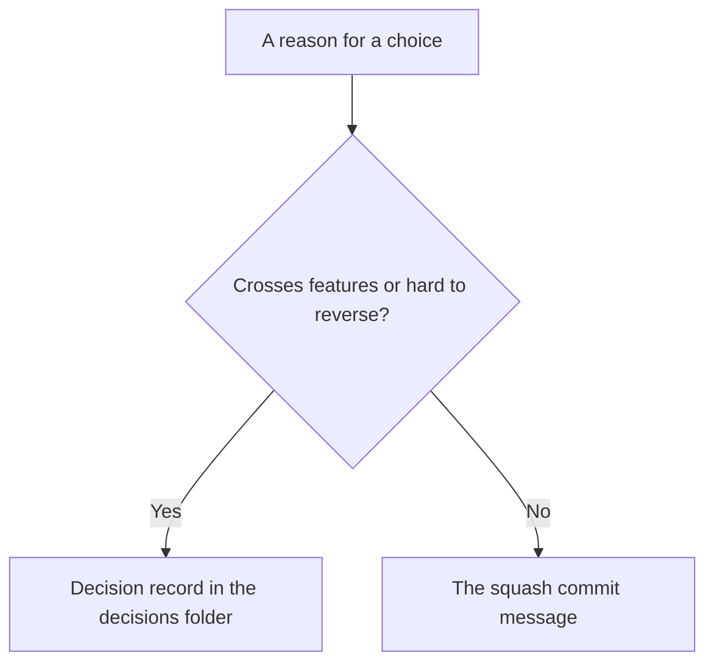

# Writing specs

Use these rules whenever you write or revise a spec document, in any project. What only one project knows lives in its own documents: the README lists the files, and each feature document's header names its requirement ID prefix.

**Why:** these rules are the same in every project, so they live in one place. A project's own facts change along with its files, so they live in its repository and change in the same commit.

## Write for readers

A spec should make sense without its edit history or special tools: plain Markdown, Mermaid diagrams, and standard contract formats such as OpenAPI and JSON Schema. People read it to decide, and agents read it to build.

- Use easy, concise words, and explain each rule in enough detail that someone new to the project can follow it.
- Start with what the user sees or can do, then give the rules behind it.
- Give plenty of concrete examples: a scenario for each rule, sample values, and what the user sees.
- Put separate rules, conditions, and outcomes in separate bullets or rows.
- Use the agreed domain terms consistently, and explain a necessary technical term the first time you use it.
- Match the format of sibling documents in the same folder.
- Describe current behavior; Git keeps the history.
- Before finishing, reword anything a reader would need to read twice.

**Why:** words alone leave gaps that examples close. "A Class allows three Pauses" is only clear once an example shows whether an inactivity timeout counts as one of the three. A rule that can be read two ways gets built two ways.

> Example: instead of "Pauses are limited per Class", write "A Class allows three Pauses. Pausing by hand and pausing after inactivity both count. For example, pause twice by hand, then time out once: no Pauses are left, and the Pause button is greyed out."

## Use diagrams where they explain

Prefer a diagram when it explains the idea more clearly than prose. Use Mermaid, inline, next to the text it belongs to:

| Diagram | Use it for |
| --- | --- |
| C4-style context or container diagram | The system, its users, and its main parts |
| Sequence diagram | Interactions and competing operations, such as two devices resuming the same Class |
| State diagram | Lifecycles, such as active, paused, and ended |
| Flowchart | Flows with branches only. Use a numbered list for simple steps |

Give every diagram a short explanation in prose. The prose owns the exact, testable rules and any detail that would make the diagram unreadable, and the diagram must agree with it.

**Why:** a diagram shows the shape of a flow at a glance, but nobody can test a box. Keeping the exact rule in prose lets the diagram stay simple.

## One owner for every fact

Every fact has one owning document. Other documents link to the owner instead of restating it, even in different words.

| Kind of fact | Usual owner |
| --- | --- |
| The customer, the promise, the product boundary, and global success measures | `README.md`, which links to rules instead of stating them |
| A behavior rule and its requirements | One feature document |
| Message shapes | A contract, such as OpenAPI for HTTP or JSON Schema for events |
| System boundaries and deployment | Architecture documents, which don't own product behavior |
| Domain terms and their names in code | One place, such as `architecture/domain-model.md` or a glossary |
| The reasons for a big choice | A decision record |
| Dated evidence | Research documents, which never state requirements |

The spec repository's README lists its actual files.

**Why:** two copies of one rule drift apart, and then every reader has to guess which one is current.

> Example: the README says "A Class can be paused and resumed; see Class recovery." It doesn't say how many Pauses are allowed, because the Pause feature document owns that rule.

## Feature documents

Start a new feature document from the [feature template](../assets/templates/feature.md). It begins with a header block:

```yaml
---
status: draft             # draft | accepted
implementation: backlog   # backlog | partial | complete
validation: pending       # pending | partial | passed
prefix: CHECKOUT          # requirement ID prefix owned by this document
owners: [product, backend]
last-reviewed: 2026-01-31
---
```

Then it uses this order:

1. Purpose
2. Scope and non-goals
3. Main flow
4. States and rules that always hold
5. Failure and recovery
6. Requirements
7. Links to contracts and decisions

Keep `implementation` and `validation` apart: code can be complete while validation is still pending. When the document says how the feature is validated, describe each kind of validation on its own, such as automated tests, checks with real devices or outside services, and commercial checks with real customers.

> Example: "Automated tests cover an empty cart and a declined card. Commercial validation measures how many users who start checkout finish it." The tests can pass today, but the commercial check needs real customers, so `validation` stays `partial` until both are done.

Keep a feature document under about 400 lines. Split it when it covers more than one independent lifecycle or protocol.

**Why:** the same order in every feature document lets a reader find the rules without reading everything, and short documents are easier to keep correct.

## Requirements

Define requirement IDs only in feature documents, in a table:

| ID | Rule | Example |
| --- | --- | --- |
| `EXAMPLE-001` | An empty cart MUST NOT be checked out. | A user with no items taps Checkout: the button is disabled and no order is created. |

- Each ID holds one testable rule. If a rule joins separate behaviors with "and", split it.
- Each row has a concrete example: the situation and the expected result.
- Each feature document uses its own prefix, named in its header block. To find the document that owns a prefix, search the headers, for example for `prefix: LIVE`.
- Keep an ID when you only clarify its wording. Retire an ID rather than reusing it for a different rule.

**Why:** one rule per ID lets one test prove it, and a stable ID lets specs, code, and tests point at the same rule for years.

## Tests cite requirement IDs

A test that proves a rule names the rule's ID in its title:

```ts
it('EXAMPLE-001: an empty cart cannot be checked out', () => {
  // ...
})
```

A rule that no test cites isn't proven yet. To find a rule's tests, search the code repositories for its ID.

## Domain terms

List each domain term once, with its meaning and its names in code, storage, and APIs. Use the same word everywhere, and agree on a new name in the spec before renaming code. [Map domain language into code](../SKILL.md#map-domain-language-into-code) covers how the names carry into code.

## Decisions



Write a decision record only for a choice that crosses features or is hard to reverse. Start from the [decision template](../assets/templates/decision.md), name it `decisions/NN-short-title.md`, keep its status in the header block, and cover Context, Decision, and Consequences. Feature documents link to it.

When a decision changes, follow the task's [compatibility mode](../SKILL.md#choose-the-compatibility-mode). Under `--not-live`, rewrite the record to the current decision, and add a short "Why we changed" note when the old option might come up again. In live mode, keep the history that explains supported versions.

**Why:** people and agents read files, not Git history. A decision record can be linked from every feature it affects, while a commit message can only be found by someone who already knows which commit to look at.

## Keep documents current

Documents describe the current product. Don't keep task lists, implementation plans, or old proposals in them. Git keeps the history, and active work is tracked in the workspace work record.

## Before merging a spec change

Check that:

- relative links resolve, and no absolute paths to someone's computer were added
- requirement IDs are unique and defined only in feature documents
- each new or changed rule has an example, and a test cites its ID once the code exists
- Mermaid blocks render, and contracts parse
- the change updates the owning document instead of repeating it elsewhere
- the repository's own checks pass, such as its CI jobs
