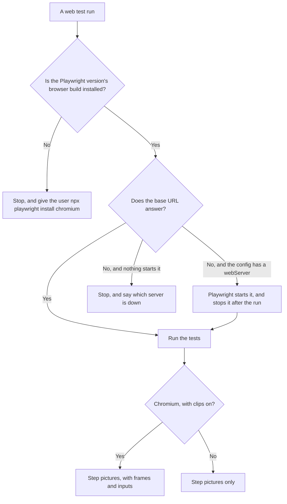

# Web Browser Tests

Run end-to-end tests of a web app in a test browser: the real app and its real pages, driven the way a user would, with [Playwright](https://playwright.dev) and its test runner, `@playwright/test`. This skill is general know-how. A project's own facts, such as its base URL and its test accounts, live in its e2e repository's README, and its secrets in its untracked `.env`. Read the README first. A new e2e repository has neither yet: [Start a new e2e repository](#start-a-new-e2e-repository) says what to settle.

What every platform shares is in [flow-tests](../flow-tests/SKILL.md): how to write a flow test, the pictures a run leaves, and the scripts that draw the clips, the sheets and the flow map. This skill adds what is the web's own.

**When the project has a framework of its own on top of Playwright,** such as Miro's Spectator, follow it for the runner, the test data and the helpers. The method here and in flow-tests still holds, and the recorder in this skill's `assets/` needs only a Playwright `Page`.



## A test browser only

Web tests run in Playwright's own browser builds, Chromium, Firefox or WebKit, with a fresh context for each test, which is Playwright's default. Never use a person's own browser or profile: no `channel: 'chrome'` with their user data folder, and no `launchPersistentContext` on it.

**Why:** a person's browser holds their real sessions, cookies and saved passwords. A test that signs in, or signs out, in it changes their accounts. A fresh context starts with nothing, and ends with nothing left.

> Example: a test needs a signed-in user. It signs the test account in once, in a setup project, and saves that context's `storageState` into a gitignored file. Each test then starts from that file, never from a person's profile.

## Start a new e2e repository

Settle the facts that [flow-tests](../flow-tests/SKILL.md#start-a-new-e2e-repository) lists with the user, and these web ones:

| Fact | Who decides | Where it goes |
| --- | --- | --- |
| The base URL of each environment, such as a local dev server and staging | The user. Never production, unless the user says so | README, and the one in use in `.env` |
| The browsers | Chromium for the pictures. Firefox or WebKit only when the project needs them | `playwright.config.ts` |
| The viewport | The size most of the product's users have, such as 1280 × 720 | `playwright.config.ts` |
| How test data is made | The project, such as its own API, a seed script, or its framework | README |

- **Pin `@playwright/test` to one exact version** in `package.json`. Each version runs its own browser build: 1.64.1 runs Chromium build 1248. A new version needs a new download.
- **Check for the browser build, and install none.** `npx playwright install --dry-run chromium` prints each build's install location. When those folders are missing, or a run says "Executable doesn't exist at …", stop and give the user `npx playwright install chromium`. It downloads the build into `~/Library/Caches/ms-playwright`, a cache that the whole machine shares: Chromium and its headless shell take about 570 MB.
- **The machine needs Node.** When it's missing, stop and name it.
- **Install the repository's own packages** from its lockfile, such as with `npm ci`.

## Test data

- **The project decides how test data is made.** Use its own API, seed script or framework, in a fixture. Never make test data through the UI, unless the UI is what the flow tests.
- **Each test makes its own data,** such as a new user with a unique email, so the tests can run in any order, and in parallel.
- **Name what a test makes so it can be found,** such as with an `e2e-` start, and clean up what the project's API lets you.
- **Never on production,** unless the user says so for this run.

## Servers

- **Let Playwright start the dev server,** with `webServer` in `playwright.config.ts` and `reuseExistingServer: !process.env.CI`. On a person's machine, a server that already answers is used and left running. A server that Playwright started, it stops after the run.
- **Stop no server the run didn't start.**
- **A run can use its own server** on another port, with its settings in the shell, so a person's own dev server keeps running.

## Find and drive

- **Find things the way a user does:** `getByRole` with the name, `getByLabel`, and `getByText`. Use `getByTestId` only for an element with neither text nor label.
- **Let Playwright wait.** An action waits until its element is visible, steady and enabled, and `expect` checks again until its timeout. Never use `waitForTimeout` in a test.
- **Keep the app's animations on,** the way people use it. Don't set `reducedMotion`, and keep the screenshots' default, `animations: 'allow'`.
- **Narrow a locator that matches two elements,** by its role and name, or within a region such as `page.getByRole('dialog')`. Playwright refuses to act on more than one.
- **One page for each flow.** The recorder follows the page that the test was given. A new tab or a popup gets no frames.

## Secrets

- **Read secrets from the environment,** such as `SHOP_PASSWORD` from the untracked `.env`, and stop when one is missing. Never write one in a test, not even as a fallback, a step name, a title, or a log. When a test fails, Playwright copies its source into the `error-context.md` of its output.
- **Turn the trace off in a flow that types a real secret,** with `test.use({ trace: 'off' })`. Playwright's trace keeps the text that `fill` and `type` send, and the HTML report keeps a copy of the trace.
- **Turn the video off where a secret shows in clear,** such as a code in a plain text field. A password field shows only dots.
- **Type a secret inside `flow.secret(...)`.** The recorder then writes no frame from the first key until the act is done, and for half a second more.
- **Mask a field that shows a secret in a step's picture,** with `flow.snap(name, { mask: [field] })`.
- **A saved `storageState` is a secret:** it holds the session's cookies. Keep it in a gitignored folder.

> Example: a made-up password typed with `fill()` showed up 6 times in the run's `trace.zip`, and the HTML report held a copy of it. A fallback password written in the test showed up in a failed test's `error-context.md`, though that test never typed it. With the password in the environment only, the trace off, and the password typed inside `flow.secret(...)`, it was in none of the run's files.

## Record the pictures

This skill's `assets/` holds a recorder that writes the [flow-tests format](../flow-tests/SKILL.md#the-pictures-of-a-run), and follows its [rules for a recorder](../flow-tests/SKILL.md#record-beside-the-test). Copy both files into the e2e repository, such as into `tests/support/`:

- **`flow-pictures.ts`:** the test fixture `flow`, with `flow.snap(name)` for a step's picture and `flow.secret(act)` for a secret. When a test fails, it takes one more picture, "Where it stopped", unless a secret may still show.
- **`flow-recorder.ts`:** the frames and the inputs.

How it works:

- **The pictures go to `test-results/pictures/<the test's title>/`,** inside Playwright's output folder. Playwright empties that folder when a run starts, so a run never mixes with an earlier one.
- **The frames come from Chromium's screencast,** through the DevTools protocol (`Page.startScreencast`). It sends a frame each time the page draws, with the time it drew it, and none while the page stands still, like the Android emulator's stream. Firefox and WebKit have no screencast, so their runs get the step pictures and the still sheet only. Take the pictures in one project only, such as `chromium`: two projects that run the same test write into the same folder.
- **The inputs come from the page itself:** its trusted `pointerdown`, `pointerup`, `keydown` and `input` events, in the top frame. Every click and key passes through the page, also those of a framework's helpers. A click inside an iframe gets no dot. `fill()` sends no key events, only an `input` event, which still counts as typing.
- **A frame shows a click about 0.03 seconds after the page's `pointerdown`,** as measured on Chromium build 1248, headless. The recorder adds that to each input's time.
- **The screencast runs beside Playwright's own video,** and goes on across a navigation to another site.
- **`FLOW_CLIPS=off` turns the recording off.** The step pictures stay.

After the run, draw the clips and sheets, and then the map, as [flow-tests](../flow-tests/SKILL.md#draw-the-clips-and-sheets) says.

For example, a made-up shop (the shop and its texts are made up):

```ts
import { expect, test } from './support/flow-pictures';

function fromEnv(name: string): string {
  const value = process.env[name];
  if (!value) throw new Error(`${name} is not set: add it to the untracked .env`);
  return value;
}

const PASSWORD = fromEnv('SHOP_PASSWORD');

test('SHOP-001: A new shopper signs up, and Home notices the verified email by itself', async ({ page, flow }) => {
  await page.goto('/');
  await flow.snap('Welcome');

  await page.getByRole('button', { name: 'Sign up' }).click();
  await flow.snap('The email screen');

  await page.getByLabel('Email').fill('ada@example.com');
  await page.getByRole('button', { name: 'Continue' }).click();
  await expect(page.getByRole('heading', { name: 'Choose a password' })).toBeVisible();
  await flow.snap('The new password screen');

  await flow.secret(async () => {
    await page.getByLabel('Password').fill(PASSWORD);
    await page.getByRole('button', { name: 'Done' }).click();
    await expect(page.getByLabel('Password')).toBeHidden();
  });
  await flow.snap('Home, email not verified');

  // The shop checks the email 3 seconds after sign-up. 10 leave room for a slow machine.
  await expect(page.getByText('Your email is verified.')).toBeVisible({ timeout: 10_000 });
  await flow.snap('SHOP-001: Home says the email is verified');
});
```

> Example: three flows of the made-up shop ran in 16 seconds. The run left 6, 4 and 3 step pictures, 30 to 37 frames for each passed flow, and no frame while the password was typed. Drawing their clips and sheets took 1 second: the clips are 15 to 32 KB, and the moving sheets 31 to 93 KB.

## Microphone, camera and permissions

- **Grant a permission in the context,** such as `permissions: ['camera']` in the config, or `context.grantPermissions(['geolocation'])` in a test, so no browser question blocks the flow.
- **Give Chromium a fake camera and microphone** with `launchOptions: { args: ['--use-fake-ui-for-media-stream', '--use-fake-device-for-media-stream'] }`. It shows a test pattern, and plays a beep.
- **Play a sound file as the microphone** with `--use-file-for-fake-audio-capture=<file.wav>`, for a flow that needs a speaking user.

## Environments

- **Take the base URL from `.env`,** such as `E2E_BASE_URL`, so one test suite runs against a local server or staging.
- **A host that needs a VPN fails without it,** with `net::ERR_NAME_NOT_RESOLVED` or a timeout on the first `goto`. Ask the user to connect, instead of retrying.
- **Block service workers** with `serviceWorkers: 'block'` when the flow doesn't test them. A service worker can serve the app's old files.

## When a run fails in the browser

| What you see | Likely cause | What to do |
| --- | --- | --- |
| "Executable doesn't exist at …" | This Playwright version's browser build isn't installed | Stop, and give the user `npx playwright install chromium` |
| "strict mode violation: … resolved to 2 elements" | The locator matches more than one element | Narrow it by role and name, or within a region |
| "… intercepts pointer events" | A cookie banner, a toast or an overlay covers the element | Close it as a user would, in a fixture |
| A signed-in test lands on the sign-in page | The saved `storageState` has expired | Sign in again in the setup project |
| `net::ERR_CONNECTION_REFUSED` on the first `goto` | The server isn't up | Check `webServer`, or start the dev server |
| The pictures show an old version of the app | A service worker served cached files | Block service workers |
| It passes headed and fails headless | Another viewport, missing fonts, or the app's bot checks | Set the viewport in the config, and compare a run with `--headed` |
| Step pictures, but no clips | Not Chromium, or `FLOW_CLIPS=off` | Run the Chromium project |

To dig further, read the `error-context.md` that Playwright writes in the failed test's output folder, open a trace with `npx playwright show-trace` for a flow that types no secret, or step through a test with `--debug`.

## Check before you run

- **The browser** is Playwright's own, with a fresh context, never a person's own.
- **The browser build** is installed, and you installed nothing on the machine.
- **The base URL** isn't production, unless the user said so.
- **Each secret** comes from the environment, stays out of names, and is typed inside `flow.secret(...)`, with the trace off.
- **The pictures** come from one project, such as `chromium`.
- **Nothing you started** is left running, and nothing you didn't start is stopped.
